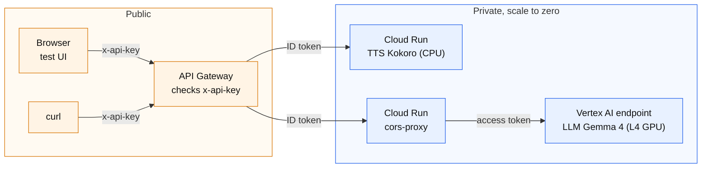
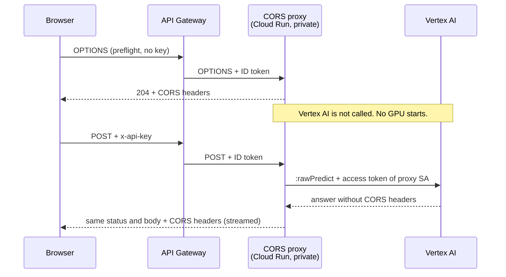
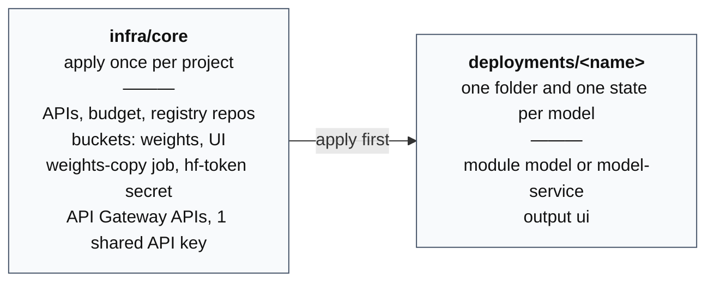
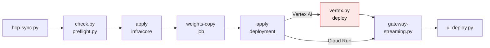
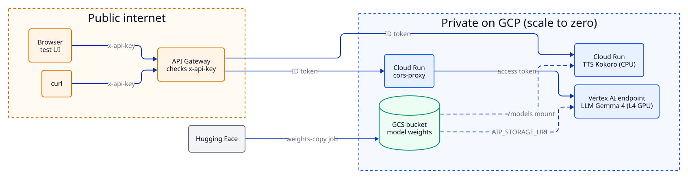

# Reference examples

Each example shows one rule set in practice. Copy the closest one and change the content.

## 1. Mermaid: architecture with zones

Use for: who calls whom, and which part is public. One story only: the request path. The weights flow is a separate diagram.

## 2. Mermaid: sequence for a protocol

Use for: requests and answers in time order (CORS, cold start, retries). A flowchart with back edges is hard to read; a sequence is not.

## 3. Mermaid: list nodes for layers

Use for: "what is in each part". One node per part with a short list. Do not put many unlinked nodes in a subgraph: Mermaid stacks them in one long column or row.

## 4. Mermaid: pipeline with one branch

Use for: steps in order. Left to right, short labels, each step once. Mark the step that costs money in red.

## 5. D2: full system map in one picture

Use for: request path and data flow together, with zones. The ELK layout routes edges at right angles and avoids crossings. Mermaid could not do this without crossed edges. Used in [`docs/README.md`](../../../docs/README.md). Source: [`examples/system-map.d2`](examples/system-map.d2).

## 6. draw.io: overview with GCP icons

Use for: a slide-quality overview for people outside the team, with vendor icons. The SVG holds the editable diagram: open it in draw.io to change it. Positions are by hand, so every change costs more work.

