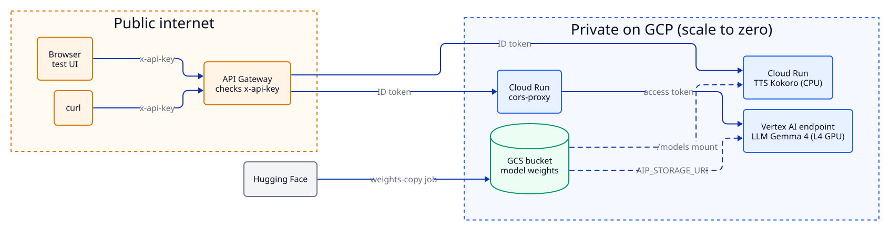
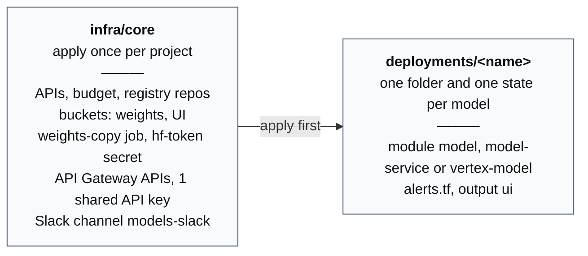
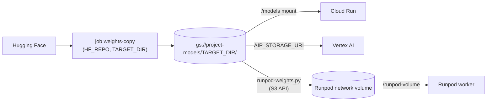

# Docs

Short guides with diagrams. Details are in [`infra/README.md`](../infra/README.md). Commands for one model are in the README of its deployment.

| Read | To learn |
|---|---|
| This page | The system map, the 2 layers, the weights flow |
| [scripts.md](scripts.md) | What each script in `scripts/` does, and in which order to run them |
| [gateway-and-streaming.md](gateway-and-streaming.md) | What API Gateway does, and how streaming works |
| [backends.md](backends.md) | Cloud Run and Vertex AI, cold start and cost, Slack messages at scale up and down |
| [auth-and-ui.md](auth-and-ui.md) | Keys and tokens, the test UI, common errors |

Older notes: [`research/`](research/) (options and prices) and [`specs/`](specs/) (design and plans, dated).

## System map

Source: [`diagrams/system-map.d2`](diagrams/system-map.d2). After a change, run `d2 --layout elk --pad 20 docs/diagrams/system-map.d2 docs/diagrams/system-map.svg`.

Only the gateway is public. Every backend is private and scales to zero. Dashed lines show how the services read the weights. The details of the weights flow are in the diagram below.

## Two layers

| Folder | Content |
|---|---|
| `infra/core/` | Shared setup. Apply once. |
| `infra/modules/` | `model` (1 model on a list of platforms, with `platform-vertex`, `gateway`, `cors-proxy`), `model-service` (Cloud Run), `vertex-model` (Vertex AI), `scale-alerts` (Slack) |
| `deployments/<name>/` | One model: image, flags, gateway, Slack alerts |
| `scripts/` | Python helpers |
| `ui/` | React test UI |

State and runs are on HCP Terraform. Each root has its own workspace.

## Weights flow

`local.model_dir` in a deployment must match `TARGET_DIR` of the job. A Runpod worker with a volume (STT-A) reads the same folder from `/runpod-volume/<TARGET_DIR>/`. LLM-A on Runpod has no volume: vLLM downloads from Hugging Face at start.
