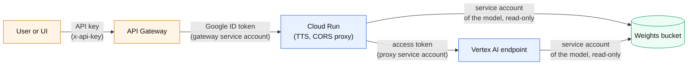
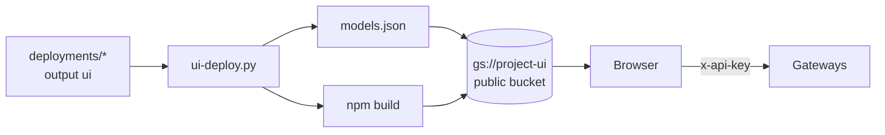

# Keys, tokens and the test UI

## Who trusts whom



Edge 1, API key: it is the only thing a client needs.

Edge 2, ID token: the gateway SA has `run.invoker` on the Cloud Run backend. For the LLM, the backend is the CORS proxy. The proxy SA has `aiplatform.user` and calls Vertex AI with its own access token. The gateway never calls Vertex AI itself.

Edge 3: the model SA can read the weights bucket only.

## Secrets

| Secret | Lives in | Used by | Never |
|---|---|---|---|
| API key | Terraform state (`infra/core`) | Clients, the UI | Print it or commit it |
| Service account key (JSON file) | Outside the repo. `.env` holds the path. | gcloud, scripts, HCP variable `GOOGLE_CREDENTIALS` | Put it in the repo |
| `TF_TOKEN_app_terraform_io` | `.env` | Terraform, `hcp-sync.py`, `preflight.py` | Commit it |
| `HF_TOKEN` | `.env`, then secret `hf-token` (write-only) | `weights-copy` job | Put it in the state |
| Access token (1 hour) | `gcloud auth print-access-token` | `vertex.py`, `preflight.py` | Reuse it after it expires |

All secrets are in the git-ignored `.env` (template: `.env.example`). Get the API key:

```sh
cd infra/core && terraform output -raw api_key
```

## Test UI

URL: <https://storage.googleapis.com/custom-models-inference-ui/index.html>



```text
+--------------------------------------------------+
| Model tests  [LLM tab] [TTS tab]   API key [***] |
+--------------------------------------------------+
| Input (chat or text)   |  Output + HTTP, timing   |
| [Send] [Stop]          |  "Request as curl"       |
+--------------------------------------------------+
```

- One tab for each model. Tabs come from `models.json`.
- The browser keeps the key. It is sent only to the gateways.
- On a Vertex AI cold start, the UI retries every 30 s (up to 30 minutes).
- Local work: `cd ui && npm test && npm run build`. Mock backend: `npm run mock` and `npm run dev`.
- To add a model tab, use the `model-ui` skill (`.claude/skills/model-ui/SKILL.md`).

## Common errors

| Symptom | Likely cause | Fix |
|---|---|---|
| UI: "Failed to fetch", voices do not load | Wrong or missing key (the gateway sends a 4xx without CORS headers), old gateway URL, or CORS (LLM: the proxy is not applied) | Enter the key, click Reload voices, run `ui-deploy.py --config-only` |
| HTTP 401 from the gateway | Wrong API key | Get the key again |
| HTTP 429 from the LLM | Cold start (0 replicas) | Wait. The UI retries. |
| `ACCESS_TOKEN_EXPIRED` in `vertex.py` | Operation longer than 1 hour | Run it again (the script refreshes the token) |
| Plan shows the wrong region | Stale shell or old HCP variable | `direnv reload`, `./scripts/hcp-sync.py` |
| 401 or 403 on the LLM `POST` | The gateway SA has no `run.invoker` on the proxy, or the proxy SA has no `aiplatform.user` | Apply the deployment again. Check both roles. |
| 502 on the LLM `POST`, body `proxy: ...` | The proxy cannot reach Vertex AI (token or network) | Read the text after `proxy:`. Check the Cloud Run logs of the `-proxy` service. |
