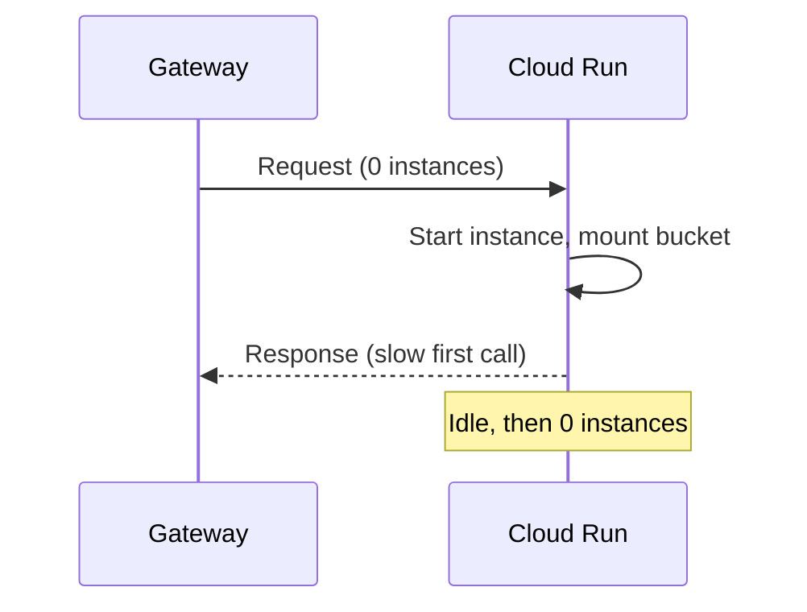
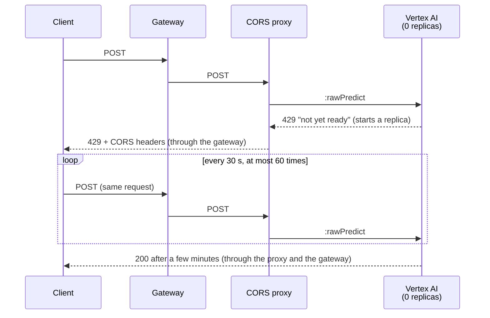
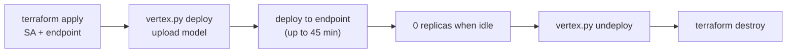
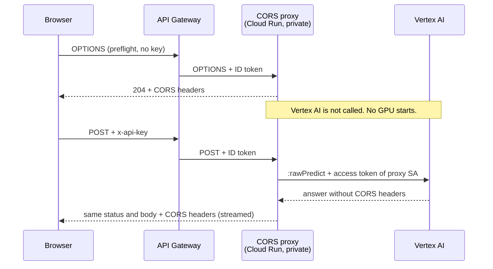

# Backends: Cloud Run and Vertex AI

Both are private and scale to zero. Pick one when you add a model.

| | Cloud Run (`model-service`) | Vertex AI (`vertex-model`) |
|---|---|---|
| Used for | TTS Kokoro (CPU), the STT-A files service (CPU) | LLM Gemma 4, LLM-B Qwen3.5, STT-A Qwen3-ASR + Pyannote (1 L4 GPU each) |
| Created by | Terraform only | Terraform (endpoint) + `deploy.py deploy` or `vertex.py deploy` (model) |
| Weights | Read-only mount at `/models` | The container reads `$AIP_STORAGE_URI` |
| Image source | `ghcr` or `models` repo | `dockerhub` proxy repo (Vertex AI pulls only from Artifact Registry) |
| Access | `run.invoker` for listed members | `aiplatform.user` for the CORS proxy SA. The gateway SA has `run.invoker` on the proxy. |
| Cold start answer | Gateway waits for the instance | HTTP **429** at once |
| Billing | CPU: per request. GPU: per instance. | Per node-hour while a replica runs (about $1.34 per hour for 1 L4) |
| Scale to zero | Min instances is always 0 | Min replicas 0 (Preview). Idle for 300 s, then 0. |

## Cloud Run cold start

## Vertex AI cold start

Rule: retry only on a real 429. The UI does this. The loop in the deployment README does the same. The UI does not retry a network error: that error means a wrong API key, a CORS problem or a wrong URL, and a wait would not help.

## Slack messages at scale up and scale down

Every model sends a Slack message when it is ready after a cold start, and when it scales to 0. You do not need to watch the UI during a cold start of several minutes. A "scaled to 0" message also shows that a GPU stopped billing.

| Platform | "Ready" log line | "Scaled to 0" log line |
|---|---|---|
| Cloud Run | `STARTUP HTTP probe succeeded` (system log) | `Application shutdown complete.` |
| Vertex AI | The line after the model loads (`Application startup complete.` for vLLM) | `Application shutdown complete.` |

The message comes less than 1 minute after the log line (measured on 2026-11-20). Setup and limits: [`infra/README.md`](../infra/README.md#scale-notifications-slack).

## Vertex AI deploy

Warning: a running replica bills. A budget alert does not stop spend. After tests, wait about 15 minutes and check that the replicas are 0. To stop the cost, run `vertex.py undeploy`.

## CORS for Vertex AI

Vertex AI has no CORS: it does not answer `OPTIONS` and it adds no CORS headers to any answer (200, 429, 5xx). A browser blocks such an answer. API Gateway cannot add response headers. So a private Cloud Run service sits between the gateway and Vertex AI. It is the module `infra/modules/cors-proxy`.

- `OPTIONS`: the proxy answers it itself. It never calls Vertex AI, so a preflight never starts a GPU.
- `POST`: the proxy forwards the body to `:rawPredict`, streams the answer back (SSE works) and adds the CORS headers. It keeps the status code, so a 429 reaches the UI as a 429.
- If the call to Vertex AI fails, the proxy answers 502 with CORS headers and the text `proxy: <cause>`.
- The code is `infra/modules/cors-proxy/cors_proxy.py` (standard library only) in the stock `python` image. There is no image build.
- The TTS gateway does not use it: Kokoro answers CORS itself.
