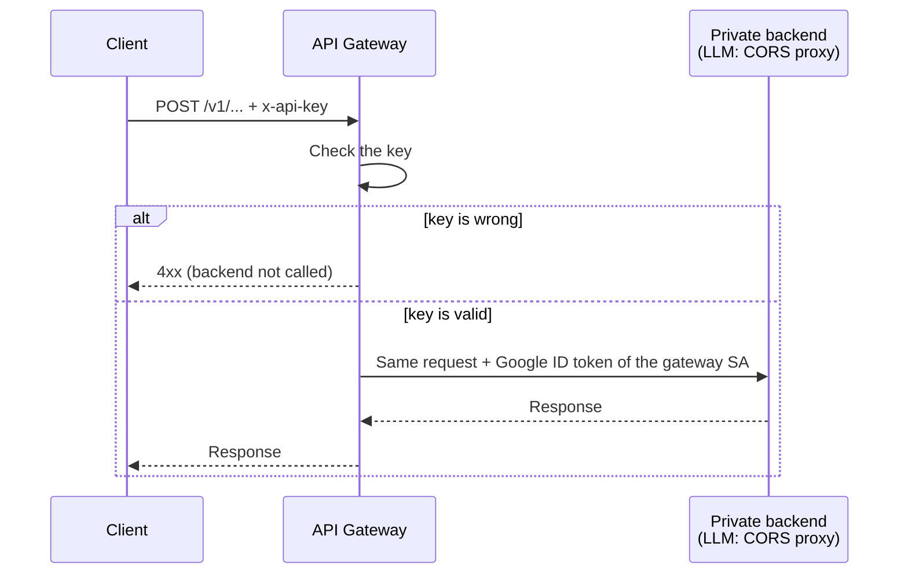
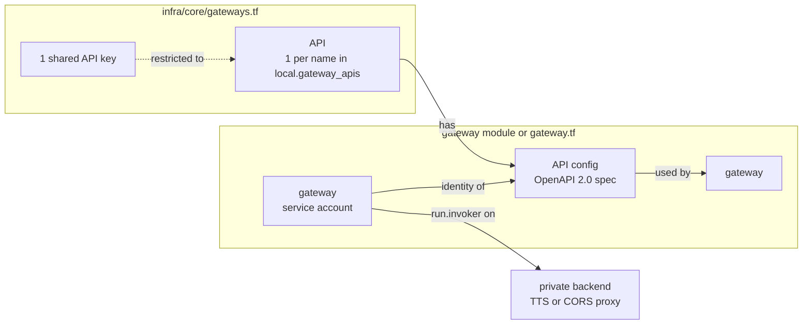
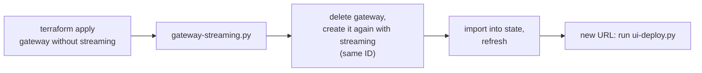
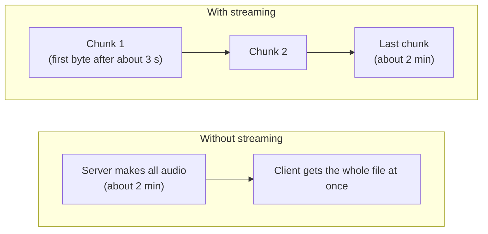

# API Gateway and streaming

## What the gateway does

The gateway is the only public door. It checks the API key. A request without a valid key never reaches a backend, so it never starts a GPU.

## Who creates what

- The OpenAPI spec lists the paths that reach the backend. All other paths return 404.
- `deadline` is the time limit for the whole response (300 s).
- Each path also has an `options` operation without a key. It answers the browser CORS preflight. For Vertex AI, the CORS proxy answers it.
- A config cannot change in place, so Terraform makes the new config first (`create_before_destroy`).

## Platform paths

A deployment on the `model` module (LLM-A) can run on several platforms. Its gateway has 2 paths per route:

| Path | Goes to |
|---|---|
| `/vertex/v1/chat/completions` | The `vertex` target. The CORS proxy removes `/vertex` |
| `/v1/chat/completions` (old path) | The default platform: the first one in `local.platforms` |

The gateway sends the full path to the CORS proxy (`APPEND_PATH_TO_ADDRESS`). The proxy picks the target by the first path segment. Details: `infra/README.md`, sections "Module: gateway" and "CORS proxy".

## Streaming

Terraform creates a gateway without streaming. The provider has no field for it. Streaming can be set only when a gateway is created (Public Preview).

Warning: the gateway URL changes, and the gateway is down for some minutes. The script asks before it deletes (flag `--yes` skips the question). It does nothing when the gateway already streams.

| Model | Stream format | Where |
|---|---|---|
| LLM | SSE (`stream: true`) | `ui/src/panels/Llm.tsx` |
| TTS | raw PCM chunks, played at once | `ui/src/panels/Tts.tsx` |

Limits: the `deadline` ends the stream when it passes. It must not be longer than the Cloud Run request timeout. Streaming gateways have no custom domain during the preview.
