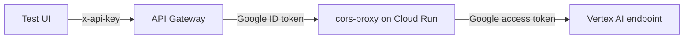
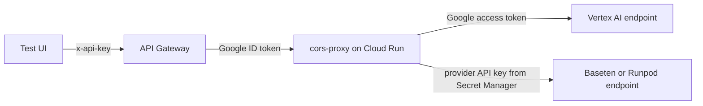

# Research: Other GPU providers next to GCP (Modal, Baseten, Runpod, Replicate)

Date: 2026-11-22. Card: "Other providers reserach". Status: research done.

Decision by the user (2026-11-22): use Baseten and Runpod next to Vertex AI. Modal and Replicate are out. The integration design is in `08-multi-platform-design.md`.

Update 2026-11-23: Baseten is deferred. The Baseten account answered "Your account does not support deploying custom models. Contact support@baseten.co to enable." on 2 apply attempts, so the user decided to remove Baseten for now. The code (adapter `platform-baseten`, facade wiring, keys, `scale-watch` reader) is not on master. The git tag `archive/baseten-platform` keeps the last Baseten version; restore it from there after Baseten support enables custom models. Runpod is the live second platform.

Update 2026-11-23: Azure is checked in `09-azure.md`. Only Azure Container Apps with serverless GPU (T4 or A100) scales to zero. The user decided not to use Azure for now.

Update 2026-11-24: Modal is checked again for STT-A in `10-modal-stt-a.md` (recommendation: go after a small paid test). Some Modal facts below are older than that document; `10-modal-stt-a.md` wins.

## Goal

- GCP has capacity problems. Vertex AI in `us-central1` often has no L4 stock ("Machine type temporarily unavailable"). See the pitfall in `04-vertex-ai.md` and the Vertex AI 429 notes in `infra/README.md`.
- Find a second provider for the GPU models (LLM-A, LLM-B, STT-A). TTS-A (CPU, Cloud Run) has no capacity problem.
- For each provider, check 3 things: scale to zero, Terraform (IaC), and what we need to start.
- Find how a provider fits into this repo: gateway, API key, test UI, Slack alerts, weights.

Sources: official docs and pricing pages, read on 2026-11-22. Each provider section lists its sources. We made no account and no test call. All cold-start numbers are from the providers, not measured by us.

## Summary

| Topic | Modal | Baseten | Runpod Serverless | Replicate |
|---|---|---|---|---|
| Scale to zero | Default. `scaledown_window` 2 s to 20 min (default 60 s) | Default (`min_replica: 0`). Scale-down delay 0 to 3600 s (default 900 s) | Default (0 active workers). Idle timeout 1 to 3600 s | `min_instances = 0`. Idle time cannot be set |
| First request at 0 replicas | Functions: waits. `@app.server()`: HTTP 503, client retries | Waits ("parked") up to 1200 s. No client retry | Queue endpoint: waits. Load balancing endpoint: error, client retries | Waits in the queue. Sync call returns `starting` after 60 s, then you poll |
| Idle cost | $0 | $0 (startup time is billed) | $0 (idle window is billed) | Private models bill setup and idle time |
| Terraform | No provider | Official `basetenlabs/baseten` 0.1.0 (2026-09) | Official `runpod/runpod` 2.0.0 (2026-10) | No provider (old repo archived) |
| Runs a stock image (`vllm/vllm-openai`) | Yes (`Image.from_registry`), plus Python app code | Yes (`docker_server`), YAML only | Yes (load balancing endpoint) | No. Needs a Cog wrapper |
| OpenAI API with SSE | Yes | Yes | Yes (load balancing or `worker-vllm`) | No. Predictions API only |
| L4 price per hour | about $0.80 (×1.15 to ×1.75 for a pinned region) | about $0.85 | about $0.68 to $0.75 | No L4. L40S about $3.51 |
| Request body limit | 4 GiB | 100 MB | 10 to 30 MB | 100 MB upload, larger as URL |
| Browser (CORS) | Partly. Needs app-level auth or a proxy | No CORS. Needs a proxy | Queue API has CORS. Key is then in the browser | Not documented. Needs a proxy |
| Scoped API keys | Proxy tokens per workspace | Keys limited to models and environments | Restricted keys, per endpoint | No scopes |
| Scale events for Slack | No. Use `@modal.enter` hook or a poller | No. Poll the Prometheus metrics | No. Poll the metrics API | No |
| Capacity | Multi-cloud. Starter plan: 10 GPUs at once | Multi-cloud ("10+ clouds and regions") | No guarantee. Max 5 workers by default (10 with $100 credit) | No statement |
| Fit for this repo | Medium | Good | Good | Poor |

Recommendation (see the end of this document): try **Baseten** first with LLM-A, and keep **Runpod** as the second choice. Do not use Replicate. Use Modal only if we accept Python app code and a deploy script instead of Terraform resources.

## How a provider fits into this repo

The current request path is:

The API Gateway checks the shared API key. The CORS proxy (`infra/modules/cors-proxy/cors_proxy.py`) adds the CORS headers and calls Vertex AI with a Google access token. No provider below sends CORS headers that are safe for our UI. So we keep the gateway and the proxy, and change only the last step:

Changes for this path:

1. `cors_proxy.py` gets a second auth mode. When an env var such as `UPSTREAM_KEY` is set (from a Secret Manager secret), the proxy sends `Authorization: Bearer <key>` and does not ask the metadata server for a token. The rest of the proxy stays the same.
2. `infra/modules/cors-proxy/` gets an optional secret input for that env var.
3. A deployment folder keeps `gateway.tf` and `cors_proxy.tf`. `main.tf` calls the provider resources instead of `infra/modules/vertex-model`. The gateway URL does not change, so the test UI and `scripts/ui-deploy.py` need no change.
4. The provider key goes into `.env` (for example `BASETEN_API_KEY` or `RUNPOD_API_KEY`). `scripts/hcp-sync.py` writes it to the HCP workspace as a sensitive variable. `infra/core` writes it to a Secret Manager secret, as it does for `hf-token`.

Other parts:

| Part | Today | With an outside provider |
|---|---|---|
| Weights | `weights-copy` job puts the weights in `gs://<project_id>-models`. Vertex AI gives the container `AIP_STORAGE_URI` | The provider pulls from Hugging Face itself (Baseten `weights` block, Runpod cached models, Modal Volume). The `weights-copy` job is not used. Gated repos need `HF_TOKEN` as a provider secret |
| Own images (LLM-B, STT-A) | Read `AIP_STORAGE_URI` and `AIP_HTTP_PORT` | Read a local model path and `PORT` instead. LLM-B already falls back to `MODEL`. STT-A needs the same fallback |
| STT-A audio | Files service gives signed upload URLs. The GPU service reads `gs://<audio bucket>/...` with its service account | The GPU service runs outside GCP, so it has no service account. The files service must give a signed GET URL, or the image needs a GCP key with read access to the audio bucket only |
| Slack alerts | `infra/modules/scale-alerts/` reads Cloud Logging | No provider sends scale events. We need a small poller (for example a Cloud Run job on Cloud Scheduler) that reads the provider metrics and posts to Slack. Or the container posts "ready" itself at start |
| Cold start at 0 | Vertex AI returns HTTP 429 at once. The client retries | Baseten holds the request until a replica is ready. Runpod load balancing returns an error, so the client retries as today |
| Budget | GCP budget in `infra/core` | Each provider has its own billing. Runpod has a spend limit ($80/h by default) and prepaid credit. Baseten and Modal bill a card |

## Modal

### Scale to zero

- Scale to zero is the default. Containers bill per second only while they run. [M1][M2]
- `scaledown_window` sets the idle time: default 60 s, from 2 s to 20 min. Other settings: `min_containers`, `max_containers`, `buffer_containers`. [M1][M3]
- At 0 containers, a Function or web endpoint request waits while a container starts. The newer `@app.server()` returns HTTP 503 and has no queue, so the client must retry. [M3][M4]
- Modal says a vLLM cold start takes "tens of seconds to a few minutes". GPU memory snapshots are alpha. Modal reports 118 s to 12 s for one vLLM model with snapshots. [M5][M6]

### Terraform

- There is no Terraform provider. The registry has none. One empty community repo exists (`twelsh-aw/terraform-provider-modal`, no releases).
- The deploy path is Python code plus `modal deploy`. Auth: `MODAL_TOKEN_ID`, `MODAL_TOKEN_SECRET`, `MODAL_ENVIRONMENT`. [M7]
- For this repo, a script in `scripts/` (like `vertex.py`) would run `modal deploy` after `terraform apply`. HCP remote runs cannot run it.

### Our workloads

- `Image.from_registry("vllm/vllm-openai:v0.33.0")` runs the stock image. Our Artifact Registry works with `from_gcp_artifact_registry`. [M8]
- Each model needs a Python app file (`@modal.web_server` or `@app.server()`). SSE works. [M4][M9]
- Web endpoints stop a request at 150 s and send HTTP 303. The 303 does not work with CORS. A long STT call from the browser is a risk. [M10]
- Prices per hour: L4 about $0.80, A10 $1.10, L40S $1.95, H100 $3.95. A pinned region costs ×1.15 (`us`, `eu`) or ×1.75 (for example `us-central`). [M2][M11]
- Weights: a Modal Volume, filled with `snapshot_download`. `HF_TOKEN` is a Modal Secret. [M12][M13]

### Auth, alerts, capacity

- Proxy auth with `Modal-Key` and `Modal-Secret` headers. Custom domains need the Team plan ($250 per month). [M14][M2]
- No scale webhooks. The `@modal.enter` hook can post "ready" to Slack. [M15]
- Starter plan: $0 per month, $30 credit per month, 10 GPUs at once. Modal runs on several clouds. [M2][M11]

### What we need to start

1. A Modal account (Starter plan) with a payment card.
2. `modal token new`. Put `MODAL_TOKEN_ID` and `MODAL_TOKEN_SECRET` in `.env`.
3. A Modal Secret with `HF_TOKEN`, and a Volume for the weights.
4. One Python app file for each model, and a deploy script in `scripts/`.

Sources: [M1] https://modal.com/docs/guide/scale · [M2] https://modal.com/pricing · [M3] https://modal.com/docs/guide/cold-start · [M4] https://modal.com/docs/guide/servers · [M5] https://modal.com/docs/examples/vllm_inference · [M6] https://modal.com/docs/guide/memory-snapshot · [M7] https://modal.com/docs/guide/continuous-deployment · [M8] https://modal.com/docs/guide/existing-images · [M9] https://modal.com/docs/guide/webhooks · [M10] https://modal.com/docs/guide/webhook-timeouts · [M11] https://modal.com/docs/guide/region-selection · [M12] https://modal.com/docs/guide/model-weights · [M13] https://modal.com/docs/guide/secrets · [M14] https://modal.com/docs/guide/webhook-proxy-auth · [M15] https://modal.com/docs/guide/lifecycle-functions

## Baseten

### Scale to zero

- Defaults: min replicas 0, max replicas 1, scale-down delay 900 s (0 to 3600 s), concurrency target 1. [B1]
- At 0 replicas, Baseten holds ("parks") a sync request until a replica is ready. The limit is 1200 s, then HTTP 500. Under load, a cold request can also get HTTP 529. [B2]
- 0 replicas cost $0. Startup time is billed. [B1][B3]
- No official cold-start seconds. Image streaming and BDN weight caching make cold starts shorter. [B4][B5]

### Terraform

- Official provider `basetenlabs/baseten`, version 0.1.0 (2026-09-15). It is pre-1.0, so breaking changes are possible. [B6][B7]
- Resources: `baseten_model`, `baseten_secret` (`value_wo` is write-only, not in state), `baseten_api_key`.
- `baseten_model` in "managed" mode pushes a deployment from an inline `push.config` or a `config_dir`, with `wait = true`.
- Auth: `BASETEN_API_KEY`.
- Not confirmed: if `push` needs a local `truss` binary. If it does, HCP remote runs cannot push, and a script runs `truss push` instead. The management REST API can set the autoscaling settings. [B8][B9]

### Our workloads

- `docker_server` runs a stock image with YAML only: `start_command`, `server_port`, `predict_endpoint`, `readiness_endpoint`, `liveness_endpoint`. Port 8080 is reserved. All routes of the server can be called. [B10][B11]
- So LLM-A runs `vllm/vllm-openai` with the same flags as today. LLM-B, STT-A and TTS-A run their images unchanged, except for the weights path.
- Our Artifact Registry works through `docker_auth` with GCP OIDC or a service account JSON. [B12]
- SSE streaming works. Request body limit: 100 MB. Request timeout: 1200 s. [B11][B13]
- Prices per hour: L4 $0.85, T4 $0.63, A10G $1.21, A100 80 GB $4.00, H100 $6.50. CPU from $0.035 (1 vCPU, 2 GiB). You cannot pick a region on the self-serve plan. [B3]
- Weights: a `weights` block (`source: hf://org/repo@<sha>`, `mount_location`). Gated repos use a secret (`hf_access_token`). [B5][B14]

### Auth, alerts, capacity

- Every call needs `Authorization: Bearer <key>`. Team keys can be limited to some models and environments. [B15][B16]
- Endpoints send no CORS headers. Baseten says to call them from server code. Our CORS proxy does this. [B15]
- No scale webhooks. A Prometheus endpoint exports the replica metrics. A poller can post to Slack. [B17]
- Since 2026-11-10 there are 2 plans: pay as you go ($0 per month) and "Production scale" (reserved capacity, by contract). Baseten spreads capacity over many clouds. [B3][B18]

### What we need to start

1. A Baseten account and an org admin API key. Put `BASETEN_API_KEY` in `.env` and sync it to HCP.
2. A `baseten_secret` for `HF_TOKEN`.
3. Pull access to our Artifact Registry for LLM-B and STT-A (GCP OIDC or a key).
4. The `basetenlabs/baseten` provider in the deployment root, with one `baseten_model` and `min_replica = 0`.
5. The CORS proxy change and a Slack poller (see "How a provider fits into this repo").

Sources: [B1] https://docs.baseten.co/deployment/autoscaling · [B2] https://docs.baseten.co/deployment/autoscaling/request-lifecycle · [B3] https://www.baseten.co/pricing/ · [B4] https://docs.baseten.co/deployment/autoscaling/cold-starts · [B5] https://docs.baseten.co/development/model/bdn · [B6] https://registry.terraform.io/providers/basetenlabs/baseten/latest · [B7] https://github.com/basetenlabs/terraform-provider-baseten · [B8] https://docs.baseten.co/reference/cli/truss/push · [B9] https://docs.baseten.co/reference/management-api/environments/update-an-environments-settings · [B10] https://docs.baseten.co/development/model/custom-server · [B11] https://docs.baseten.co/development/model/streaming-and-endpoints · [B12] https://docs.baseten.co/development/model/private-registries · [B13] https://docs.baseten.co/inference/errors · [B14] https://docs.baseten.co/development/model/model-cache · [B15] https://docs.baseten.co/inference/calling-your-model · [B16] https://docs.baseten.co/organization/api-keys · [B17] https://docs.baseten.co/observability/metrics · [B18] https://docs.baseten.co/hosting-options/cloud

## Runpod (Serverless)

### Scale to zero

- 0 active workers is the default. Flex workers scale to 0 and cost $0 while scaled down. Active workers bill all the time. [R1][R2]
- Idle timeout: 1 to 3600 s. The default is 5 s in the console and 10 s in the REST API. The idle window is billed. [R1][R3]
- FlashBoot (faster cold starts) is on by default in the console, but off by default in Terraform. Set `flashboot = true`. [R1][R4]
- There are 2 endpoint types:
  - **Queue endpoint** (`/run`, `/runsync`, `/stream`): at 0 workers, the request waits in the queue. Payload limit 10 to 20 MB. `/stream` is polled, not SSE. [R5]
  - **Load balancing endpoint**: direct HTTP to our own server at `https://<endpoint_id>.api.runpod.ai/<path>`. The server needs a `/ping` route. At 0 workers there is no queue, so the endpoint returns "no workers available" and the client retries. Limits: 30 MB payload, 5.5 min processing. [R6]
- The official `worker-vllm` image (vLLM 0.34.0) has an OpenAI route with SSE on a queue endpoint. [R7]

### Terraform

- Official provider `runpod/runpod`, version 2.0.0 (2026-10-27). Version 2.0.0 renamed resources from 1.x. [R4][R8]
- Resources: `runpod_serverless_endpoint` (`endpoint_type` QUEUE or LOAD_BALANCER, `workers_min`, `workers_max`, `idle_timeout`, `flashboot`, `gpu_pools`, `data_center_ids`, `env`), `runpod_template`, `runpod_network_volume`, `runpod_registry`. [R9]
- There is no secret resource and no cached-model field. Create the `HF_TOKEN` secret and the cached model in the console or with the REST API. [R10][R11]
- Auth: `RUNPOD_API_KEY`.

### Our workloads

- Any Docker image runs. Private registries work through `runpod_registry`. [R10]
- LLM-A and LLM-B run on a load balancing endpoint with real SSE. The docs have a FastAPI + vLLM example. [R6][R12]
- STT-A: the 30 MB limit is too small for large audio, but STT-A already sends a URL, not the file.
- Prices per hour (flex): 24 GB (L4, A5000) about $0.68 (docs) or $0.75 (pricing page), L40S $1.91, A100 $2.74, H100 $4.18. CPU prices not confirmed. [R1][R2]
- Data centers in the US, EU and Asia. Pinning a data center makes the GPU pool smaller. [R1]
- Weights: "cached models" pull a Hugging Face repo (also gated) for free into `/runpod-volume/huggingface-cache/`. Or a network volume at $0.07 per GB per month, tied to 1 data center. [R11][R2]

### Auth, alerts, capacity

- Restricted API keys can be limited to 1 endpoint. [R13]
- The queue API sends `Access-Control-Allow-Origin: *`, but then the key is in the browser. Not confirmed for load balancing endpoints. We keep the CORS proxy.
- No scale webhooks. The metrics API has worker states and cold-start counts. A poller can post to Slack. [R10]
- Prepaid credit (from $10). Spend limit $80 per hour by default. Max workers over all endpoints: 5 by default, 10 with $100 credit, 20 with $200 credit. No capacity guarantee. You can give up to 3 GPU types as fallbacks. [R14][R1]

### What we need to start

1. A Runpod account with credit. $100 or more lifts the worker cap to 10.
2. A restricted API key. Put `RUNPOD_API_KEY` in `.env` and sync it to HCP.
3. An `hf_token` secret and registry auth (console or REST API).
4. The `runpod/runpod ~> 2.0` provider in the deployment root, with one load balancing endpoint, `workers_min = 0`, `flashboot = true` and an explicit `idle_timeout`.
5. The cached model, set in the console.

Sources: [R1] https://docs.runpod.io/serverless/endpoints/endpoint-configurations · [R2] https://www.runpod.io/pricing · [R3] https://docs.runpod.io/serverless/pricing · [R4] https://docs.runpod.io/integrations/terraform/overview · [R5] https://docs.runpod.io/serverless/endpoints/send-requests · [R6] https://docs.runpod.io/serverless/load-balancing/overview · [R7] https://docs.runpod.io/serverless/vllm/openai-compatibility · [R8] https://registry.terraform.io/providers/runpod/runpod · [R9] https://github.com/runpod/terraform-provider-runpod/blob/main/docs/resources/serverless_endpoint.md · [R10] https://docs.runpod.io/llms-full.txt · [R11] https://docs.runpod.io/serverless/endpoints/model-caching · [R12] https://docs.runpod.io/serverless/load-balancing/vllm-worker · [R13] https://docs.runpod.io/get-started/api-keys · [R14] https://docs.runpod.io/get-started/billing-information

## Replicate

- Cloudflare bought Replicate (closed 2025-12-01). The changelog shows no change to deployments or the API since then. [P1][P2]
- Scale to zero: deployments accept `min_instances = 0`. The idle time is not documented and cannot be set. Users report cold starts of about 2 minutes. [P3][P4]
- Billing: private models bill setup, idle and active time. Only public models bill active time only. [P5]
- Terraform: no provider. The old `replicate/terraform-provider-replicate` repo is archived. The path is `cog push` plus the HTTP API (`POST /v1/deployments`). Auth: `REPLICATE_API_TOKEN`. [P3][P6]
- Each model must be packaged with Cog (`cog.yaml` plus `run.py`). A stock image such as `vllm/vllm-openai` does not run as is. [P7]
- The API is a predictions API, not the OpenAI API. Our UI and clients would need a translation layer. [P3]
- There is no L4. The cheapest GPU for our FP8 models is the L40S at about $3.51 per hour. [P8]
- API tokens have no scopes. Scale events have no webhook. [P9]

Result: Replicate needs the most work and costs the most. Do not use it for this repo.

Sources: [P1] https://blog.cloudflare.com/why-replicate-joining-cloudflare/ · [P2] https://replicate.com/changelog · [P3] https://replicate.com/docs/reference/http · [P4] https://github.com/replicate/replicate-python/issues/227 · [P5] https://replicate.com/docs/topics/billing · [P6] https://pkg.go.dev/github.com/replicate/terraform-provider-replicate · [P7] https://github.com/replicate/cog · [P8] https://replicate.com/pricing · [P9] https://replicate.com/docs/topics/security/api-tokens

## Recommendation

1. **Baseten first.** It runs our images with YAML only. It has a Terraform provider with write-only secrets, as we use for `hf-token`. It holds the first request at 0 replicas, so the UI gets no 429. It spreads capacity over many clouds, which is the problem we want to fix. Risks: the provider is 0.1.0, and `push` can need the `truss` binary (not confirmed).
2. **Runpod second.** It has the most complete Terraform provider (2.0.0) and the lowest L4 price. Risks: no capacity guarantee, a worker cap of 5 to 10 at the start, and the load balancing endpoint returns an error at 0 workers, as Vertex AI does today.
3. **Modal only if we accept code.** It has no Terraform. Each model needs a Python app file and a deploy script.
4. **Not Replicate.** It needs a Cog wrapper per model, it has no OpenAI API and no L4, and private models bill idle time.

## Proposed pilot (needs approval)

1. Move LLM-A (stock vLLM, no own image) to Baseten in a new folder `deployments/llm-a-gemma4-12b-vllm-baseten/`. Keep the Vertex AI folder.
2. Add the upstream-key mode to `infra/modules/cors-proxy/`, and the provider key secret to `infra/core`.
3. Run `terraform plan` on HCP to confirm that `baseten_model` push works on a remote run.
4. Measure the cold start and the scale-down delay. Compare with Vertex AI.
5. Then decide for LLM-B and STT-A. STT-A also needs signed GET URLs for the audio.

## Not checked

- Real cold-start times and real L4 stock on each provider. We made no account and no call.
- If `baseten_model` push works on an HCP remote run.
- Runpod CPU prices and flex-against-active prices.
- CORS on Runpod load balancing endpoints.
- How the Modal 150 s limit acts on a long SSE stream.
