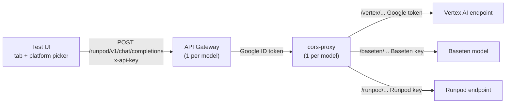

# Research: Deploy one model to several platforms (Vertex AI, Baseten, Runpod)

Date: 2026-11-22. Card: "Other providers reserach". Status: first design proposal. The newer design is the spec (waiting for approval) `docs/specs/2026-11-22-multi-platform-design.md`; it wins where the two differ (for example per-platform engine flags, and the STT-A layout `services/stt_api` and `services/speech_engine` from master `fd8a12f`). Builds on `07-other-gpu-providers.md`.

Update 2026-11-23: Baseten is deferred. The Baseten account answered "Your account does not support deploying custom models. Contact support@baseten.co to enable." on 2 apply attempts, so the user decided to remove Baseten for now. The code (adapter `platform-baseten`, facade wiring, keys, `scale-watch` reader) is not on master. The git tag `archive/baseten-platform` keeps the last Baseten version; restore it from there after Baseten support enables custom models. Runpod is the live second platform.

## Decisions by the user (2026-11-22)

1. Use only Baseten and Runpod next to Vertex AI. Modal and Replicate are out.
2. One model can run on several platforms at the same time, for example `["vertex", "runpod"]`. With scale to zero, an idle platform costs $0. When Vertex AI has no L4, the user picks another platform at once.
3. The platform list is in code (the deployment folder). One deploy script handles all platforms. The UI shows the platforms and lets the user pick which one to call. The UI does not start deploys.
4. The code has no copy per platform. Each platform adds one adapter, and nothing more.

## Goal

- One model spec per model. It lists the platforms.
- One adapter per platform: a Terraform module and a small Python part. The adapters have the same inputs and the same outputs.
- One gateway, one CORS proxy and one API key per model, for all its platforms.
- In the UI, one tab per model, with a platform picker.

TTS-A (Kokoro, CPU, Cloud Run) has no capacity problem. It stays as it is. A later card can add Cloud Run as a fourth platform with the same adapter interface.

## Architecture



1. The first path segment names the platform: `/vertex/...`, `/baseten/...`, `/runpod/...`.
2. The gateway checks the shared API key, as today. It sends every path to the CORS proxy.
3. The proxy removes the first segment and calls that platform with the platform credential. It adds the CORS headers to every answer, as today.
4. The proxy also makes the cold-start answers the same on all platforms (see "Cold start" below).

## Terraform layout

```text
infra/modules/
  model/                  NEW. The facade. One call per model: spec + platforms.
                          Calls the platform adapters, the gateway and the cors-proxy.
  platform-vertex/        The current vertex-model module, with the adapter interface.
  platform-baseten/       NEW. baseten_model.
  platform-runpod/        NEW. runpod_template + runpod_serverless_endpoint.
  gateway/                NEW. The gateway.tf of today, as a module. Paths are made from routes x platforms.
  cors-proxy/             Changed. Several targets, routed by the first path segment.
  model-service/          Changed. Optional secret env vars (for the proxy keys).
  scale-alerts/           Unchanged (Vertex AI and Cloud Run logs).
deployments/<name>/
  main.tf                 One module "model" call: the spec and local.platforms.
  alerts.tf               Unchanged.
  outputs.tf              ui, platforms and vertex outputs from the module.
  backend.tf, README.md   Unchanged.
```

The folder names stay as they are. Update 2026-11-23: LLM-A was renamed from `llm-a-gemma4-12b-vllm` to `llm-a-gemma4-12b-vllm` (folder, HCP workspace, Vertex AI name and gateway ID). See its README, section "Rename (2026-11-23)".

### The model spec

A deployment folder has one module call. This is the only file that changes when you add or remove a platform:

```hcl
locals {
  platforms = ["vertex", "runpod"] # the platforms of this model. The first one is the default in the UI.
}

module "model" {
  source = "../../infra/modules/model"

  project_id = var.project_id
  region     = var.region
  name       = "llm-a-gemma4-12b"   # base of all names on all platforms
  gateway_id = "llm-a-gemma4" # the existing API in infra/core/gateways.tf
  platforms  = local.platforms

  spec = {
    image  = { stock = "vllm/vllm-openai:v0.33.0" } # or { own = "llm-b-qwen35-9b-fastapi:${var.image_tag}" }
    args   = ["--model={model}", "--served-model-name=gemma-4-12b", "--max-model-len=32768",
              "--kv-cache-dtype=fp8", "--host=0.0.0.0", "--port=8080"]
    env    = {}     # the adapter adds HF_HUB_OFFLINE: "1" on vertex and baseten (weights are local), "0" on runpod
    port   = 8080
    health = "/health"
    routes = ["/v1/chat/completions"]
    gpu    = "L4"   # null = CPU only
    max_replicas = 1
    idle_seconds = 600
    weights = { hf_repo = "google/gemma-4-12B-it-qat-w4a16-ct", revision = "<sha>", gcs_dir = local.model_dir }
  }

  # Only what one platform needs. Everything else comes from spec.
  platform_options = {
    vertex = { machine_type = "g2-standard-12", shared_memory_size_mb = 16384, deployment_timeout = "1800s",
               extra_args = ["--load-format=runai_streamer"] }
  }
}
```

`{model}` in `args` is the model location. Each adapter fills it in:

| Platform | `{model}` becomes | Where the weights come from |
|---|---|---|
| vertex | `$(AIP_STORAGE_URI)` | `gs://<project_id>-models/<gcs_dir>/` (the `weights-copy` job, as today) |
| baseten | `/models/weights` | Baseten `weights` block: `hf://<hf_repo>@<revision>`, cached by Baseten (BDN) |
| runpod | `<hf_repo>` | vLLM downloads from Hugging Face at start (see "Open points") |

The image is also filled in by the adapter:

| `spec.image` | vertex | baseten, runpod |
|---|---|---|
| `{ stock = "vllm/vllm-openai:v0.33.0" }` | `<region>-docker.pkg.dev/<project>/dockerhub/vllm/vllm-openai:v0.33.0` (proxy repo, as today) | `vllm/vllm-openai:v0.33.0` from Docker Hub |
| `{ own = "llm-b-...:<tag>" }` | `<region>-docker.pkg.dev/<project>/models/llm-b-...:<tag>` | The same Artifact Registry URL, with registry auth (see "Secrets") |

### The adapter interface

Every `platform-*` module has the same inputs and outputs. The facade calls each one with `count`:

```hcl
module "runpod" {
  source = "../platform-runpod"
  count  = contains(var.platforms, "runpod") ? 1 : 0
  name   = var.name
  spec   = var.spec
  options = lookup(var.platform_options, "runpod", {})
}
```

Inputs: `name`, `spec`, `options` (plus `project_id` and `region` for vertex).

Output `target`, the same object on every platform:

| Field | Meaning | vertex | baseten | runpod |
|---|---|---|---|---|
| `url` | Base URL. The proxy appends the route. | `https://<endpoint_dns>/v1/projects/.../endpoints/<id>/invoke` (or the `:rawPredict` URL for 1 route) | `https://model-<id>.api.baseten.co/environments/production/sync` | `https://<endpoint_id>.api.runpod.ai` (`request_urls.base`) |
| `auth` | Credential type for the proxy | `google` | `baseten` | `runpod` |
| `label` | Name in the UI | `Vertex AI` | `Baseten` | `Runpod` |
| `post_apply` | A deploy step that Terraform cannot do | `vertex` (model upload and deploy) | none | none |

The facade merges the outputs into one map, `targets = { vertex = {...}, runpod = {...} }`. The proxy, the gateway, the deploy script and the UI read only this map. They never ask which platform it is, except to pick the credential.

### What each adapter creates

| | platform-vertex | platform-baseten | platform-runpod |
|---|---|---|---|
| Resources | Service account, bucket read access, dedicated endpoint (as today) | `baseten_model` with `push.config` (`docker_server`, `weights`, `resources.accelerator = "L4"`) and `environments.production.autoscaling` (`min_replica = 0`, `max_replica`, `scale_down_delay = idle_seconds`) | `runpod_template` (`image`, `args`, `env`, `ports`) and `runpod_serverless_endpoint` (`endpoint_type = "LOAD_BALANCER"`, `scaling_type = "REQUEST_COUNT"`, `gpu_pools = ["AMPERE_24"]`, `workers_min = 0`, `workers_max`, `idle_timeout = idle_seconds`, `flashboot = "FLASHBOOT"`) |
| Health route | `healthRoute` | `docker_server.readiness_endpoint` and `liveness_endpoint` | Env vars `PORT`, `PORT_HEALTH` and `HEALTH_CHECK_PATH` (Runpod polls `/ping` by default) |
| Scale to zero | `minReplicaCount = 0`, `idleScaledownPeriod` | `min_replica = 0`, `scale_down_delay` | `workers_min = 0`, `idle_timeout` |
| Post-apply step | `scripts/deploy.py` (model upload and deploy) | None. The provider pushes in Go, with no local `truss` binary, so it works on HCP remote runs | None |

### Gateway module

Today each deployment has its own `gateway.tf` (81 to 113 lines, mostly the same). The new `infra/modules/gateway/` makes the OpenAPI paths from 2 lists:

```hcl
paths = merge([
  for p in var.platforms : {
    for r in var.routes : "/${p}${r}" => {
      post    = { operationId = "${p}_${replace(r, "/[^a-zA-Z0-9]/", "_")}", ... }
      options = { security = [], ... } # CORS preflight, no key
    }
  }
]...)
```

1. Every path goes to the CORS proxy with `APPEND_PATH_TO_ADDRESS`.
2. The old paths without a prefix (for example `/v1/chat/completions`) stay, and go to the first platform. So existing curl commands and READMEs keep working.
3. The gateway SA, the API config and the gateway move into the module. The streaming step (`scripts/gateway-streaming.py`) does not change.
4. STT-A also needs paths to its files service. The module gets an optional `extra_paths` input with its own backend.

### CORS proxy

`cors_proxy.py` gets 3 small changes. The rest stays the same.

1. Env var `TARGETS` (JSON) replaces `TARGET`: `{"vertex": {"url": "...", "auth": "google"}, "runpod": {"url": "...", "auth": "runpod"}}`.
2. The first path segment selects the target. The proxy removes it and appends the rest to `url`. An unknown segment returns 404 with CORS headers.
3. Credentials by `auth`: `google` uses the metadata server token (as today). `baseten` and `runpod` read `BASETEN_API_KEY` and `RUNPOD_API_KEY` from env vars that Cloud Run fills from Secret Manager. Only the proxy has the provider keys. The browser never sees them.

### Cold start: one rule for all platforms

| Platform | Answer at 0 replicas |
|---|---|
| Vertex AI | HTTP 429 at once |
| Baseten | Holds the request until a replica is ready (up to 1200 s). No error |
| Runpod load balancing | "no workers available" error at once. The exact HTTP status is not confirmed |

The proxy changes the Runpod "no workers" answer to HTTP 429 with `Retry-After`. Then the UI keeps one rule: "on 429, retry every 30 s". The gateway deadline (300 s today) must be longer than a Baseten cold start. Set it to the Baseten maximum or close to it, and measure.

## Secrets and keys

| Item | Where it lives | Who uses it |
|---|---|---|
| `BASETEN_API_KEY`, `RUNPOD_API_KEY` | `.env` (new lines in `.env.example`) | `scripts/hcp-sync.py` writes them to **every** HCP workspace as sensitive env vars |
| Same keys in Secret Manager | `infra/core` (write-only, like `hf-token`): secrets `baseten-api-key`, `runpod-api-key` | The CORS proxy of each model (`secretAccessor`) |
| `HF_TOKEN` on Baseten | `infra/core`: `baseten_secret` `hf_access_token` (`value_wo`, not in state) | `weights` block of gated models |
| `HF_TOKEN` on Runpod | Runpod console secret `hf_token` (the provider has no secret resource) | Template env `HF_TOKEN = "{{ RUNPOD_SECRET_hf_token }}"` |
| Pull access for own images | `infra/core`: Baseten uses GCP OIDC (no key). Runpod uses `runpod_registry` with a read-only service account key (`_json_key`) | LLM-B, STT-A images from Artifact Registry |

Important: each provider fails at plan when its key is empty, also when the model does not use that platform. The module "model" declares all 3 providers, so every deployment needs both keys. `hcp-sync.py` writes them to all workspaces. A test or check run without keys uses `mock_provider`, so `scripts/check.py` needs no keys.

## Deploy script

One script for all platforms replaces the direct use of `scripts/vertex.py`:

```sh
./scripts/deploy.py deploy deployments/<name>                       # all platforms in local.platforms
./scripts/deploy.py deploy deployments/<name> --platform runpod     # one platform only
./scripts/deploy.py undeploy deployments/<name> --platform vertex   # before you remove vertex from the list
```

1. The script reads `terraform output -json targets` (the facade output).
2. For each target with a `post_apply` step, it runs that step. Today only `vertex` has one: the code of `vertex.py` moves into a function in `scripts/platforms/vertex.py`. `vertex.py` stays as a short wrapper, so the READMEs keep working.
3. For each target, it waits until the health route answers through the proxy (optional, with `--wait`).
4. At the end it runs `ui-deploy.py --config-only`, as `vertex.py` does today.

A platform is selected with 1 edit in `main.tf` (`local.platforms`), then `terraform apply` (by the user), then `./scripts/deploy.py deploy`. To remove Vertex AI from a model, run `undeploy --platform vertex` first: Terraform cannot delete an endpoint that still has a deployed model.

## UI

The tab stays one per model. A platform picker shows above the panel when the model has more than 1 platform:

```text
LLM-A Gemma 4 12B   llm · gemma-4-12b
Platform:  [ Vertex AI ]  [ Runpod ]  [ Baseten ]
           ------------
<chat panel, unchanged>
```

### `models.json` schema change

`ui-deploy.py` reads the `ui` output. The output gets one new field, `platforms`. `base_url` stays and is the first platform, so an old UI build still works:

```json
{
  "id": "llm-a-gemma4",
  "title": "LLM-A Gemma 4 12B",
  "type": "llm",
  "base_url": "https://<gateway>/vertex",
  "model": "gemma-4-12b",
  "features": { "stream": true, "max_tokens": 1024, "max_context": 32768, "cold_start": "retry-429" },
  "platforms": [
    { "id": "vertex", "label": "Vertex AI", "base_url": "https://<gateway>/vertex" },
    { "id": "runpod", "label": "Runpod", "base_url": "https://<gateway>/runpod" }
  ]
}
```

The facade builds the `platforms` list from `targets`, so no deployment writes it by hand.

### UI code changes

1. `config.ts`: `ModelConfig` gets an optional `platforms` list. `parseModels` checks each `base_url` the same way as today.
2. `App.tsx`: a small `PlatformPicker` component. The choice is saved per model in `localStorage`, and in the URL as `#/<tab>@<platform>`.
3. The panel gets the model with `base_url` replaced by the base URL of the chosen platform. **The panels do not change.** `call()` and `curlFor()` already use `model.base_url`, so the curl command also shows the right platform.
4. `api.ts`: the retry check reads `cold_start === "retry-429"`. The old value `vertex-429` stays accepted until all deployments use the new one.
5. The panel key is `<model id>`, not `<model id>@<platform>`. So the chat stays when you switch platforms, and you can compare 2 answers.
6. `ui-deploy.py` shows only the platforms that are deployed. For vertex, it checks for a deployed model (as today). For baseten and runpod, the Terraform resource means "deployed".
7. `ui/mock-server.mjs` accepts the platform prefix on every route.

Not in the first version: a live "warm or cold" badge per platform. It needs a status call through the proxy. A later card can add `GET /<platform>/_status` to the proxy.

## Slack messages for Baseten and Runpod

`scale-alerts` reads Cloud Logging. Baseten and Runpod logs are not in Cloud Logging, and neither platform sends scale events. The proposal:

1. A Cloud Run job `scale-watch` in `infra/core`, started by Cloud Scheduler every minute. Python, standard library only.
2. One function per platform reads the replica count: Runpod metrics API (`/v2/serverless/<id>/metrics/workers`), Baseten metrics export. The exact Baseten call is not confirmed.
3. The job saves the last count per endpoint in a GCS object. On 0 → 1 it posts "ready". On 1 → 0 it posts "scaled to 0".
4. The job finds the endpoints by the `name` prefix of our models. It needs no list per deployment.
5. It needs the Slack bot token in Secret Manager. Today `infra/core` writes the token only into the notification channel.

Vertex AI keeps `scale-alerts`. `check.py` still needs `alerts.tf` in every deployment.

## Container contract for own images

The stock vLLM image needs only flags. Own images (LLM-B, STT-A) must not depend on Vertex AI env vars:

| Item | Today | Rule for all platforms |
|---|---|---|
| Port | `AIP_HTTP_PORT`, default 8080 | `PORT`, default 8080. The Vertex adapter sets `PORT=8080` |
| Model location | `AIP_STORAGE_URI` | `MODEL` (a local path, a `gs://` URI or a Hugging Face repo). The adapter sets it, with the same `{model}` value as in `args` |
| STT-A audio | `gs://` URI, read with the service account | A signed HTTPS GET URL from the files service. The GPU service then needs no GCP credentials |

LLM-B already reads `MODEL` when `AIP_STORAGE_URI` is not set. STT-A needs this change and the signed GET URLs.

## Phased plan

Each phase is one card. Each phase ends with `scripts/check.py` and `terraform test` green.

1. **Refactor, no change in behavior.** Add `infra/modules/model/`, `platform-vertex/` (move `vertex-model`), `gateway/`, and multi-target `cors-proxy`. Move LLM-A to the facade with `platforms = ["vertex"]`. Add `scripts/deploy.py`. The gateway keeps the old paths.
2. **UI.** `platforms` in the `ui` output and `models.json`, `PlatformPicker`, `cold_start = "retry-429"`, mock server, tests.
3. **Runpod.** `platform-runpod/`, keys in `.env`, `hcp-sync.py` and `infra/core`. LLM-A gets `["vertex", "runpod"]`. Measure the cold start.
4. **Baseten.** `platform-baseten/`, `baseten_secret` for `HF_TOKEN`. LLM-A gets `["vertex", "runpod", "baseten"]`. Measure.
5. **Slack.** `scale-watch` job in `infra/core`.
6. **Own images.** LLM-B (registry auth, `MODEL`, `PORT`), then STT-A (signed GET URLs).

## Open points

| Point | Why it matters | How to close it |
|---|---|---|
| Runpod HTTP status for "no workers available" | The proxy must change it to 429 | Phase 3, first cold call |
| `{{ RUNPOD_SECRET_hf_token }}` works on Serverless | Documented for Pods only. Without it, `HF_TOKEN` is a plain template env var (in the Terraform state) | Phase 3. Gemma needs `HF_TOKEN` (gated) |
| Runpod weights | vLLM downloads the weights at each cold start. Runpod "cached models" are console-only. A network volume ties the endpoint to 1 data center | Phase 3: measure the cold start with download. Then choose |
| `vllm/vllm-openai` ENTRYPOINT for Runpod `args` | `args` are appended to the ENTRYPOINT | Read the image config in phase 3 |
| GPU ids to pin L4 in pool `AMPERE_24` (also A5000, 3090) | An A5000 is fine for these models. Pinning is not required | Decide in phase 3 |
| Baseten `secrets` form in `push.config` (map or list) | The provider docs and the Truss docs differ | Phase 4, first plan |
| Baseten auth header (`Bearer` or `Api-Key`) | The proxy sends it | Phase 4, first call |
| Baseten first push uses default autoscaling | The provider writes the settings before the first push. The first deployment can start with `min_replica` at the default | Phase 4: check after the first apply, apply again if needed |
| Gateway deadline against a Baseten cold start | Baseten holds the request. The gateway can stop it first | Phase 4: measure, then set `deadline` |
| Terraform with `count = 0` still configures the provider | Not confirmed. The design gives both keys to every workspace, so it works in both cases | No action |

## Sources

- Baseten provider: https://github.com/basetenlabs/terraform-provider-baseten (`docs/resources/model.md`, `docs/resources/secret.md`, `internal/provider/provider.go`, `internal/provider/model_push.go`), https://docs.baseten.co/development/model/custom-server, https://docs.baseten.co/reference/truss-configuration
- Runpod provider: https://github.com/runpod/terraform-provider-runpod (`docs/resources/serverless_endpoint.md`, `docs/resources/template.md`, `docs/resources/registry.md`), https://docs.runpod.io/serverless/load-balancing/overview, https://docs.runpod.io/references/gpu-types, https://docs.runpod.io/pods/templates/secrets
- Other sources: see `07-other-gpu-providers.md`.
