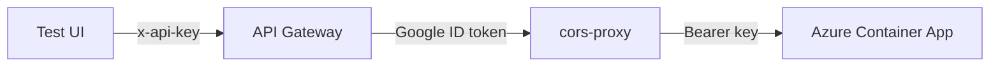

# Research: Azure as a GPU platform next to Vertex AI and Runpod

Date: 2026-11-23. Card: "Other providers reserach". Status: research done. Decision by the user (2026-11-23): do not use Azure for now. The project stays on Vertex AI (GCP) and Runpod.

## Goal

- Check if Azure can be one more platform for the GPU models (LLM-A, LLM-B, STT-A), next to Vertex AI and Runpod.
- Check the same 3 things as in `07-other-gpu-providers.md`: scale to zero, Terraform (IaC), and what we need to start.
- Check how Azure fits into the facade `infra/modules/model` (design: `docs/specs/2026-11-22-multi-platform-design.md`).

Sources: Microsoft Learn pages, the azurerm provider docs and issues on GitHub, and the public Azure retail prices API (`https://prices.azure.com/api/retail/prices`), read on 2026-11-23. We made no Azure account and no test call. Prices are pay-as-you-go list prices in USD.

## Summary

Azure has 4 ways to run a GPU model. Only 1 of them scales to zero:

| Option | Scale to zero | Own image (`vllm/vllm-openai`) | Terraform | Fit |
|---|---|---|---|---|
| **Container Apps, serverless GPU** (Consumption GPU profile) | Yes. Min replicas 0, per-second billing | Yes | `azurerm` (GPU profile fixed in 5.14.0, 2026-11-13) | **Good** |
| Azure ML managed online endpoint | No. Billed for the VMs while the deployment exists. No documented `instance_count = 0` | Yes (BYOC) | No confirmed `azurerm` resource. Needs `azapi` or the CLI | Poor |
| Microsoft Foundry (serverless API or managed compute) | Serverless API: yes, but catalog models only. Managed compute: no | Serverless: no. Managed compute: yes | `azapi` only | Poor |
| AKS with a GPU node pool and KEDA | Possible (node pool min 0), but node start is slow | Yes | `azurerm` | Poor (cluster to run, same reason as the rejected GKE Autopilot) |

Recommendation: if we add Azure, use **Azure Container Apps with serverless GPU**. It is the same model as Cloud Run with GPU: a container, an HTTPS URL, min replicas 0. The other 3 options do not scale to zero or need a cluster.

Main limits of Container Apps serverless GPU:

1. **GPU types are only T4 (16 GB) and A100 (80 GB).** There is no L4, A10 or H100. T4 is an old Turing GPU (see "Our workloads"). A100 costs about 2 to 4 times more per hour than the L4.
2. **The ingress request timeout is 240 s.** A cold start plus the first answer must finish in 240 s, or the client gets a timeout and retries.
3. **Region choice is small for A100.** A100: Australia East, Brazil South, Canada Central, East US, Italy North, Sweden Central, West US, West US 3. T4 is in 17 regions.

## Azure Container Apps, serverless GPU

### Scale to zero

- Min replicas: default 0, minimum 0. Max replicas: default 10, up to 1000. No usage charge while the app is at 0 replicas. [A1][A2]
- Cool down period: default 300 s. It applies only to the step from the last replica to 0. In Terraform: `cooldown_period_in_seconds`. [A1][A5]
- HTTP scale rule: `concurrent_requests` (default 10). The count is read every 15 s. [A1]
- At 0 replicas, the next request starts a cold start (image pull, GPU start, app start). The docs do not say if the request waits or gets an error. The docs tell the client to retry. **Test this in a pilot.** [A3]
- Cold start tips from Microsoft: put the model files on a storage mount (Azure Files), use a registry near the environment, and use artifact streaming (needs a Premium Azure Container Registry). A Microsoft tutorial measured 1 to 2 minutes for the first request with a 5 GB model on T4. [A2][A3][A4]
- 1 container per app can use the GPU. Multi-GPU and fractional GPU replicas are not supported. [A2]

### Terraform

- Provider `hashicorp/azurerm`. Latest release: 5.14.0 (2026-11-13). [A6]
- Resources:
  - `azurerm_resource_group`, `azurerm_log_analytics_workspace`.
  - `azurerm_container_app_environment` with `workload_profile { name, workload_profile_type = "Consumption-GPU-NC8as-T4" or "Consumption-GPU-NC24-A100" }`. Do not set `minimum_count` or `maximum_count` on a Consumption GPU profile. [A5]
  - `azurerm_container_app` with `workload_profile_name`, `template { min_replicas = 0, max_replicas, cooldown_period_in_seconds, http_scale_rule, container {...}, volume {...} }`, `ingress { external_enabled, target_port, transport }`, `secret { ... key_vault_secret_id }` and `registry {...}`. [A5]
  - Optional: `azurerm_storage_account` and `azurerm_storage_share` plus `azurerm_container_app_environment_storage` for the weights mount.
- **Pitfall:** azurerm before 5.14.0 sent `MinimumCount` for a Consumption GPU profile, and Azure answered HTTP 400 `WorkloadProfilePropertyNotSupported`. Issue #31763, fix in PR #32242 (5.14.0). The old docs said "create the GPU profile in the portal after apply". Pin `azurerm >= 5.14.0`. [A7][A8]
- A GPU profile must be added to an environment that has workload profiles. An environment made without workload profiles cannot get one later. [A5]
- Auth for HCP remote runs: a service principal (`ARM_CLIENT_ID`, `ARM_CLIENT_SECRET`, `ARM_TENANT_ID`, `ARM_SUBSCRIPTION_ID` as sensitive env vars), or HCP dynamic credentials (OIDC) for Azure. `scripts/hcp-sync.py` writes the env vars, as it does for `RUNPOD_API_KEY`.

### Our workloads

GPU fit:

| Model | Today | T4 (16 GB, Turing) | A100 (80 GB, Ampere) |
|---|---|---|---|
| LLM-A Gemma 4 12B QAT W4A16, stock vLLM | L4 on Vertex AI, Ampere 24 GB on Runpod | Not confirmed. Turing has no bf16 and no FP8. The vLLM W4A16 Marlin kernels need Ampere (sm80) or newer. 16 GB limits the context | Yes. Same flags as on Runpod (no `--kv-cache-dtype=fp8`) |
| LLM-B Qwen3.5 9B FP8, own image | L4 | No. FP8 weights need Ampere or newer for the weight-only FP8 path | Yes |
| STT-A Qwen3-ASR plus diarization, own image | L4 | Not confirmed (bf16 models) | Yes |

So in practice we use the **A100** profile. That costs more than the L4 (see "Prices").

Other points:

- The app runs any image from a registry. Docker Hub works directly. A private image (LLM-B, STT-A) needs a registry with credentials (Azure Container Registry, or our GCP Artifact Registry with a key). [A5]
- vLLM `--api-key` checks `Authorization: Bearer <key>`. So the CORS proxy can call LLM-A on Azure the same way it calls Runpod: a key from Secret Manager. LLM-B and STT-A need the same key check in their own server.
- The 240 s timeout is an Azure ingress limit. Our API Gateway deadline is 300 s. A long LLM answer or a long STT file can hit 240 s first. The docs do not say if a streamed (SSE) answer resets the timeout. **Test this in a pilot.** [A9]
- Weights: vLLM can download from Hugging Face at start, as on Runpod. Or the weights go on an Azure Files share that the app mounts. The share is in 1 region. The `weights-copy` job (GCS) is not used.
- STT-A audio: the GPU service runs outside GCP, so it needs signed GET URLs for the audio files. This is the same open point as for Runpod (`07-other-gpu-providers.md`).

### Auth, alerts, capacity

- Ingress: external (public URL) or internal (only inside the environment). Options: IP allow rules, built-in authentication (Microsoft Entra ID and others), and client certificates (mTLS). The docs do not confirm that built-in authentication accepts a machine token (client credentials) on API calls. Use the vLLM API key, as for Runpod. [A9][A10]
- Scale events for Slack: there is no webhook. `scale-watch` (infra/core) can read the replica count from the Azure Resource Manager API (`.../containerApps/<name>/revisions/<revision>/replicas`) with a service principal token. That is 1 more entry in `PLATFORMS` in `infra/core/scale_watch.py`, plus the service principal secret in Secret Manager.
- Quota: pay-as-you-go and Enterprise Agreement subscriptions have T4 and A100 quota on by default. Quota names: "Managed Environment Consumption T4 GPUs" and "Managed Environment Consumption NCA100 GPUs". Request more on the Quota page of the environment. Other subscription types (free trial, credits) can have 0 quota. [A2]
- Capacity: Azure gives no capacity guarantee for serverless GPU. A different cloud and a different GPU pool lowers the risk that all platforms fail at the same time, which is the goal of this card.

### Prices

Serverless GPU bills the GPU per second, plus the vCPU and the memory of the app while it is active. [A11]

| Meter (Consumption plan) | East US, West US 3 | Sweden Central, Italy North, West Europe |
|---|---|---|
| T4 GPU | $0.000073/s ($0.26/h) | $0.000095/s ($0.34/h) |
| A100 GPU | $0.000529/s ($1.90/h) | $0.000688/s ($2.48/h) |
| vCPU, active | $0.000024/s ($0.086/h) | $0.000024/s |
| Memory, active | $0.000003 per GiB per s ($0.011/h) | same |

The GPU profiles give 8 to 24 vCPU and 56 to 220 GiB per replica. Microsoft does not give a separate range per profile. [A12] Examples for 1 replica with 8 vCPU and 56 GiB:

- T4 in East US: about $1.56/h.
- A100 in East US: about $3.20/h. A100 in Sweden Central: about $3.78/h.
- For comparison: L4 on Vertex AI about $1.34/h, Ampere 24 GB on Runpod about $0.70/h.

Other costs:

- The price list has an "Environment Management Hour" meter at $0.10/h (about $73 per month). We did not confirm if a Consumption GPU environment pays it. **Check in the pricing calculator before the pilot.**
- Azure Container Registry: Basic $0.17/day, Premium (needed for artifact streaming) $1.67/day (about $50 per month).
- Log Analytics ingest for the app logs.

### What we need to start

1. An Azure subscription with pay-as-you-go billing (GPU quota is on by default), and a budget alert.
2. A service principal with Contributor on 1 resource group. Put `ARM_CLIENT_ID`, `ARM_CLIENT_SECRET`, `ARM_TENANT_ID` and `ARM_SUBSCRIPTION_ID` in `.env` and sync them to HCP. Or set up HCP dynamic credentials.
3. A region with A100 (East US or Sweden Central). Check the quota on the environment Quota page.
4. A new adapter `infra/modules/platform-azure` (azurerm `>= 5.14.0`): environment with a Consumption GPU profile, container app with `min_replicas = 0`, the vLLM API key as a secret, external ingress.
5. Facade and proxy: `azure` in the platform list of the facade, an `azure` key in `KEYS` of the CORS proxy, and a cold-start rule for the UI (the 240 s timeout means `retryTimeouts` with a 504 retry).
6. A pilot with LLM-A on the A100 profile. Measure: cold start, the answer to the first request at 0 replicas (held or error), SSE past 240 s, and the scale to 0 after the cool down.

Sources: [A1] https://learn.microsoft.com/en-us/azure/container-apps/scale-app · [A2] https://learn.microsoft.com/en-us/azure/container-apps/gpu-serverless-overview · [A3] https://learn.microsoft.com/en-us/azure/container-apps/cold-start · [A4] https://learn.microsoft.com/en-us/azure/container-apps/tutorial-gpu-image-generation · [A5] https://github.com/hashicorp/terraform-provider-azurerm/blob/main/website/docs/r/container_app_environment.html.markdown and https://github.com/hashicorp/terraform-provider-azurerm/blob/main/website/docs/r/container_app.html.markdown · [A6] https://github.com/hashicorp/terraform-provider-azurerm/releases · [A7] https://github.com/hashicorp/terraform-provider-azurerm/issues/31763 · [A8] https://github.com/hashicorp/terraform-provider-azurerm/pull/32242 · [A9] https://learn.microsoft.com/en-us/azure/container-apps/ingress-overview · [A10] https://learn.microsoft.com/en-us/azure/container-apps/authentication · [A11] https://azure.microsoft.com/en-us/pricing/details/container-apps/ and the retail prices API (`serviceName eq 'Azure Container Apps'`) · [A12] https://learn.microsoft.com/en-us/azure/container-apps/workload-profiles-overview · [A13] https://learn.microsoft.com/en-us/azure/container-apps/gpu-types

## Azure ML managed online endpoints

- You pay for the compute while the deployment exists. The docs give no scale-to-zero option, and no example uses `instance_count = 0`. The autoscale examples use a minimum of 2 instances. To stop the cost, you delete the deployment. [M1][M2]
- Azure ML can keep 20% extra quota on some VM SKUs for upgrades. [M3]
- GPU SKUs: T4 (`Standard_NC4as_T4_v3` and larger), A10 (`Standard_NV6ads_A10_v5` and larger), A100 (`Standard_NC24ads_A100_v4` and larger), H100 (`Standard_NC40ads_H100_v5` and larger). [M3]
- Terraform: we found no `azurerm` resource for an online endpoint or deployment. The `azapi` provider or the `az ml` CLI is needed.

Result: this is the same model as a Vertex AI endpoint without scale to zero. Do not use it.

Sources: [M1] https://learn.microsoft.com/en-us/azure/machine-learning/concept-endpoints-online · [M2] https://learn.microsoft.com/en-us/azure/machine-learning/how-to-autoscale-endpoints · [M3] https://learn.microsoft.com/en-us/azure/machine-learning/reference-managed-online-endpoints-vm-sku-list

## Microsoft Foundry

- "Serverless API endpoint" bills per token, but only for models in the Foundry catalog. Our own image or our own weights do not run there. [F1]
- "Managed compute" runs custom models on dedicated VMs, billed per uptime until you delete the endpoint. No scale to zero. [F1]

Result: do not use it for this repo. It can be useful later only if a catalog model replaces one of ours.

Sources: [F1] https://learn.microsoft.com/en-us/azure/foundry-classic/concepts/deployments-overview

## AKS with GPU nodes

- A GPU node pool can scale to 0 nodes with the cluster autoscaler, and KEDA can scale the pods to 0. A new GPU node takes minutes to start, plus the image pull.
- It needs a cluster to run and update (control plane, drivers, ingress). The repo rejected GKE Autopilot for the same reason (decision 2026-11-10).

Result: do not use it.

## Fit for this repo

The request path stays the same as for Runpod:

| Part | Change for Azure |
|---|---|
| Facade `infra/modules/model` | 1 new adapter `platform-azure`, the same interface as `platform-runpod` (`targets` entry with `auth = "azure"`, `cold_start`, `deadline`) |
| HCP workspaces | `ARM_*` env vars in every workspace that uses the adapter (`scripts/hcp-sync.py`). The azurerm provider needs them at plan, as the Runpod provider needs its key |
| CORS proxy | `KEYS = {"runpod": ..., "azure": "AZURE_MODEL_API_KEY"}` and a secret `azure-model-api-key` in `infra/core` |
| UI | Platform label "Azure". Cold-start rule: retry a 504 or a network error (240 s ingress timeout) |
| `scale-watch` | 1 more reader in `PLATFORMS` that reads the replica count from the ARM API |
| Weights | vLLM downloads from Hugging Face at start, or an Azure Files mount |
| Budget | Azure budget alert in the subscription. It does not stop spend, as on GCP |

## Recommendation

The user decided on 2026-11-23 to stop with Vertex AI and Runpod for now. This section stays as input for a later decision.

1. **Azure is possible, but it is not a cheap second platform.** Azure Container Apps serverless GPU scales to zero and has good Terraform support from azurerm 5.14.0. But our models need the A100 profile, at about $3.20 to $3.80 per hour, against $0.70 on Runpod and $1.34 on Vertex AI.
2. Use Azure as a **third platform for capacity**, not as the default. It is a third cloud and a third GPU pool. It helps when Vertex AI has no L4 and Runpod has no Ampere workers.
3. If the user agrees, run a small pilot: LLM-A on the A100 profile in East US. It needs no own image, and the Runpod work already gives the proxy key mode and the UI retry.
4. Do not use Azure ML online endpoints, Foundry managed compute or AKS. They do not scale to zero, or they need a cluster.

## Not checked

- What a request gets at 0 replicas (held or error), and the real cold start of vLLM on A100.
- If an SSE stream can run past the 240 s ingress timeout.
- If LLM-A (W4A16) runs on T4 with vLLM. If yes, T4 at about $1.56/h is an option.
- If a Consumption GPU environment pays the "Environment Management Hour" meter.
- Real A100 stock in each region.
- If built-in authentication accepts a client-credentials token on API calls.
