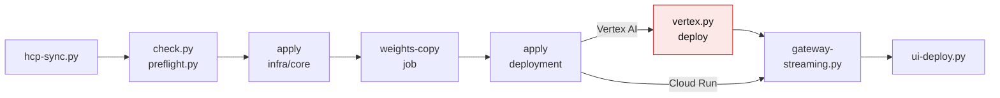

# Scripts

All scripts are Python 3 (standard library only) in `scripts/`. They load the repo `.env` themselves, so you do not need direnv. Run them from the repo root.

| Script | Does | Changes the cloud? |
|---|---|---|
| `check.py` | `fmt`, `validate`, `terraform test` and `tflint` in every root. No credentials. | No |
| `preflight.py` | Reads the real project: stale shell, HCP region variable, APIs, bucket and repo region. Flag `--weights <folder>`: weights exist. Flag `--l4`: L4 quota. | No (read-only) |
| `hcp-sync.py` | Copies `.env` values to the HCP workspaces. Makes a missing workspace. Flag `--dry-run`. | HCP only |
| `vertex.py deploy\|undeploy <dir>` | First fills the image cache of the `dockerhub` proxy repo (one manifest request, must give 200). Then it uploads and deploys the model on Vertex AI, or removes it. Refreshes the token on a 401. | Yes (GPU cost) |
| `gateway-streaming.py <dir>` | Replaces the gateway with a streaming one. Skips a gateway that already streams. | Yes (URL changes) |
| `ui-deploy.py` | Writes `models.json`, builds the UI, uploads to the UI bucket. Flags: `--config-only`, `--local`. | Yes (UI bucket) |
| `verify-ui.py up\|doctor\|down` | Starts the UI and the mock gateways on free ports for a verification run, checks them, stops them. Logs and evidence stay in `.verify/ui/<run-id>/`. Guide: the `verify-ui` skill. | No (local only) |
| `verify-gcp.py state [--plan]\|smoke\|call --tts\|--llm` | Checks the real project: state (read-only), drift (`--plan`, remote plan), smoke (no key, curl-level), real calls (`call`, costs money). Reports in `.verify/gcp/`. Guide: the `verify-gcp` skill. | No (`call`: yes, model calls) |

Why the post-apply scripts exist: the Terraform provider has no resource for a Vertex AI model deploy, and no field for gateway streaming.

## Order

Run `hcp-sync.py` after each `.env` change. The red step starts GPU cost.

Destroy order for Vertex AI: `vertex.py undeploy`, then `terraform destroy`.

Run `ui-deploy.py` after every apply or `gateway-streaming.py` run, because the gateway URL can change. The exact commands are in the README of each deployment.
