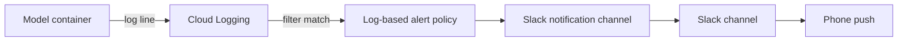

# Design: Slack notifications for scale up and scale down

Date: 2026-11-19. Status: done on 2026-11-20. Approved by the user, built from `2026-11-19-scale-notifications-slack-plan.md`, applied, and verified: all 8 Slack messages of the 3 models arrived.

## Intent

All models scale to zero. A first request starts a cold start that takes minutes. The user wants a Slack message on the phone when a model is ready to use (0 → 1), and when it scales down (1 → 0). The user must not keep the browser open to know this. A message for scale down also shows that a GPU stopped billing.

## Decisions (by the user)

1. Slack, with a push notification on the phone. No browser notification.
2. One message for each scale up (0 → 1) and one for each scale down (1 → 0), for every model.
3. Terraform creates all of it. After one apply, the messages come with no further Terraform run.

## How it works (agent decisions)

Cloud Monitoring log-based alert policies watch the log line that each model writes for each event. A matched line opens an incident. The incident sends a message to a native Slack notification channel. No new service and no new code runs in GCP.

### The log lines (the signal)

The signal for "ready" is the line after the model is loaded, not the instance start. An instance start comes minutes before the model can answer.

| Deployment | Scale up: ready | Scale down | Verified in real logs |
|---|---|---|---|
| `tts-a-kokoro-cpu` (Cloud Run) | `run.googleapis.com/varlog/system`: `STARTUP HTTP probe succeeded` | `run.googleapis.com/stderr`: `Application shutdown complete.` | Yes, 13 to 17 Nov 2026 |
| `llm-a-gemma4-12b-vllm-vertex` (Vertex AI) | `Application startup complete.` (vLLM loads the model before it starts uvicorn) | `Application shutdown complete.` | Ready: yes, 2026-11-20 10:55:30 UTC. Scale down: same uvicorn stack as llm-b |
| `llm-b-qwen35-9b-fastapi` (Vertex AI) | A new line `engine ready` | `Application shutdown complete.` | Yes: ready 10:02:28 and 10:51:10, shutdown 10:08:14 UTC on 2026-11-20 |

- `llm-b` starts uvicorn before the model loads (`load_engine` runs in a thread, so the TCP liveness probe passes). So `Application startup complete.` comes too early. The image prints `engine ready` after `AsyncLLM.from_engine_args` returns. This needs an image rebuild.
- Vertex AI container logs are off today. Both deployed models show `disableContainerLogging: true`. We did not set it. `scripts/vertex.py` uses v1beta1, where container logs are off by default and the opt-in field is `enableContainerLogging` (`disableContainerLogging = false` had no effect, seen on 2026-11-20). The module sets `enableContainerLogging = true` in the `deployed_model` body. The change needs a new deploy with `scripts/vertex.py`.
- Vertex AI filters use `resource.type="aiplatform.googleapis.com/Endpoint"` and `resource.labels.endpoint_id` (the `endpoint_id` output of `vertex-model`). Cloud Run filters use `resource.type="cloud_run_revision"` and `resource.labels.service_name`.

### Components

1. `infra/core/notifications.tf`: one `google_monitoring_notification_channel` of type `slack`, display name `models-slack`. Labels: `channel_name` from `.env`. The bot token goes in `sensitive_labels.auth_token_wo` (write-only, not in state, provider 8.10.0 has it), with `auth_token_wo_version` for rotation. This is the same pattern as the `hf-token` secret.
2. `infra/modules/scale-alerts/`: a new module. Inputs: `title` (model title for the message), `resource_filter` (the model's resource), `ready_text`, `down_text` (default `Application shutdown complete.`), `notification_channel`. Each filter is `<resource_filter> AND (textPayload:"<text>" OR jsonPayload.message:"<text>")`. It creates 2 `google_monitoring_alert_policy` resources, each with one `condition_matched_log`. Settings:
   - `alert_strategy.notification_rate_limit.period = "300s"` (the minimum for log-based alerts).
   - `alert_strategy.auto_close = "1800s"`.
   - `alert_strategy.notification_prompts = ["OPENED"]`, so Slack gets no "incident closed" message.
   - `documentation.subject` and `documentation.content` hold the message: `🟢 <name> is ready` and `⚪ <name> scaled to 0`.
3. Each deployment root calls `scale-alerts` once with its own filters. It finds the channel with the data source `google_monitoring_notification_channel` (by display name). So the deployment does not read the core state. This keeps one model per root.
4. `infra/modules/vertex-model/main.tf`: `enableContainerLogging = true`.
5. `deployments/llm-b-qwen35-9b-fastapi/image/`: print `engine ready` after the engine loads.
6. `.env.example`, `.envrc`, `scripts/hcp-sync.py`: new variables `SLACK_BOT_TOKEN` (sensitive, to the core workspace only) and `SLACK_CHANNEL`.

### One-time Slack setup (by the user)

1. Create a Slack app in the workspace. Give it the bot scope `chat:write`. Install it.
2. Copy the Bot User OAuth Token (`xoxb-...`) to `SLACK_BOT_TOKEN` in `.env`. Put the channel name in `SLACK_CHANNEL`.
3. Invite the bot to the channel (`/invite @<bot>`).
4. In the Slack phone app, set the channel notifications to "All new messages".
5. Run `scripts/hcp-sync.py`, then apply `infra/core/`, then each deployment.

### Tests

- `terraform test` with the mock provider: `scale-alerts` makes 2 policies with the given filters, the rate limit, `notification_prompts` and the channel. The core test checks that the token is in `auth_token_wo`, not in `auth_token`. The `vertex-model` test checks `enableContainerLogging == true`.
- Each deployment test checks that the filters contain its service name or endpoint ID.
- Real check (by the user): call each model from the UI. Wait for "ready", then wait for "scaled to 0" (Cloud Run about 15 min, Vertex AI 300 s idle plus shutdown).

## Limits

1. The alert counts instances, not the exact change 0 → 1. A scale from 1 to 2 also sends "ready". All models have a max of 1 instance today, so this has no effect now.
2. At most 1 message for each policy in 5 minutes, and at most 20 incidents for each policy in a day. Scale up and scale down use different policies. Cold starts are at least 5 minutes apart.
3. A deploy, a new revision or a crash also starts or stops a container, so it also sends messages. This is acceptable: the GPU bills in these cases too.
4. The delay from log line to phone is not measured. The expected delay is about 1 minute.

## Cost

- Log-based alert policies and Slack notifications: no cost, or almost none, at this volume. Not verified against the current price list.
- Vertex AI container logs: Cloud Logging has 50 GiB free each month. vLLM writes a stats line about every 10 s while it runs. This is far below the free amount.
- The redeploy for the logging fix starts each LLM once, on an L4 GPU (about $1.34 per hour), until it scales down.

## Non-goals

- No browser notification and no UI change.
- No message for "cold start began" (Cloud Run logs `Starting new instance`). It is easy to add later as a third policy, if the user wants it.
- No custom message format. Slack shows the Cloud Monitoring incident card with the `documentation` text.
- No Pub/Sub, no Cloud Run function, no Slack incoming webhook. Slack webhooks need `{"text": ...}`, and Cloud Monitoring sends its own JSON.

## Open points

- Closed on 2026-11-20: Vertex AI container logs have `resource.type="aiplatform.googleapis.com/Endpoint"`, the label `endpoint_id`, the log `aiplatform.googleapis.com/prediction_container`, and the text in `jsonPayload.message`. The filters match them.
- A Terraform-made Slack channel that sent nothing is reported once (provider issue #11346). The cause there was a bot that was not in the channel. Check with "Send test notification" in the console after the apply.
- Closed on 2026-11-20: `mutateDeployedModel` (v1beta1, `updateMask=enableContainerLogging`) turns logs on for a running deployed model. No undeploy is needed.
