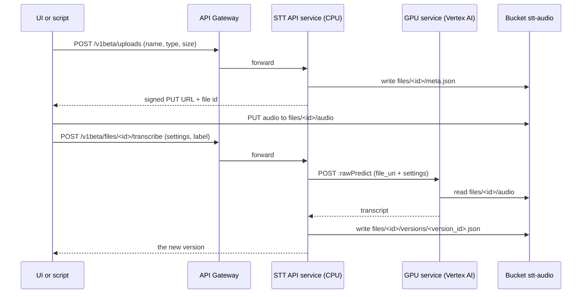
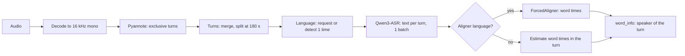

# Design: STT-A Qwen3-ASR with speaker diarization and transcript history on Vertex AI (L4)

Date: 2026-11-21. Card: "STT with Diarization". Status: approved by the user on 2026-11-21.
This spec merges the diarization design (approved 2026-11-19) and the stored files and transcript history design (approved 2026-11-21). The 2026-11-19 file is deleted; it is in git history (commit `09d35d3`).
Inputs: `docs/research/06-stt-diarization.md`, `docs/research/03-speech-models.md`, `docs/research/04-vertex-ai.md`.

## Intent

Deploy 1 speech-to-text service that returns the text and a speaker for each word.
The API copies the Gemini 3.5 Transcribe request and response, so a client can change the base URL and keep its code.
This deployment replaces the card "4. STT-A: Qwen3-ASR-1.7B on stock vLLM on Vertex AI (L4)".

The user also tests STT-A after each change (model, image, settings). To compare, the user runs the same audio again and sees the old and the new result. So the app keeps every uploaded file and every transcript run, in 1 shared store in the bucket. The UI, curl and scripts see the same list.

## Goals

1. `deployments/stt-a-qwen3-asr-diar/` deploys 1 custom container on a Vertex AI endpoint with 1 L4.
2. The container runs 3 models: Qwen3-ASR-1.7B (text), Qwen3-ForcedAligner-0.6B (word times), Pyannote `speaker-diarization-community-1` (speakers).
3. `POST /v1beta/interactions` accepts the Gemini 3.5 Transcribe request and returns `output_text` and `word_info` annotations.
4. Speakers per word work in all 30 Qwen3-ASR languages.
5. `POST /v1beta/uploads` gives an API-key client a signed upload URL. Uploaded files are kept forever.
6. A list of all uploaded audio files, shared by all clients.
7. For each file, a list of transcript versions. A version is 1 run: the full answer, plus the image tag, the settings, the run time and an optional label.
8. "Transcribe again" on a stored file makes a new version. No new upload.
9. Every run through `POST /v1beta/files/{id}/transcribe` is saved, from any client, with no extra call. A direct call to `/v1beta/interactions` is not saved (non-goal below); the README tells test scripts to use `transcribe`.
10. A public API Gateway with the shared API key, the CORS proxy, and a "stt" tab in the test UI. The tab shows the files, the versions of a file, 1 version in full, and 2 versions side by side.

## Non-goals

- Streaming and the live model (`gemini-3.5-transcribe-live`).
- Smart mode features: voice editing, `source_text`. The `"smart"` mode returns plain text only.
- `custom_vocabulary`. Qwen3-ASR has no such input. Gemini also rejects it together with diarization.
- Delete, rename or edit of files or versions. Nobody asked for it. Add it later if the bucket grows.
- A word-level diff of 2 versions. The side-by-side view is the first step.
- Users, owners or per-user lists. The store is shared. Everyone with the API key sees everything.
- Saving runs of the direct route `/v1beta/interactions` (inline audio or `file_uri`). It stays the plain Gemini-style route and saves nothing.
- The Gemini key header `x-goog-api-key`. Clients send `x-api-key`, as for the other gateways. A Gemini client changes the base URL and the key header.
- An async job API. 1 request gives 1 response.
- Overlapped speech. Each moment has 1 speaker (Pyannote exclusive output).

## Anti-goals

- No public Vertex AI endpoint. Only the API Gateway with the API key is public.
- No min replicas above 0.
- No fetch of `http(s)://` audio URLs by the service (SSRF risk). Only `gs://` and inline data.
- The GPU service does more than audio work. It does not write to the bucket and does not know about versions.
- A public bucket or public objects.
- A second store (Firestore, a database). The bucket is the only store.

## Decisions by the user

2026-11-19:

| Topic | Decision |
|---|---|
| Platform | Vertex AI, module `infra/modules/vertex-model`. |
| Shape | 1 custom container with ASR, aligner and diarization. It replaces the STT-A card. |
| Diarization model | Pyannote `speaker-diarization-community-1`. |
| Contract | The full Gemini shape: `output_text` and `steps[].content[].annotations[]` with `type == "word_info"`. |
| Languages | All 30 Qwen3-ASR languages must give speakers per word. |
| Word speaker | Diarize first, then ASR per turn. |
| Long audio | Keep the Gemini limit of 30 minutes. Accept the risk of the 300 s gateway deadline. Measure, then decide again. |
| Key header | `x-api-key` only. No change to the shared CORS proxy. |
| Large audio | A signed upload URL route for API-key clients. |

2026-11-21:

| Topic | Decision |
|---|---|
| Where the history lives | In the bucket, 1 shared store for the whole app. Not in the browser. |
| Split of work | The CPU service does all storage and history work. The GPU service handles audio only. |
| Who saves a version | The CPU service. It calls the GPU service and saves the answer before it replies. |
| Retention | Forever. |
| UI | Must support the full flow (list, versions, re-run, compare). |
| Specs | 1 merged spec (this file). |

## Approaches

### Where diarization runs

| Approach | Trade-off | Status |
|---|---|---|
| A. 1 custom container: ASR, aligner and Pyannote in 1 process on 1 L4 | 1 cold start, 1 GPU bill, audio crosses the network 1 time. Needs a custom image and a working `qwen-asr` and vLLM pair. | Picked. |
| B. Stock vLLM STT-A service plus a second diarization service | Reuses the LLM-A image. 2 cold starts, 2 GPU bills, a third part to join the results. | Rejected. |
| C. NVIDIA Sortformer instead of Pyannote | End-to-end model, but 4 speakers at most, NVIDIA license and a heavy NeMo image. Gemini allows 8 speakers. | Rejected. |

### How a word gets its speaker

The user requires speakers per word in all 30 languages. The aligner gives word times in 11 languages only.

| Approach | Trade-off | Status |
|---|---|---|
| 1. Diarize first, then ASR per turn | The speaker is exact in all 30 languages. Word times are estimates in 19 languages. More ASR calls (1 batch). A word cut at a turn edge can go to the wrong side. | Picked. |
| 2. ASR on the whole audio, then match word times to speaker turns | Fewer ASR calls and full context. In 19 languages there are no word times, so the speaker per word fails. | Rejected. |
| 3. Approach 2 for the 11 aligner languages, approach 1 for the others | Best word times in 11 languages, but 2 code paths to build and test. | Rejected: more code for a small gain. |

### Who saves a transcript version

| Approach | Trade-off | Status |
|---|---|---|
| A. The client saves: the UI calls the GPU route, then a "save" route on the CPU service | A curl or script run that skips "save" is not recorded. A 504 at the 300 s gateway deadline loses the result. | Rejected. |
| B. The GPU service writes the version after each run | Every run is recorded, but the GPU service does more than audio work. | Rejected by the user. |
| A2. The CPU service calls the GPU service (`:rawPredict`) and saves the version before it answers | Every run on a stored file is saved. The GPU service does not change. | Picked. |

A database (Firestore) was left out: the user asked for the bucket, and it is 1 more service to run.

## Constraints and facts checked

1. Qwen3-ASR-1.7B supports 30 languages: Chinese, English, Cantonese, Arabic, German, French, Spanish, Portuguese, Indonesian, Italian, Korean, Russian, Thai, Vietnamese, Japanese, Turkish, Hindi, Malay, Dutch, Swedish, Danish, Finnish, Polish, Czech, Filipino, Persian, Greek, Hungarian, Macedonian, Romanian (Qwen3-ASR README).
2. Qwen3-ForcedAligner-0.6B supports 11 of them: Chinese, English, Cantonese, French, German, Italian, Japanese, Korean, Portuguese, Russian, Spanish. The model card says up to 5 minutes per call. The `qwen-asr` package aligns at most 180 s per call (`MAX_FORCE_ALIGN_INPUT_SECONDS = 180`), so the service splits turns at 180 s.
3. The `qwen-asr` package (Apache 2.0, PyPI 0.0.6) has `Qwen3ASRModel.LLM(...)` (vLLM backend) and `Qwen3ForcedAligner.from_pretrained(...)`. `transcribe(audio=, language=)` takes a `(np.ndarray, sr)` tuple and a list for batches. Each result has `language` and `text`. `align(audio=, text=, language=)` returns items with `text`, `start_time`, `end_time`.
4. `qwen-asr` 0.0.6 (the newest release) pins `vllm==0.14.0` (extra `vllm`) and `transformers==4.57.6`. vLLM 0.33.0 needs `transformers>=5.16.1`, so the base image is `vllm/vllm-openai:v0.14.0`. `align` returns `start_time` and `end_time` in seconds (the package divides the milliseconds by 1000). `transcribe` returns `language` as a name (`"English"`), a list of names (`"Chinese,English"`) or `""` for silence.
5. Pyannote community-1: code MIT, weights CC-BY-4.0, gated on Hugging Face (accept the user conditions with the account of `HF_TOKEN`). `pipeline(...)` returns a `DiarizeOutput` with the field `exclusive_speaker_diarization`. `Pipeline.from_pretrained("/models/pyannote")` loads a local folder with `config.yaml` offline, and expands the `$model/` subfolders. An in-memory `{"waveform", "sample_rate"}` input does not need `torchcodec`.
6. Gemini 3.5 Transcribe (official page `aistudio.google.com/docs/transcribe`): labels `spk_1`, `spk_2`; up to 8 speakers; 30 minutes of audio with diarization or word timestamps; smart mode rejects diarization and word timestamps.
7. The `vertex-model` module makes a dedicated endpoint, so the 1.5 MB body limit of the shared endpoint does not apply. `predict_route` sets the 1 route of `:rawPredict`.
8. API Gateway reads `x-google-backend` at the top level or on each operation, not on a path.
9. Not confirmed: Cloud Run keeps a request running after the gateway closes its connection (no official page says so). See "Long files and the 300 s gateway deadline".
10. A dedicated Vertex AI endpoint has a default request timeout of 10 minutes. Only `clientConnectionConfig.inferenceTimeout` at endpoint creation raises it. The `google` provider (`~> 8.10`) has no such field on `google_vertex_ai_endpoint`, so this deployment keeps 600 s. A GPU run longer than 600 s fails on every route.
11. Cloud Run documents no size limit for 1 container argument (1000 arguments at most; 1 env value at most 32 KB). The STT API service first passed `upload.py` as 1 argument. Since 2026-11-22 it has its own image, so this limit no longer applies.

Not checked (the plan must have a step for each): the full Gemini response JSON, the offset format `"0.100s"`, GPU memory use of the 3 models together.

## Design

### System flow



The direct route stays: a client can send inline base64 audio (20 MB or less) or a `file_uri` to `POST /v1beta/interactions`. The gateway sends it through the CORS proxy to `:rawPredict`. That run is not saved.

### Pipeline (1 request on the GPU service)



1. Decode the audio to 16 kHz mono float32. Reject audio longer than 30 minutes (HTTP 400).
2. Diarize with Pyannote, `max_speakers=8`. Use `exclusive_speaker_diarization`.
3. Make turns. Merge 2 turns of the same speaker when the gap is 1.0 s or less. Drop turns shorter than 0.2 s. Split a turn longer than 180 s into equal parts of 180 s or less (aligner limit of `qwen-asr`).
4. Language. With 1 code in `language_codes`, map it to the Qwen name (table below). With 0 or 2+ codes, detect the language 1 time: run ASR on the longest turn, cut to 30 s. Use that language for all turns. Short turns detect the language badly, so the service does not detect per turn.
5. Run Qwen3-ASR on all turns in 1 batch with the language forced.
6. Word times:
   - Aligner language: run the aligner on each (turn audio, turn text). Add the turn start to each time.
   - Other language (19 of 30), or aligner error: split the text at white space. Give each word a part of the turn time in proportion to its character count.
7. Each word gets the speaker of its turn. The speaker is always exact, because it comes from the turn. Only the word times are estimates in the 19 languages.
8. Speaker labels: `spk_1`, `spk_2`, ... in the order of first speech.

Why diarize first: speakers then come from the audio, not from word times. This gives speakers per word in all 30 languages with 1 code path.

Without `diarization_mode`, skip step 2. The whole audio is 1 turn without a speaker (split at 180 s), and `word_info` has no `speaker` field.

Thai, and other text without spaces in a non-aligner language: a "word" is the text between spaces. This can be a phrase. This is a known limit.

### Language table

BCP-47 primary subtag to the Qwen name: `zh` Chinese, `en` English, `yue` Cantonese, `ar` Arabic, `de` German, `fr` French, `es` Spanish, `pt` Portuguese, `id` Indonesian, `it` Italian, `ko` Korean, `ru` Russian, `th` Thai, `vi` Vietnamese, `ja` Japanese, `tr` Turkish, `hi` Hindi, `ms` Malay, `nl` Dutch, `sv` Swedish, `da` Danish, `fi` Finnish, `pl` Polish, `cs` Czech, `fil` Filipino (also `tl`), `fa` Persian, `el` Greek, `hu` Hungarian, `mk` Macedonian, `ro` Romanian. `zh-HK` and `zh-yue` map to Cantonese. Any other code returns HTTP 400.

### API contract of the GPU service

Route: `POST /v1beta/interactions`. Health: `GET /health` returns 200 after all 3 models are loaded.

Request:

```json
{
  "model": "models/qwen3-asr-diar",
  "input": [
    {"type": "audio", "data": "<base64>", "mime_type": "audio/wav"}
  ],
  "generation_config": {
    "transcription_config": {
      "language_codes": ["en-US"],
      "mode": {"type": "verbatim", "diarization_mode": "speaker", "timestamp_granularities": ["word"]}
    }
  }
}
```

- `input`: exactly 1 audio item. Forms: `{"type": "audio", "data", "mime_type"}`, `{"type": "audio", "uri": "gs://..."}`, `{"type": "file", "file_uri": "gs://..."}`.
- `model`: ignored.
- `mode`: the string `"smart"` or `"verbatim"`, or an object with `type`. Default `verbatim`.
- Errors (HTTP 400, shape `{"error": {"code": 400, "message": "...", "status": "INVALID_ARGUMENT"}}`): no audio or more than 1 item; bad base64; a URI that is not `gs://`; `smart` with `diarization_mode` or `timestamp_granularities`; `custom_vocabulary` present; unknown language code; audio longer than 1800 s; audio that does not decode; fields of the wrong JSON type.

Response (HTTP 200):

```json
{
  "id": "<uuid4>",
  "status": "completed",
  "model": "qwen3-asr-diar",
  "output_text": "Hello there.\nHi, how are you?",
  "steps": [
    {
      "type": "model_output",
      "content": [
        {
          "type": "text",
          "text": "Hello there.\nHi, how are you?",
          "annotations": [
            {"type": "word_info", "text": "Hello", "speaker": "spk_1", "start_offset": "0.100s", "end_offset": "0.400s"}
          ]
        }
      ]
    }
  ]
}
```

- `output_text`: the turn texts joined with `\n`.
- `annotations`: present when `diarization_mode == "speaker"` or `"word"` is in `timestamp_granularities`. Offsets are strings in seconds with 3 decimals and the suffix `s`.
- `steps[].type` and `content[].type` copy the general Interactions shape. Check them against a real Gemini answer before release.

### Container (`deployments/stt-a-qwen3-asr-diar/services/speech_engine/`)

- `Dockerfile`: `FROM vllm/vllm-openai:v0.14.0`. LLM-B uses v0.33.0, but `qwen-asr` 0.0.6 pins vLLM 0.14.0 (fact 4). Install `qwen-asr`, `pyannote.audio` 4.x, `soundfile`, `google-cloud-storage`. Also `ffmpeg` to decode mp3, m4a, ogg and webm.
- `speech_engine/logic.py`: pure functions, no model imports (turns, language map, word times, labels, response, request check). Unit tests run without a GPU.
- `speech_engine/pipeline.py` (split out on 2026-11-22): the transcription work (decode, diarize, transcribe each turn, word times). `speech_engine/main.py` keeps only the HTTP server.
- `speech_engine/main.py`: FastAPI, same start pattern as LLM-B. Uvicorn opens the port at once (the Vertex AI liveness probe is TCP). The models load in a thread: copy the 3 model folders from `AIP_STORAGE_URI` to `/models` on local disk, then load the 3 models. `/health` returns 503 until all 3 are loaded, then 200. After that, the app prints the log line `models ready` (the Slack "ready" signal). Listen on `0.0.0.0:$AIP_HTTP_PORT` (8080). 1 Uvicorn worker. 1 request at a time (an `asyncio.Lock`). vLLM `gpu_memory_utilization=0.5` leaves room for the aligner and Pyannote on the 24 GB L4.
- `cloudbuild.yaml`: copy the LLM-B file. Build and push to `<region>-docker.pkg.dev/<project_id>/models/stt-a-qwen3-asr-diar:${_TAG}`. `_TAG` must match `var.image_tag`.
- Env: `HF_HUB_OFFLINE=1`, `AUDIO_BUCKET`.
- The GPU service accepts `file_uri` only from `gs://<audio_bucket>/`. It needs no change for the history: the object names `files/<id>/audio` are under that bucket.

### Weights

3 runs of the weights-copy job into 1 folder, so `AIP_STORAGE_URI` points to their parent:

| HF_REPO | TARGET_DIR |
|---|---|
| `Qwen/Qwen3-ASR-1.7B` | `stt-a-qwen3-asr-diar/asr` |
| `Qwen/Qwen3-ForcedAligner-0.6B` | `stt-a-qwen3-asr-diar/aligner` |
| `pyannote/speaker-diarization-community-1` | `stt-a-qwen3-asr-diar/pyannote` |

The Pyannote copy needs the Hugging Face user conditions accepted for the `HF_TOKEN` account.

### Bucket layout

The bucket `<project_id>-stt-audio` (infra/core) holds everything under 1 prefix:

```
files/<id>/audio                           the audio, uploaded 1 time (signed PUT)
files/<id>/meta.json                       {"id", "name", "mime_type", "size_bytes", "created"}
files/<id>/versions/<version_id>.json      1 transcript run (shape below)
files/<id>/versions/<version_id>.names.json  speaker names of that run, {"spk_1": "Alice"} (can change)
```

- `<id>` is a new UUID4 from the server.
- `<version_id>` is the UTC start time `YYYYMMDDTHHMMSSZ` plus 4 random hex chars, for example `20261121T104512Z-3fa1`. Names sort by time.
- The old prefix `uploads/` goes away. Nothing is deployed yet, so nothing migrates.
- Retention: no lifecycle rule (files are kept forever). `force_destroy = false`, so a destroy of infra/core cannot delete the history (my call). A CORS rule allows `PUT` from any origin (the browser upload).

### Version JSON

```json
{
  "id": "20261121T104512Z-3fa1",
  "file_id": "<id>",
  "created": "2026-11-21T10:45:12Z",
  "label": "after pyannote tuning",
  "image_tag": "0.1.0",
  "settings": {"language_codes": ["en"], "diarization": true},
  "run_seconds": 41.2,
  "response": { "...": "the full Gemini-style answer of the GPU service" }
}
```

- `image_tag` comes from the env value `IMAGE_TAG` of the STT API service. Terraform sets it from `var.image_tag`, the same value as the GPU image. It is the tag in Terraform, not a value that the GPU reports. If the user builds a new image but does not apply, the tag can be wrong. This is a known limit.
- `label` is optional free text from the user, 200 chars at most (my call: it makes a test run easy to find).

### STT API service (`deployments/stt-a-qwen3-asr-diar/services/stt_api/`)

A small CPU service on Cloud Run. It gives upload URLs without a GPU cold start, keeps the file list and the history, and calls the GPU service for "transcribe again".

- Runtime: own image `stt-a-qwen3-asr-diar-api` (`FROM python:3.13.9-slim`, package `stt_api`, `python3 -m stt_api`), built by `services/stt_api/cloudbuild.yaml`. Until 2026-11-22 it was 1 file passed as `python3 -c <file>`; the evaluation code made a package with modules worth an image. Standard library only. It signs through `signBlob` with a metadata server token, and reads and writes GCS through the JSON API.
- All answers carry the CORS headers. The service answers `OPTIONS` itself, because the gateway sends it the browser preflight. Errors use the error shape of the GPU service.

| Route | Body | Answer |
|---|---|---|
| `POST /v1beta/uploads` | `{"name", "mime_type", "size_bytes"}` | `{"id", "upload_url", "method", "headers", "file_uri", "expires_in"}` (example below). It also writes `meta.json`. |
| `GET /v1beta/files` | - | `{"files": [{"id", "name", "mime_type", "size_bytes", "created", "versions": <count>, "latest": <version_id or null>}]}`, newest first. A file without `audio` (the PUT never came) is left out. |
| `GET /v1beta/files/{id}` | - | `{"file": <meta>, "versions": [<summary>]}`, newest first. A summary is the version JSON without `response`, plus `"text_chars"` and `"speakers"` (count). |
| `GET /v1beta/files/{id}/versions/{version_id}` | - | The full version JSON. |
| `POST /v1beta/files/{id}/transcribe` | `{"language_codes"?: [...], "diarization"?: true, "label"?: "..."}` | `201` with the full version JSON. |
| `PUT /v1beta/files/{id}/versions/{version_id}/names` | `{"spk_1": "Alice"}`, at most 8 keys `spk_<n>`, names 1 to 40 chars | `{"names": {...}}`. It replaces `<version_id>.names.json`. The version JSON does not change. `GET` of the version adds `"names"`. Names are per version, because the `spk_N` labels can change between runs. |
| `GET /v1beta/files/{id}/audio` | - | `{"url", "mime_type", "expires_in"}`: a V4 signed `GET` URL (15 minutes, signed header `host` only). The browser plays it in an `<audio>` element. No CORS rule is necessary for playback. |

Upload answer:

```json
{
  "id": "<uuid4>",
  "upload_url": "https://storage.googleapis.com/<bucket>/files/<uuid4>/audio?X-Goog-Signature=...",
  "method": "PUT",
  "headers": {"Content-Type": "audio/mpeg", "x-goog-content-length-range": "0,123456789"},
  "file_uri": "gs://<bucket>/files/<uuid4>/audio",
  "expires_in": 900
}
```

Upload rules:

- `name` is the file name, 1 to 200 chars. `mime_type` must be an audio type from the Gemini list. `size_bytes` must be 1 to 500 MB. Otherwise HTTP 400.
- The URL is a V4 signed URL for `PUT`, valid 15 minutes, signed through the IAM Credentials `signBlob` API (no key file).
- The object name is a new UUID. The client cannot choose it, so it cannot overwrite other files.
- The signed headers fix the content type and the max size.

`transcribe` rules:

- The file must exist (`404` if not). The body builds the GPU request: `{"input": [{"type": "file", "file_uri"}], "generation_config": {"transcription_config": {"language_codes"?, "mode": {"type": "verbatim", "diarization_mode"?: "speaker", "timestamp_granularities": ["word"]}}}}`.
- A GPU `429` (0 replicas, cold start) goes back to the client as `429`, and nothing is saved. The UI already retries every 30 s on a 429 (`features.cold_start = "vertex-429"`).
- Any other GPU error (400, 500) goes back with its status and body, and nothing is saved.
- Only a GPU `200` writes a version. The service writes the version first, then answers.

Listing uses the GCS JSON API (list with `prefix=files/`, read with `alt=media`). `GET /v1beta/files` reads no object bodies: `meta.json` also carries `name` and `created` as GCS custom metadata, which the list call returns, and the size comes from the `audio` object (my call). The list follows `nextPageToken`, because 1 page holds at most 1,000 objects. `GET /v1beta/files/{id}` reads each version file of that 1 file, for `text_chars` and `speakers`. `shortcut: the list reads every object under files/; add a summary object when there are many thousands of objects.`

### Long files and the 300 s gateway deadline

The gateway stops waiting after 300 s (HTTP 504 to the client). On the direct route, the GPU replica then finishes the work for nothing (risk accepted on 2026-11-19).

On `transcribe`, the STT API service has its own timeout of 900 s and waits for the GPU service up to its 600 s limit (fact 10). It saves the version before it answers, so its request is still open in Cloud Run. Not confirmed: if Cloud Run keeps a request running after the gateway closes its connection. If it does, a long file still gets its version, and the UI finds it with a refresh. If it does not, a long file gives a 504 and no version. The README gets a check step for this on the first real deploy.

### Terraform

- `infra/core/main.tf`: the bucket `<project_id>-stt-audio` (no lifecycle rule, `force_destroy = false`, the CORS rule for `PUT`), output `stt_audio_bucket`, the API `iamcredentials.googleapis.com` (for `signBlob`). `infra/core/gateways.tf`: the API ID `stt-a-qwen3-asr-diar` in `local.gateway_apis`.
- `variables.tf`: `project_id`, `region`, `gateway_region` and `image_tag`, as LLM-B.
- `main.tf`: module `vertex-model` with the custom image `local.image` (built from `var.image_tag`), `health_route = "/health"`, `predict_route = "/v1beta/interactions"`, `machine_type = "g2-standard-12"`, `accelerator_type = "NVIDIA_L4"`, `accelerator_count = 1`, `shared_memory_size_mb = 16384`, `deployment_timeout = "1800s"`, `max_replica_count = 1`, `weights_dir = "stt-a-qwen3-asr-diar"`. The GPU service account gets `roles/storage.objectViewer` on the audio bucket, and no write access.
- `stt_api.tf`: the STT API service, built with the module `model-service` in the same way as the CORS proxy: CPU only, min 0, private, invoked only by the gateway service account.
  - Service name `stt-a-qwen3-asr-diar-api`.
  - `timeout = "900s"` (the GPU call stops at 600 s, fact 10).
  - Env `AUDIO_BUCKET`, `SA_EMAIL`, `IMAGE_TAG`, and `TARGET` (the `:rawPredict` URL, the same value as the CORS proxy target).
  - IAM: `roles/storage.objectCreator` and `roles/storage.objectViewer` on the audio bucket, `roles/iam.serviceAccountTokenCreator` on its own service account, `roles/aiplatform.user` on the project (as the CORS proxy has).
- `cors_proxy.tf`: copy LLM-A (target `:rawPredict`).
- `gateway.tf`: gateway ID `stt-a-qwen3-asr-diar`. Every path has `options` with `security = []` for the browser preflight. Every operation that goes to the STT API service has its own `x-google-backend` with `path_translation = APPEND_PATH_TO_ADDRESS` (fact 8).
  - `/v1beta/interactions` (`post`): the top-level backend, the CORS proxy, deadline 300 s.
  - `/v1beta/uploads` (`post`), `/v1beta/files` (`get`), `/v1beta/files/{id}` (`get`), `/v1beta/files/{id}/versions/{version_id}` (`get`), `/v1beta/files/{id}/versions/{version_id}/names` (`put`), `/v1beta/files/{id}/audio` (`get`): the STT API service, deadline 30 s.
  - `/v1beta/files/{id}/transcribe` (`post`): the STT API service, deadline 300 s.
- `outputs.tf`: LLM-B outputs, plus `upload_url` and `ui` with `type = "stt"`, `features = { cold_start = "vertex-429", max_mb = 20 }`.
- `alerts.tf`: copy the LLM-B file (required: `scripts/check.py` fails without it). `title = "STT-A Qwen3 ASR + speakers"`, the Vertex AI endpoint filter, `ready_text = "models ready"`, default `down_text` (`Application shutdown complete.`, uvicorn). The module `vertex-model` already turns on container logs, which the alerts need. The STT API service gets no alerts: it runs on CPU and costs almost nothing.
- No streaming, so no `scripts/gateway-streaming.py` step.

### Test UI (`ui/src/panels/Stt.tsx`)

The STT tab has 2 parts:

```
+-- Files -------------------------+  +-- File: meeting.mp3 (12.4 MB, 2026-11-21) ------------+
| [Upload a file]                  |  | Language [auto]  [x] Speakers  Label [__________]     |
| > meeting.mp3     3 versions     |  | [Transcribe again]                                     |
|   interview.wav   1 version      |  |                                                        |
|   call.m4a        0 versions     |  | Versions            image  lang  spk  label     time   |
| [Refresh]                        |  | [x] 2026-11-21 10:45 0.1.1  auto  2   tuning   41 s   |
+----------------------------------+  | [x] 2026-11-20 16:02 0.1.0  auto  2   -        44 s   |
                                      |                                                        |
                                      | Side by side: v 10:45 | v 16:02 (speaker turns)        |
                                      +--------------------------------------------------------+
```

- Upload: every file goes through `/v1beta/uploads` and the signed `PUT`, of any size. The inline path leaves the UI (the API keeps it). After the upload, the UI starts the first `transcribe` at once.
- Files list: from `GET /v1beta/files`, with a Refresh button.
- Selected file: its versions from `GET /v1beta/files/{id}`. Click a version to show it in full: 1 line per speaker turn, 1 color per speaker. Tick 2 versions to show them side by side.
- "Transcribe again": `POST /v1beta/files/{id}/transcribe` with the language (auto plus the 30 codes), the speakers check box and the label. It uses `call()`, so the 429 retry works. On a 504, the UI says that the run can still finish, and offers Refresh.
- The curl box shows the `transcribe` call.
- The URL keeps the selected file: `#/<tab-id>/<file id>`, so a link opens the same file (my call: useful to share a test case). `hashId()` in `ui/src/App.tsx` reads the whole hash as the tab ID today, so it must split at the first `/`.
- `ui/mock-server.mjs`: the 5 files routes, kept in memory, the signed `PUT` route, and `POST /v1beta/interactions` with a fixed 2-speaker answer.

### Security

- Every route needs the API key. Everyone with the key can list and read all files and transcripts. This is the "shared store" decision.
- Forever retention plus 500 MB per upload: a holder of the key can fill the bucket without a limit. The budget alert is the only guard. Delete is a non-goal for now.
- The STT API service can create and read objects in the audio bucket, and call Vertex AI. It cannot delete or overwrite audio or versions: version names are new each time, and `objectCreator` cannot replace an object. The only exception is `*.names.json`: a conditional `roles/storage.objectUser` grant (`upload_names` in `stt_api.tf`) lets it replace these objects only.
- The GPU service can only read the audio bucket.
- Path values `{id}` and `{version_id}` must match their exact format (UUID4, and the version pattern) before any GCS call, so a client cannot read other paths.

### Evaluation (added 2026-11-22)

User decisions (2026-11-21): the test audio is the user's own stored files, and a file is evaluated only when the user saved its reference. No public data sets. The goal is to compare model setups (models and their settings), not only models.

- Reference: `files/<id>/reference.json`, `{"language", "turns": [{"speaker", "text", "start"?, "end"?}]}`. Times are seconds or `hh:mm:ss.s`. The STT API service may replace it (IAM condition in `stt_api.tf`, as `*.names.json`). The UI makes a draft from a version, so a corrected model answer becomes the reference (user feedback becomes test data).
- Setup record: the GPU service adds `setup` and `audio_seconds` to each answer. The STT API service saves `setup` at the top of the version.
- Code: `services/stt_api/stt_api/evaluation/` (`reference.py`, `metrics.py`, `scoring.py`), apart from the main upload and transcribe flow.
- Scores are computed on read, not stored: a metric change applies to all old versions. Word edit distance is bit-parallel (Myers/Hyyro) on Python ints, so a 30-minute file scores in about 0.1 s. The speaker mapping uses the Hungarian method for cpWER (fewest word errors) and for DER (most overlap time).
- Hypothesis segments for DER: consecutive words of 1 speaker, split at a gap over 1 s.
- `GET /v1beta/scores` groups by the setup plus the request settings that change the result (no diarization, a fixed language) and gives the mean of each score over the versions.

## Size limits

- Inline audio on the direct route: 20 MB of decoded bytes (as Gemini). The API Gateway and Cloud Run proxy limit is 32 MiB, and base64 adds 33%.
- Uploads: up to 500 MB (Gemini allows 2 GB, but 30 minutes of audio is rarely larger). People with GCP access can also use `gcloud storage cp` into the same bucket.
- Duration: 30 minutes for all inputs.

## Calls I made (check them)

- The Slack "ready" line is `models ready`, printed after all 3 models load (same idea as `engine ready` in LLM-B). Check it in the real logs after the first cold start.
- The signed URL is valid 15 minutes.
- The STT API service is a separate CPU service in the same deployment folder, not a route in the GPU container.
- `output_text` joins the turn texts with a new line, without speaker names.
- `force_destroy = false` on the audio bucket.
- An optional label on each version, 200 chars at most.
- The file list takes `name` and `created` from the custom metadata of `meta.json`.
- The UI link keeps the selected file.
- Contract check: the release check compares our answer with the fields on the Gemini page. There is no Gemini API key in `.env`.

## Left to the builder

- The code structure inside `image/` and `upload/`.
- How the UI lays out the 2 parts on a narrow screen, and how the side-by-side view aligns 2 versions (by turn order is enough).
- The exact error texts.

## Risks

1. The 3 models may not fit in 24 GB with `gpu_memory_utilization=0.5`. Measure it on the first deploy.
2. A 30-minute file can take longer than the 300 s gateway deadline. The user accepts this risk. Measure the real-time factor and write it in the README. The user decides again after the measurement.
3. The cold start includes the copy of about 6 GB of weights and the load of 3 models.
4. The bucket grows without a limit. The budget alert is the only guard.

## Done when

1. A request with a short 2-speaker audio file returns `word_info` items with 2 speakers through the gateway.
2. A file larger than 20 MB works through `/v1beta/uploads`.
3. Unit tests of the STT API service cover all 5 routes with a fake GCS and a fake GPU, including: 429 and 500 from the GPU save nothing; a bad `{id}` gives 400 before any GCS call; a file without audio is not listed.
4. `./scripts/check.py` passes, including the gateway paths (operation-level backend) and the IAM.
5. The UI works against the mock: upload, first version, transcribe again with a label, 2 versions side by side, a link with the file id opens it. Proof with the `verify-ui` skill.
6. The Slack messages "ready" and "scaled to 0" arrive. The real-time factor and the cold start are written down in the README. The endpoint scales to 0.
7. The README has the real-deploy checks: a re-run makes a new version; a long file (over 300 s of processing) gets a version or not (write down which).
