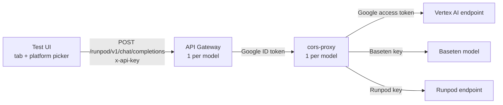

# Design: Deploy each GPU model to several platforms (Vertex AI, Baseten, Runpod)

Date: 2026-11-22. Card: "Other providers reserach". Status: approved by the user on 2026-11-22. Each phase gets its own plan in `docs/specs/`, phase 1 first.

Update 2026-11-23: Baseten is deferred. The Baseten account answered "Your account does not support deploying custom models. Contact support@baseten.co to enable." on 2 apply attempts, so the user decided to remove Baseten for now. The code (adapter `platform-baseten`, facade wiring, keys, `scale-watch` reader) is not on master. The git tag `archive/baseten-platform` keeps the last Baseten version; restore it from there after Baseten support enables custom models. Runpod is the live second platform.
Rebased on master `fd8a12f` (STT-A service layout and evaluation). Inputs: `docs/research/07-other-gpu-providers.md` (provider comparison), `docs/research/08-multi-platform-design.md` (first design and provider schemas), `docs/research/04-vertex-ai.md`.

## Intent

Vertex AI in `us-central1` often has no L4 capacity ("Machine type temporarily unavailable", long HTTP 429). Then a GPU model cannot start, and the user cannot test it.

The fix is a second and a third platform for the same model. Each model can run on Vertex AI, Baseten and Runpod at the same time. All platforms scale to zero, so an idle platform costs $0. When one platform has no capacity, the user picks another platform in the test UI and calls the same model there.

Each platform must add one adapter, not a copy of the deployment code. A new platform later (for example Cloud Run GPU) must also be one adapter.

## Goals

1. A deployment folder lists its platforms in 1 line: `local.platforms = ["vertex", "runpod", "baseten"]`. The order matters: the first platform is the default.
2. One model spec per model (image, args, port, health route, routes, GPU, replicas, idle time, weights). The adapters turn it into platform resources.
3. One adapter per platform: a Terraform module with the same inputs and the same output object.
4. One API Gateway, one API key, one CORS proxy and one Terraform state per model, for all its platforms.
5. The platform is the first path segment: `/vertex/...`, `/runpod/...`, `/baseten/...`. The old paths without a prefix keep working and go to the default platform.
6. One deploy script for all platforms: `./scripts/deploy.py deploy|undeploy deployments/<name> [--platform <id>]`.
7. The test UI keeps 1 tab per model. A platform picker shows the deployed platforms of the model. The panels do not change.
8. Slack "ready" and "scaled to 0" messages for every platform.
9. The provider keys never reach the browser and never go into the Terraform state.
10. In the end, LLM-A, LLM-B and STT-A can run on all 3 platforms.

## Non-goals

- Modal and Replicate. The user rejected them on 2026-11-22 (see `07-other-gpu-providers.md`).
- TTS-A on other platforms. It is CPU only on Cloud Run and has no capacity problem.
- Deploy or undeploy from the UI. The user chose code plus a script.
- Automatic failover. The UI does not switch platform by itself when one fails. The user picks.
- A live "warm or cold" badge per platform in the UI. A later card can add it.
- One budget across all platforms. Each platform keeps its own billing and limits.
- Renaming the deployment folders (for example `llm-a-gemma4-12b-vllm-vertex`). A rename changes the HCP workspace and needs a state move. A later card can do it.
- Load balancing over platforms, or several replicas per platform. `max_replicas` stays 1.

## Anti-goals

These make the work a failure, even if it runs:

- A file or block that is copied for each platform (a second `gateway.tf`, a second proxy, a `vertex.py` clone for Runpod).
- A provider key in the browser, in `models.json`, in git, or in the Terraform state.
- A public service, or a platform endpoint that answers without a key.
- A minimum replica count above 0 on any platform.
- The phase 1 refactor replaces the LLM-A Vertex AI endpoint or the gateway. The endpoint ID and the gateway URL must stay the same.
- Several models in one Terraform root.

## Decisions by the user

| Date | Decision |
|---|---|
| 2026-11-22 | Use only Baseten and Runpod next to Vertex AI. |
| 2026-11-22 | One model can use several platforms at the same time. |
| 2026-11-22 | The platform list is in code. One deploy script handles all platforms. The UI only shows the platforms and lets the user pick which one to call. |
| 2026-11-22 | No duplication for each platform. |
| 2026-11-22 | One spec for the full design, built in phases. Each phase gets its own plan. |
| 2026-11-22 | Routing: one gateway and one CORS proxy per model, with the platform as the path prefix. |
| 2026-11-22 | Terraform: one root and one state per model. The model module calls each adapter with `count`. Every HCP workspace gets both provider keys. |
| 2026-11-22 | No limits on where model traffic and data run: any region, any Runpod cloud type (also Community Cloud). Baseten stays on the self-serve plan. |
| 2026-11-22 | Any 24 GB GPU is allowed, not only the L4. Engine flags that depend on the platform or the GPU (for example `--kv-cache-dtype=fp8` for LLM-A, FP8 weights for LLM-B) must be set per platform. |
| 2026-11-23 | Remove Baseten for now: the Baseten account cannot deploy custom models. Finish the work with Runpod. |

## Approaches

### Routing (decided: path prefix)

| Approach | Trade-off | Result |
|---|---|---|
| **A. One gateway + one proxy per model, platform as path prefix** | 1 API key, 1 place for provider keys. Paths are generated from routes and platforms. A proxy fault affects all platforms of the model. | **Chosen** |
| B. One gateway (and proxy) per platform per model | URLs without a prefix. But 3 times the gateway APIs in `infra/core`, and the gateway, proxy and streaming step repeat for each platform. | Rejected: duplication |
| C. Browser calls Baseten or Runpod directly | No proxy. But the provider keys are in the browser. Baseten sends no CORS headers. | Rejected: anti-goal |

### Terraform layout (decided: one root per model)

| Approach | Trade-off | Result |
|---|---|---|
| **T1. One root per model, adapters with `count`** | Matches the convention "one folder and one state per model". Every workspace needs both provider keys, also when it does not use the platform. | **Chosen** |
| T2. One root per platform in each model folder, plus a root for gateway and UI | A platform fails alone, with no key problem. But more roots, more applies per change, remote state reads, and a shared spec file across folders. | Rejected: more moving parts |

## Constraints and facts checked

| Fact | Source |
|---|---|
| `basetenlabs/baseten` 0.1.0: `baseten_model` (managed mode with inline `push.config`, `environments.<env>.autoscaling`), `baseten_secret` (`value_wo`, `value_wo_version`, needs Terraform 1.11 or later). No URL attribute: build it from `id`. | Provider repo `docs/resources/model.md`, `secret.md` |
| The Baseten push runs in Go (`baseten-go` and the AWS SDK). It needs no local `truss` binary, so it works on HCP remote runs. | `internal/provider/model_push.go` |
| Baseten writes the environment settings before the first push. The first deployment of a new model can start with the Baseten default autoscaling. | Provider source |
| Baseten URL: `https://model-<id>.api.baseten.co/environments/production/sync/<route>` maps to `/<route>` on the server. | docs.baseten.co custom-server |
| Baseten holds a request at 0 replicas until a replica is ready (up to 1200 s), then HTTP 500. Body limit 100 MB. | docs.baseten.co autoscaling, request-lifecycle |
| `runpod/runpod` 2.0.0: `runpod_template` (`image`, `args`, `env`, `ports`, `serverless`), `runpod_serverless_endpoint` (`endpoint_type = "LOAD_BALANCER"`, `scaling_type = "REQUEST_COUNT"`, `gpu_pools`, `workers_min`, `workers_max`, `idle_timeout`, `flashboot`, read-only `request_urls.base`), `runpod_registry`. No secret resource. | Provider repo `docs/resources/*` |
| A Runpod load balancing endpoint polls `/ping` on `PORT_HEALTH`. Set `PORT`, `PORT_HEALTH` and `HEALTH_CHECK_PATH` to use another port and path. At 0 workers there is no queue: it answers "no workers available". Limits: 30 MB body, 5.5 min. | docs.runpod.io load-balancing |
| L4 is GPU type `"NVIDIA L4"` in pool `AMPERE_24` (with A5000 and 3090). | docs.runpod.io gpu-types |
| Both providers fail in `Configure` when the API key is empty. | `provider.go` of both repos |
| `infra/core` already needs Terraform 1.11 (write-only arguments). The deployments say `>= 1.7`. | `infra/core/versions.tf` |
| STT-A (master `fd8a12f`): the GPU image is `services/speech_engine` (reads `AIP_HTTP_PORT`, `AIP_STORAGE_URI`, reads `gs://` audio itself). The CPU service is `services/stt_api` (Cloud Run, own image, `stt_api.tf`, Terraform address `module.stt_api`). `stt_api` calls the GPU `:rawPredict` URL from env `TARGET`. `stt_api/gcp.py` already has `signed_get`. | `deployments/stt-a-qwen3-asr-diar-vertex/` |
| STT-A saves a setup record with each version (`SETUP_ASR`, `SETUP_ALIGNER`, `SETUP_DIARIZATION`, `SETUP_IMAGE_TAG` env vars of the GPU image) and averages the scores per setup (`GET /v1beta/scores`, WER, cpWER, DER, speed). | `services/speech_engine/speech_engine/main.py`, `services/stt_api/stt_api/evaluation/` |
| STT-A scale-up from 0 on Vertex AI took 7 min 19 s (measured). | `deployments/stt-a-qwen3-asr-diar-vertex/README.md` |
| `scripts/check.py` runs Python tests only in `deployments/*/image/tests` and `deployments/*/services/*/tests`. | `scripts/check.py` |
| `scripts/gateway-streaming.py` replaces the gateway and imports it at the fixed address `google_api_gateway_gateway.this`. | `scripts/gateway-streaming.py` line 110 |
| The UI calls `model.base_url + path` in `call()` and `curlFor()`. Retry on 429 only when `features.cold_start === "vertex-429"`. | `ui/src/api.ts` |

## Design

### Overview



### Module layout

```text
infra/modules/
  model/              NEW facade. Inputs: name, gateway_id, platforms, spec, platform_options.
                      Calls the adapters (count), gateway, cors-proxy. Outputs: targets, ui_platforms, gateway outputs, vertex.
  platform-vertex/    The current vertex-model module, renamed, with the adapter output added.
  platform-baseten/   NEW. baseten_model.
  platform-runpod/    NEW. runpod_template + runpod_serverless_endpoint.
  gateway/            NEW. Moves the gateway.tf of the deployments into a module.
  cors-proxy/         CHANGED. Several targets. Secret env vars for provider keys.
  model-service/      CHANGED. Optional secret env vars.
  scale-alerts/       UNCHANGED.
```

`infra/modules/vertex-model` is moved, not copied. STT-A and LLM-B keep using it until their phase moves them, so phase 1 adds `platform-vertex` and keeps `vertex-model` as a thin wrapper that calls `platform-vertex`. The wrapper is removed in phase 6.

### Deployment folder after the change

```hcl
# deployments/llm-a-gemma4-12b-vllm-vertex/main.tf
locals {
  platforms = ["vertex", "runpod", "baseten"] # first = default in the UI and for the old paths
  model_dir = "gemma-4-12b-it-qat-w4a16"      # weights-copy TARGET_DIR (vertex)
}

module "model" {
  source = "../../infra/modules/model"

  project_id = var.project_id
  region     = var.region
  name       = "llm-a-gemma4-12b"              # base name on Baseten and Runpod
  gateway_id = "llm-a-gemma4-vertex"          # the API in infra/core/gateways.tf
  platforms  = local.platforms

  spec = {
    image        = { stock = "vllm/vllm-openai:v0.33.0" }
    args         = ["--model={model}", "--served-model-name=gemma-4-12b", "--max-model-len=32768",
                    "--host=0.0.0.0", "--port=8080"] # flags that work on every platform and GPU
    port         = 8080
    health_route = "/health"
    routes       = ["/v1/chat/completions"]
    gpu          = "L4"
    max_replicas = 1
    idle_seconds = 300
    weights      = { hf_repo = "google/gemma-4-12B-it-qat-w4a16-ct", revision = "<commit sha>", gcs_dir = local.model_dir }
  }

  platform_options = {
    vertex = {
      name                  = "llm-a-gemma4-12b-vllm-vertex" # the current Vertex AI name: keeps the endpoint ID
      machine_type          = "g2-standard-12"
      shared_memory_size_mb = 16384
      deployment_timeout    = "1800s"
      extra_args            = ["--load-format=runai_streamer", "--kv-cache-dtype=fp8"] # L4 (Ada) has FP8
      predict_route         = "/v1/chat/completions" # :rawPredict, as today
    }
    baseten = { extra_args = ["--kv-cache-dtype=fp8"] } # L4
    runpod  = { gpu_pools = ["AMPERE_24"] }             # L4, A5000 or 3090: no fp8 KV cache flag (Ampere)
  }
}
```

`gateway.tf` and `cors_proxy.tf` are deleted from the deployment. `alerts.tf` stays. `outputs.tf` passes the module outputs through and keeps the `ui` output with the model-specific fields.

### Input types of the facade

```hcl
variable "platforms" {
  type = list(string)
  # validation: not empty, no duplicates, each in ["vertex", "baseten", "runpod"]
}

variable "spec" {
  type = object({
    image        = object({ stock = optional(string), own = optional(string) }) # exactly one is set
    args         = list(string)            # may contain {model}
    env          = optional(map(string), {})
    port         = optional(number, 8080)
    health_route = string
    routes       = list(string)            # gateway paths, each starts with /
    gpu          = optional(string)        # "L4" or null for CPU
    max_replicas = optional(number, 1)
    idle_seconds = optional(number, 300)  # Vertex AI accepts 300 s or more
    weights = optional(object({
      hf_repo  = string
      revision = string                    # a commit sha, so all platforms load the same weights
      gcs_dir  = optional(string)          # vertex: folder in gs://<project_id>-models
    }))
  })
}

variable "platform_options" {
  type    = any       # object keyed by platform id. The shapes differ per platform, so not map(any).
  default = {}
}
```

Engine flags: `spec.args` holds only the flags that work on every platform and every GPU type of the model. A flag that depends on the platform or the GPU goes into `platform_options.<id>.extra_args`. The adapter appends it to `spec.args`. Per-platform env vars go into `platform_options.<id>.env` and are merged over `spec.env`. A Runpod pool can hold several GPU types (for example `AMPERE_24`: L4, A5000, 3090), and Runpod picks one at start. So the Runpod flags must work on every GPU type in its pools. Use `platform_options.runpod.gpu_pools` and `excluded_types` to narrow the pool when a flag needs it.

Names: `name` is the base name on all platforms. `platform_options.<id>.name` overrides it for one platform. LLM-A uses this for Vertex AI to keep the current name, because the endpoint ID is a hash of the name.

`spec.image.own` is the image name and tag in the Artifact Registry repo `models`, for example `llm-b-qwen35-9b-fastapi:${var.image_tag}`.

### Adapter interface

Every `platform-*` module has these inputs: `name`, `spec`, `options` (from `platform_options[<id>]`), plus `project_id` and `region`.

Every adapter has one output `target` with the same fields:

| Field | Type | Meaning |
|---|---|---|
| `id` | string | `vertex`, `baseten` or `runpod` |
| `label` | string | Name in the UI: `Vertex AI`, `Baseten`, `Runpod` |
| `url` | string | Base URL that the proxy calls |
| `append_path` | bool | True: the proxy appends the route to `url`. False: `url` is one fixed URL (Vertex AI `:rawPredict`) |
| `auth` | string | `google`, `baseten` or `runpod`. The proxy picks the credential by this field |
| `cold_start` | string | `retry-429` (vertex, runpod) or `hold` (baseten). The UI reads it |
| `deadline` | number | Gateway backend deadline in seconds for the paths of this platform |
| `post_apply` | string or null | `vertex`, or null. `scripts/deploy.py` runs this step |

The facade merges the adapter outputs into `targets` (a map by id) in the order of `platforms`. The gateway, the proxy, the deploy script and the UI output read only `targets`. No code outside an adapter checks the platform id, except the proxy for the credential and `deploy.py` for the post-apply step.

### What each adapter does

**`{model}` and the image**

| | vertex | baseten | runpod |
|---|---|---|---|
| `{model}` in `args` | `$(AIP_STORAGE_URI)` | `/models/weights` | `spec.weights.hf_repo` |
| Weights | `gs://<project_id>-models/<gcs_dir>/` from the `weights-copy` job, as today | Truss `weights` block: `source = "hf://<hf_repo>@<revision>"`, `mount_location = "/models/weights"`, `auth_secret_name = "hf_access_token"` | vLLM downloads from Hugging Face at start (`--revision` added). See "Runpod weights" in Risks |
| `HF_HUB_OFFLINE` added to env | `1` | `1` | `0` |
| Stock image | `<region>-docker.pkg.dev/<project>/dockerhub/<image>` | `<image>` from Docker Hub | `<image>` from Docker Hub |
| Own image | `<region>-docker.pkg.dev/<project>/models/<own>` | The same URL, with `docker_auth` `GCP_OIDC` | The same URL, with `runpod_registry` |
| Extra args and env | `options.extra_args`, `options.env` | `options.extra_args`, `options.env` | `options.extra_args`, `options.env` |
| GPU choice | `options.machine_type`, `accelerator_type` (L4) | `resources.accelerator = options.accelerator or "L4"` | `options.gpu_pools` (default `["AMPERE_24"]`), `options.excluded_types` (default none). Any cloud type, no data center pin |

**Resources**

| | platform-vertex | platform-baseten | platform-runpod |
|---|---|---|---|
| Creates | Service account, `objectViewer` on the weights bucket, dedicated endpoint (as today). Model upload and deploy stay in `deploy.py`. | `baseten_model` (name = `name`, `deletion_protection = false`, `push.wait = true`, inline `push.config` with `base_image`, `docker_server`, `weights`, `secrets`, `resources.accelerator`). `environments.production.autoscaling = { min_replica = 0, max_replica = max_replicas, scale_down_delay = idle_seconds, concurrency_target = options.concurrency_target or 4 }` | `runpod_template` (`serverless = true`, `image`, `args`, `env`, `ports = ["<port>/http"]`, `disk = options.disk_gb or 60`). `runpod_serverless_endpoint` (`template_id`, `endpoint_type = "LOAD_BALANCER"`, `scaling_type = "REQUEST_COUNT"`, `scaling_value = 4`, `gpu_pools = options.gpu_pools`, `excluded_types = options.excluded_types`, or `cpu` for CPU, `gpu_count = 1`, `workers_min = 0`, `workers_max = max_replicas`, `idle_timeout = idle_seconds`, `flashboot = "FLASHBOOT"`) |
| Health | `healthRoute = health_route` | `readiness_endpoint` and `liveness_endpoint = health_route`, `server_port = port`, `predict_endpoint = routes[0]` | Env `PORT`, `PORT_HEALTH` = `port`, `HEALTH_CHECK_PATH = health_route` |
| `target.url` | `invoke` base, or the `:rawPredict` URL when `options.predict_route` is set | `https://model-${baseten_model.this.id}.api.baseten.co/environments/production/sync` | `runpod_serverless_endpoint.this.request_urls.base` |
| `target.deadline` | 300 | 1200 | 300 |
| `post_apply` | `vertex` | null | null |

Port 8080 is reserved on Baseten. When `spec.port` is 8080, the Baseten adapter starts the server on 8000: it replaces `--port=8080` with `--port=8000` in `args` and sets `server_port = 8000`. It also sets `PORT=8000` for own images. This is the only port rule in the code.

### Gateway module

`infra/modules/gateway/` takes `gateway_id`, `targets`, `routes`, `backend_url` (the proxy URL), `default_platform` and optional `extra_paths` (for the STT-A API service `stt_api`: a map of path to `{ backend_url, methods, deadline }`). It creates the gateway SA, the API config and the gateway, as the `gateway.tf` files do today.

OpenAPI paths:

1. For each target `p` and each route `r`: path `/<p><r>` with `post` (key required, `deadline = targets[p].deadline`) and `options` (`security = []`, for the CORS preflight).
2. For each route `r`: the old path `r` with the same operations, with the deadline of the default platform.
3. All operations go to the proxy with `path_translation = "APPEND_PATH_TO_ADDRESS"`. The `x-google-backend` block is on each operation, not on the path (see the project pitfall: a path-level block is ignored).
4. `operationId` is made from the platform and the route, so it is unique.
5. `extra_paths` get the same prefix rule: `/<p><path>` for each target, plus the old path. They go to their own backend (the STT-A `stt_api` service), not to the proxy. So the panels keep one `base_url` per platform and do not change.

Outputs: `gateway_url`, `gateway_id`, `gateway_region`, `api_config`, and new `gateway_address` (the state address of the gateway resource). `gateway-streaming.py` reads `gateway_address` instead of the fixed `google_api_gateway_gateway.this`. When the output does not exist (TTS-A), it uses the old address.

### CORS proxy

`cors_proxy.py` changes:

1. Env var `TARGETS` (JSON of `targets`: `url`, `append_path`, `auth`) replaces `TARGET`. `DEFAULT` names the default platform.
2. Routing: when the first path segment is a key of `TARGETS`, the proxy uses that target and removes the segment. Else it uses `DEFAULT` and the full path (the old paths).
3. Credentials: `google` uses the metadata server token, as today. `baseten` and `runpod` send `Authorization: Bearer <key>` with `BASETEN_API_KEY` or `RUNPOD_API_KEY` from the env.
4. Cold start: a Runpod answer that means "no workers available" becomes HTTP 429 with `Retry-After: 30`, with CORS headers. The builder confirms the real status and body in phase 3, and writes the match in one function.
5. The proxy also forwards `GET` (STT-A file list and scores, TTS voices). Today it forwards only `POST`.
6. Everything else stays: CORS on every answer, `OPTIONS` 204, chunked streaming, 502 with CORS on a proxy error.

Terraform changes in `infra/modules/cors-proxy/`:

- Input `targets` (map) and `default_platform` replace `target`.
- `roles/aiplatform.user` only when a target has `auth = "google"`.
- For each other `auth`, a secret env var from the Secret Manager secret `<auth>-api-key` (`infra/core`), and `secretAccessor` on that secret for the proxy SA.
- Cloud Run `timeout` = the largest `deadline` of the targets.

`infra/modules/model-service/` gets an optional input `secret_env` (map of env name to secret ID, version `latest`).

### Secrets and keys

| Item | Where | Notes |
|---|---|---|
| `BASETEN_API_KEY`, `RUNPOD_API_KEY` | `.env`, new lines in `.env.example` | Never printed or committed |
| Provider auth for every root | `scripts/hcp-sync.py` writes both keys as sensitive env vars to every HCP workspace | Both providers fail without a key |
| Proxy keys | `infra/core`: Secret Manager secrets `baseten-api-key`, `runpod-api-key`, write-only from `TF_VAR_baseten_api_key` and `TF_VAR_runpod_api_key` (`.envrc` and `hcp-sync.py` set them), like `hf-token` | Rotate: change `.env`, raise the `_wo_version` |
| `HF_TOKEN` on Baseten | `infra/core`: `baseten_secret` `hf_access_token` (`value_wo`) | `infra/core` gets the Baseten provider |
| `HF_TOKEN` on Runpod | A Runpod console secret `hf_token`, made by the user once (documented in `infra/README.md`). Template env `HF_TOKEN = "{{ RUNPOD_SECRET_hf_token }}"` | The provider has no secret resource |
| Own images on Runpod (phase 6) | `infra/core`: service account with `artifactregistry.reader` on repo `models`, a key, and `runpod_registry` (`username = "_json_key"`) | The key is in the state of `infra/core` (sensitive). Accepted for a read-only pull key |
| Own images on Baseten (phase 6) | `docker_auth` with `GCP_OIDC`, no key | The builder confirms the OIDC setup steps |

All deployment roots move to `required_version = ">= 1.11"`, because the module tree uses write-only arguments.

### Deploy script

`scripts/deploy.py` (Python 3, standard library, loads `.env` itself, like the other scripts):

```sh
./scripts/deploy.py deploy   deployments/<name>                    # every platform in local.platforms
./scripts/deploy.py deploy   deployments/<name> --platform vertex  # one platform
./scripts/deploy.py undeploy deployments/<name> --platform vertex  # before you remove vertex from the list
./scripts/deploy.py status   deployments/<name>                    # deployed or not, per platform
```

1. It reads `terraform output -json targets`.
2. For each target with `post_apply`, it calls the step in `scripts/platforms/<post_apply>.py`. Only `vertex` has one: the code of `scripts/vertex.py` moves to `scripts/platforms/vertex.py` (functions `deploy`, `undeploy`, `deployed`). `scripts/vertex.py` stays as a thin CLI that calls these functions, so READMEs and skills keep working.
3. `status` asks each platform if the model is deployed. Vertex: the endpoint has a deployed model. Baseten and Runpod: the target is in `targets` (the resource exists).
4. At the end it runs `ui-deploy.py --config-only`.
5. Apply and destroy stay with the user. `deploy.py` does not run `terraform apply`.

Steps to add a platform to a model: edit `local.platforms`, run `terraform apply`, run `./scripts/deploy.py deploy deployments/<name>`.

Steps to remove a platform: for `vertex`, run `undeploy --platform vertex` first. Then edit the list and apply.

### UI

The `ui` output of a deployment keeps `id`, `title`, `type`, `model`, `features`. It gets 2 new things from the facade:

- `base_url`: the URL of the default platform (`<gateway>/<first platform>`).
- `platforms`: a list of `{ id, label, base_url, cold_start }`, one per target, in the order of `local.platforms`.

`features.cold_start` moves into each platform entry. `scripts/ui-deploy.py` drops a platform entry when `status` says it is not deployed. It drops the tab when no entry is left (as today for Vertex AI).

UI code:

1. `config.ts`: `ModelConfig.platforms` (optional). `parseModels` checks each platform `base_url` with the same rule as today.
2. `App.tsx`: `PlatformPicker` above the panel, only when there are 2 or more platforms. The choice is kept per model in `localStorage` and in the hash as `#/<tab>@<platform>`. `parseHash` reads it. An STT link `#/<tab>/<file>` keeps working.
3. The panel gets the model with `base_url` and `features.cold_start` of the chosen platform. The panel files do not change. The panel key stays the model id, so a chat is kept when the user switches platform.
4. `api.ts`: retry on 429 when `cold_start` is `retry-429` or the old `vertex-429`. For `hold`, the panel status says "waiting for a replica (Baseten holds the request)" while the request runs.
5. The header line under the title shows the platform label next to the model name.
6. `ui/mock-server.mjs`: every route also works with a `/<platform>` prefix.
7. Unit tests for `parseModels` with platforms, `parseHash` with `@<platform>`, and the retry rule.

```text
LLM-A Gemma 4 12B   llm · gemma-4-12b · Runpod
Platform:  ( Vertex AI )  [ Runpod ]  ( Baseten )
<chat panel, unchanged>
```

### Slack messages for Baseten and Runpod

Vertex AI keeps `scale-alerts` (Cloud Logging). `alerts.tf` calls it with `count = contains(local.platforms, "vertex") ? 1 : 0` and the endpoint ID from the facade output `vertex_endpoint_id`.

For Baseten and Runpod, `infra/core` gets a Cloud Run job `scale-watch`:

1. Cloud Scheduler starts it every minute. Python 3, standard library, in the stock Python image (like the CORS proxy).
2. One function per platform lists the models or endpoints of the account and reads the running replica count. Runpod: metrics API (`/v2/serverless/<id>/metrics/workers`). Baseten: the call is not confirmed (see Open points).
3. It keeps the last count per endpoint in `gs://<project_id>-models/_scale-watch/state.json`.
4. On 0 → 1 or more: Slack "ready on <platform>". On 1 or more → 0: Slack "scaled to 0 on <platform>". The message has the model name and the platform label.
5. It watches every endpoint of the account. The accounts are used only for this project.
6. It needs the Slack bot token in Secret Manager (new secret `slack-bot-token`, write-only) and both provider keys.
7. Cost: 1 short CPU job per minute, inside the Cloud Run free tier.

"Ready" here means "a replica runs", not "the model is loaded". For Runpod, the builder uses the worker state `RUNNING` or `IDLE`, not `INITIALIZING`.

### Container contract for own images (phase 6)

| Item | Today | New rule |
|---|---|---|
| Port | `AIP_HTTP_PORT`, default 8080 | `PORT`, default 8080. The adapters set `PORT` |
| Model location | `AIP_STORAGE_URI` | `MODEL` (local path, `gs://` URI or Hugging Face repo). The adapters set it to the same value as `{model}` |
| STT-A audio | `speech_engine` reads the `gs://` URI itself (`read_gcs`, service account) | `stt_api` sends a signed HTTPS GET URL (`gcp.signed_get` exists). `speech_engine` accepts an `https://storage.googleapis.com/` URL and needs no GCP credentials. `AUDIO_BUCKET` stays only as the allow-list for `gs://` on Vertex AI |
| STT-A "transcribe again" | `stt_api` calls `:rawPredict` (env `TARGET`) | `stt_api` reads the platform from the path prefix (`/<p>/v1beta/files/<id>/transcribe`) and calls the GPU service through the CORS proxy of the model (`/<p>/v1beta/interactions`, with a Google ID token). Env `TARGET` becomes the proxy URL plus `DEFAULT`. So the provider credentials stay in the proxy only. Old paths use the default platform |
| STT-A setup record | `SETUP_ASR`, `SETUP_ALIGNER`, `SETUP_DIARIZATION`, `SETUP_IMAGE_TAG` | Each adapter adds `SETUP_PLATFORM = <id>`. `speech_engine` adds the GPU name at run time (`torch.cuda.get_device_name()`), because a Runpod pool can give an L4, an A5000 or a 3090. So "Accuracy per setup" separates the platforms and GPUs. Speed depends on the GPU |
| STT-A weights | 3 folders copied from GCS | On Baseten and Runpod: 3 `weights` entries or 3 Hugging Face downloads. The builder writes the mapping in the STT-A phase plan |

### Migration of the existing deployments

Phase 1 moves LLM-A into the facade with `platforms = ["vertex"]`. `moved` blocks keep every resource:

| Old address | New address |
|---|---|
| `module.model.<each resource>` | `module.model.module.vertex[0].<each resource>` (Terraform can reject a module move into its own child address, so move each resource) |
| `module.cors_proxy` | `module.model.module.cors_proxy` |
| `google_service_account.gateway` | `module.model.module.gateway.google_service_account.this` |
| `google_api_gateway_api_config.this` | `module.model.module.gateway.google_api_gateway_api_config.this` |
| `google_api_gateway_gateway.this` | `module.model.module.gateway.google_api_gateway_gateway.this` |

The builder checks the real addresses with `terraform state list` (read-only) and lists every `moved` block in the phase plan. The plan of phase 1 must show only moves, a new API config (new paths) and an in-place update of the proxy service. No endpoint and no gateway is replaced.

LLM-B and STT-A move in phase 6, with the same method. For STT-A, `module.stt_api`, its IAM members and the audio bucket stay in the deployment root. Only `module.model` (the GPU part), `module.cors_proxy` and the gateway move.

## Phases

Each phase is one plan and one card. Each phase ends with `./scripts/check.py` green and the docs updated (`infra/README.md`, `docs/README.md`, the `model-ui` skill, `CLAUDE.md`, the deployment README).

| Phase | Content | Done when |
|---|---|---|
| 1. Refactor, Vertex AI only | `model`, `platform-vertex`, `gateway` modules. Multi-target `cors-proxy`, `secret_env` in `model-service`. `scripts/deploy.py` and `scripts/platforms/vertex.py`. `gateway-streaming.py` reads `gateway_address`. LLM-A on `["vertex"]`. Required version 1.11 | `terraform test` passes for all new modules and LLM-A. The user's plan shows no replaced endpoint or gateway. Old and `/vertex/` paths both answer |
| 2. UI | `platforms` in the `ui` output and `models.json`. `PlatformPicker`, hash, retry rule, mock server, tests | `npm test` and `npm run build` pass. `verify-ui` shows the picker with 2 mock platforms |
| 3. Runpod | `platform-runpod`. Keys in `.env`, `hcp-sync.py`, `infra/core` secrets. Runpod HF secret (user, console). Proxy 429 mapping. LLM-A on `["vertex", "runpod"]` | First cold call through `/runpod/` answers. Cold start time is in the LLM-A README |
| 4. Baseten | `platform-baseten`, Baseten provider and `baseten_secret` in `infra/core`. LLM-A on `["vertex", "runpod", "baseten"]` | First cold call through `/baseten/` answers. Autoscaling shows `min_replica = 0` after apply. Cold start time in the README |
| 5. Slack | `scale-watch` job and scheduler, `slack-bot-token` secret | Slack shows "ready" and "scaled to 0" for a Runpod and a Baseten cold start |
| 6. Own images | Container contract in LLM-B and STT-A. Registry access. `stt_api` sends signed GET URLs and calls the GPU through the proxy. Move LLM-B and STT-A into the facade. Remove the `vertex-model` wrapper | LLM-B and STT-A answer on all 3 platforms |

## Calls I made (check them)

1. The deployment keeps its current Vertex AI `name` in the facade, so the endpoint ID (a hash of the name) does not change.
2. `vertex-model` stays as a thin wrapper until phase 6, so STT-A and LLM-B are not touched in phase 1.
3. Baseten adapter moves the server port from 8080 to 8000, because Baseten reserves 8080.
4. Default `concurrency_target = 4` on Baseten and `scaling_value = 4` on Runpod (vLLM handles several requests at once).
5. Runpod default GPU pool `AMPERE_24` without pinning L4 (the user allows any 24 GB GPU). Flags that need FP8 are left out of the Runpod options.
6. Runpod container disk 60 GB for the Hugging Face download.
7. Gateway deadline 1200 s for Baseten paths, 300 s for the others.
8. `scale-watch` watches the whole Runpod and Baseten account, not a list per deployment.
9. A read-only Artifact Registry key in the `infra/core` state for Runpod pulls (phase 6).
10. The proxy also forwards `GET`.
11. `extra_paths` (STT-A `stt_api`) get the platform prefix too, and `stt_api` calls the GPU through the CORS proxy.
12. `idle_seconds` default 300 (the current Vertex AI value and its minimum).
13. The facade `name` is the base name. Vertex AI keeps the old name through `platform_options.vertex.name`.
14. Each adapter sets `SETUP_PLATFORM`, and `speech_engine` records the GPU name, so STT-A scores are per platform and GPU.

## Left to the builder

- The exact `moved` blocks, after `terraform state list`.
- The function names and the file split inside `scripts/platforms/`.
- The OpenAPI `operationId` format.
- The `PlatformPicker` look (match `styles.css`).
- The README text for each phase.

## Open points

| Point | Closed in | If the answer is bad |
|---|---|---|
| HTTP status and body of Runpod "no workers available" | Phase 3 | Change only the match function in the proxy |
| `{{ RUNPOD_SECRET_hf_token }}` works on Serverless templates | Phase 3 | Ask the user before `HF_TOKEN` goes into a template env var (it would be in the state) |
| `vllm/vllm-openai:v0.33.0` ENTRYPOINT accepts the `args` as flags | Phase 3 | Set `docker_entrypoint` in the Runpod adapter |
| Baseten `secrets` form in `push.config` (map or list) | Phase 4 | Fix the adapter |
| Baseten auth header: `Bearer` or `Api-Key` | Phase 4 | Map it in the proxy credential function |
| API Gateway accepts a 1200 s deadline | Phase 4 | Use the maximum it accepts, and write the limit in the README |
| Baseten call for the replica count | Phase 5 | Use the Prometheus metrics export with a metrics key |
| Baseten `GCP_OIDC` setup for Artifact Registry | Phase 6 | Use a service account JSON secret |
| `terraform plan` with `count = 0` resources configures the provider | Any | No effect: every workspace has both keys |

## Risks

| Risk | Effect | Mitigation |
|---|---|---|
| Runpod weights download at each cold start | Cold start of several minutes for a 12B model | Measure in phase 3. Options: Runpod cached models (console only), a network volume (ties to 1 data center), or baking weights into an own image |
| Baseten provider 0.1.0 is not stable | Breaking changes | Pin `~> 0.1.0`, keep the lock file, read the changelog before an upgrade |
| One proxy for all platforms of a model | A proxy fault stops all platforms of that model | Keep the proxy small. Add Python unit tests for the routing, credential and 429 functions in `infra/modules/cors-proxy/tests/`, and extend `scripts/check.py` to run Python tests in `infra/modules/*/tests` (today it runs them only under `deployments/`). `verify-gcp` calls each platform path |
| Runpod worker cap 5 by default (10 with $100 credit) | Not more than 5 GPU workers over all endpoints | `max_replicas = 1` per model. Add credit when needed |
| Runpod spend limit $80 per hour by default | Safe default | Keep it |
| Runpod gives an Ampere GPU (A5000, 3090) | FP8 flags can fail, or the model is slower | Runpod flags in `platform_options.runpod` work without native FP8. Test LLM-A and LLM-B on an A5000 in phase 3 and phase 6. vLLM runs FP8 weights on Ampere with a W8A16 fallback (not confirmed for Qwen3.5) |
| Community Cloud GPUs are hosted by third parties | Prompts and audio run on their hosts | Accepted by the user (no data limits) |
| Baseten bills startup time | A failed start still costs | `deploy_timeout_minutes` in the push, short `scale_down_delay` |
| A gateway replace during phase 1 | The gateway URL changes, the UI breaks | Check the plan. If it happens, run `gateway-streaming.py` and `ui-deploy.py`, as today |

## Done when

1. LLM-A, LLM-B and STT-A each answer through `/vertex/`, `/runpod/` and `/baseten/` on their gateway, with the shared API key.
2. The old paths without a prefix still answer, on the default platform.
3. The test UI shows a platform picker on each GPU model tab, and only for deployed platforms.
4. A new platform needs only a new `platform-<id>` module, a credential line in the proxy, a `post_apply` module if needed, and a `scale-watch` function. No deployment file changes, except `local.platforms`.
5. No provider key is in git, `models.json`, the browser or any Terraform state.
6. Slack shows "ready" and "scaled to 0" for each platform.
7. `./scripts/check.py`, `terraform test` in every root, and `cd ui && npm test && npm run build` pass.
