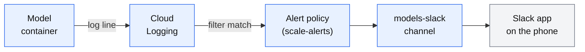

# Infrastructure

`infra/` has 3 folders and this README:

| Folder | Content |
|---|---|
| `core/` | One Terraform root with one apply. It prepares one GCP project for all deployments under `deployments/`. |
| `modules/model-service/` | The Cloud Run module. Each Cloud Run deployment calls it. |
| `modules/model/` | The platform-neutral model module. Each GPU deployment calls it. It calls `platform-vertex` (Vertex AI), `platform-runpod` (Runpod), `cors-proxy` and `gateway`. |
| `modules/cors-proxy/` | The CORS proxy module (Cloud Run). The model module calls it. |

Contents:

1. [What core creates](#what-core-creates)
2. [First setup](#first-setup)
3. [HCP Terraform (state and runs)](#hcp-terraform-state-and-runs)
4. [Apply](#apply)
5. [Copy model weights](#copy-model-weights)
6. [API Gateway and API keys](#api-gateway-and-api-keys)
7. [Module: model-service](#module-model-service)
8. [Vertex AI (platform-vertex)](#vertex-ai-platform-vertex)
9. [Test UI](#test-ui)
10. [Tests](#tests)

## What core creates

- The APIs: run, artifactregistry, cloudbuild, secretmanager, storage, compute, billingbudgets, iam, cloudresourcemanager, serviceusage, apigateway, servicemanagement, servicecontrol, apikeys, aiplatform (Vertex AI), cloudquotas, monitoring.
- The bucket `<project_id>-models` for model weights.
- The Artifact Registry Docker repo `models` for custom images.
- The Artifact Registry remote repo `ghcr`, a proxy for `ghcr.io`. Cloud Run cannot pull from `ghcr.io` directly.
- The Artifact Registry remote repo `dockerhub`, a proxy for Docker Hub. Vertex AI pulls images only from Artifact Registry.
- A monthly billing budget with email alerts at 50%, 90% and 100%. A budget does not stop spend.
- The Secret Manager secret `hf-token` and its value, taken from `HF_TOKEN` in `.env`. The value is write-only: it is not in the Terraform state. To rotate it, change `HF_TOKEN` and raise `secret_data_wo_version` in `weights_copy.tf`.
- The Cloud Run job `weights-copy` and its service account. The job copies 1 Hugging Face repo into `<project_id>-models/<TARGET_DIR>/`. It can write to the weights bucket and read `hf-token`, and nothing more.
- One API Gateway API for each entry in `local.gateway_apis` (`gateways.tf`), and a placeholder API config. A managed service can be enabled only after its API has a config, so the placeholder comes first, then the enabled service, then the key. No gateway uses the placeholder.
- One API key for all gateways (`models-gateways`). The key works only for those gateway APIs.
- The Slack notification channel `models-slack` (`notifications.tf`). The deployments send their scale messages to it. See [Scale notifications (Slack)](#scale-notifications-slack).
- The secrets `runpod-s3-access-key` and `runpod-s3-secret-key` (`runpod_s3.tf`, write-only from `RUNPOD_S3_*` in `.env`). Only the Cloud Build service account may read them: `scripts/runpod-weights.py --cloud` uses them.
- The Runpod registry credential `gcp-models` (`runpod_registry.tf`): a service account `runpod-pull` with `roles/artifactregistry.reader` on the repo `models` only, its JSON key, and a `runpod_registry` with the username `_json_key`. Runpod pulls own images (STT-A) with it. The key is in the state of `infra/core` (sensitive, read-only). The sensitive output `registry_pull_key` gives the same key to `scripts/platforms/modal.py` for the Modal image pull. To rotate it, run `terraform apply -replace=google_service_account_key.runpod_pull`.
- The secrets `runpod-api-key` and `modal-api-key` (`provider_keys.tf`, write-only from `RUNPOD_API_KEY`, and from `MODAL_PROXY_TOKEN_ID` and `MODAL_PROXY_TOKEN_SECRET` in `.env`). The CORS proxies read them.
- The bucket `<project_id>-ui` for the static test UI (`ui.tf`). Anyone can read a file in it (`roles/storage.legacyObjectReader`: no list, no write). See [Test UI](#test-ui).

All resources go in `us-central1` by default. Set `GCP_REGION` in `.env` to change it.

| File in `core/` | Content |
|---|---|
| `main.tf` | APIs, buckets, Artifact Registry repos, budget |
| `weights_copy.tf` | `hf-token` secret and `weights-copy` job |
| `gateways.tf` | Gateway APIs and the shared API key |
| `ui.tf` | Public bucket of the test UI |
| `notifications.tf` | Slack notification channel `models-slack` |
| `runpod_registry.tf` | Runpod pull credential for the repo `models`, and the output `registry_pull_key` (Modal) |
| `provider_keys.tf` | Secrets `runpod-api-key` and `modal-api-key` for the CORS proxies |
| `runpod_s3.tf` | Runpod S3 API key secrets for the cloud weights copy |

## First setup

1. Create the project and link it to a billing account.
2. Create a service account key (see `.env.example`). Put its path in `GOOGLE_APPLICATION_CREDENTIALS` in `.env`. Terraform and gcloud both use this key. `.envrc` sets `CLOUDSDK_AUTH_CREDENTIAL_FILE_OVERRIDE` to the same file and `CLOUDSDK_CONFIG` to the local `.gcloud/` folder, so gcloud never uses your global login or config. Do not run `gcloud auth login` for this project. Check: `gcloud auth print-access-token >/dev/null && echo ok`.
3. Turn on the 2 APIs that Terraform needs before it can turn on the others:
   ```sh
   gcloud services enable serviceusage.googleapis.com cloudresourcemanager.googleapis.com
   ```
4. Give the service account the Owner role on the project. Also give it Billing Account Costs Manager (or Billing Account Administrator) on the billing account.
5. Put `GCP_PROJECT_ID` and `BILLING_ACCOUNT` in `.env` (see `.env.example`). `.envrc` maps them to `TF_VAR_project_id` and `TF_VAR_billing_account`. Find the billing account ID with `gcloud billing accounts list`. There is no `terraform.tfvars` file.

## HCP Terraform (state and runs)

Terraform runs on HCP Terraform (remote execution). HCP stores the state, the variables and the Google credentials. Do this once:

1. Create an HCP Terraform organization and a project (for example `custom-models-inference`).
2. Copy `.env.example` to `.env` in the repo root and fill it in. Run `direnv allow` in the repo root. direnv then loads `.env` when you enter the folder. Run `direnv allow` again each time `.envrc` changes, for example after `git pull`. If you do not, direnv blocks `.envrc` and `terraform init` fails with `"organization" must be set`. Check it with `echo $TF_CLOUD_ORGANIZATION`. Without direnv, run `set -a; source .env; set +a` in each shell. `TF_TOKEN_app_terraform_io` replaces `terraform login`.
3. Sync `.env` to HCP. The script creates the workspaces in the project, sets remote execution, and writes the variables. It also writes the service account key as the sensitive variable `GOOGLE_CREDENTIALS`.
   ```sh
   ./scripts/hcp-sync.py --dry-run   # shows what it will do, no values
   ./scripts/hcp-sync.py
   ```
   Run the script again each time you change `.env`.
4. Run `terraform init` and `terraform apply` in each root. The plan and apply run on HCP. The terminal shows the output.

**The run does not use your `.env` or your gcloud login.** It uses the workspace variables from step 3. A local `.env` change has no effect until you run the script again.

**What the CLI uploads.** `infra/core/` and the deployments use the module in `infra/modules/`, so the CLI uploads the whole repo for them (the workspace working directory is `deployments/<name>`). `.terraformignore` keeps `.env`, key files and `.gcloud/` out of the upload. Do not remove it.

The workspace of `infra/core/` is `custom-models-bootstrap` (the old name, kept so that the state stays). Each root has its workspace name in `backend.tf`.

### Quick steps for a deployment

Use these steps for each new deployment, after the one-time setup above.

1. Go to the repo root. Run `direnv allow` once. direnv loads `.env` in each terminal that you open in the repo.
2. Run `./scripts/hcp-sync.py` in the repo root. It creates the HCP workspace with its working directory. Run it again after each `.env` change.
3. Go to the deployment folder: `cd deployments/<name>`.
4. Run `terraform init`, then `terraform plan` or `terraform apply`. You do not need the `direnv exec .` prefix in your own terminal. An agent shell has no direnv hook, so it needs the prefix.
5. A new deployment needs `gateway.tf` (see [Add a gateway to a new deployment](#add-a-gateway-to-a-new-deployment)) and `alerts.tf` (see [Add scale alerts to a new deployment](#add-scale-alerts-to-a-new-deployment)).

**Error `Unreadable module directory ... ../../infra`:** the workspace has no working directory. Run step 2 again.

## Apply

```sh
cd infra/core
terraform init
terraform apply
```

Outputs: `weights_bucket`, `models_repo`, `ghcr_repo`, `dockerhub_repo`, `region`, `weights_copy_job`, `gateway_apis` and `api_key` (sensitive). Cloud Run deployments use `ghcr_repo`. Vertex AI deployments use `dockerhub_repo` for stock images, for example `<dockerhub_repo>/vllm/vllm-openai:v0.33.0`.

### Vertex AI GPU quota (check before the first Vertex AI deployment)

A Vertex AI endpoint with 1 `NVIDIA_L4` on `g2-standard-8` needs the quota "Custom model serving Nvidia L4 GPUs per region" in `us-central1`. Prediction quota is separate from Compute Engine and Cloud Run GPU quota.

1. Apply `infra/core/` first. It turns on `aiplatform.googleapis.com` and `cloudquotas.googleapis.com`. `./scripts/preflight.py --l4` reads the quota through the second one.
2. Open the console: IAM & Admin > Quotas & System Limits. Filter for `Service: Vertex AI API` and `L4`. Read the value for `region: us-central1`.
3. Or use the CLI. This needs the Cloud Quotas API (`gcloud services enable cloudquotas.googleapis.com`) and the gcloud `beta` component:
   ```sh
   gcloud beta quotas info list --service=aiplatform.googleapis.com --format=json \
     | jq -r '.[] | select(.quotaId | test("L4")) | .quotaId as $q | .dimensionsInfos[] | select(.dimensions.region == "us-central1") | "\($q) \(.details.value)"'
   ```
4. If the value is 0, request 1 GPU on the same console page. Scale to zero reserves quota for `spec.max_replicas`.

## Copy model weights

Run the job 1 time for each model. Set the repo and the target folder for each execution. The values for a model are in the README of its deployment folder.

```sh
gcloud run jobs execute weights-copy --wait \
  --update-env-vars HF_REPO=<org/repo>,TARGET_DIR=<folder>
```

The job mounts the bucket with GCS FUSE at `/models` and runs `hf download --local-dir /models/$TARGET_DIR`. The task timeout is 1 hour. A deployment then reads the files at `/models/<TARGET_DIR>`.

## API Gateway and API keys

### How it works

```
client --x-api-key--> API Gateway (*.gateway.dev) --ID token of the gateway SA--> Cloud Run (private)
```

- The Cloud Run service stays private. Only the invokers of the module can call its `run.app` URL.
- The gateway URL is public. The gateway checks the `x-api-key` header before it calls Cloud Run. A request without a valid key gets `401`, and no instance starts.
- The gateway calls Cloud Run as its own service account. That account has `roles/run.invoker` on the service.
- Only the paths in the OpenAPI spec of the deployment go through. All other paths get `404` at the gateway.

The parts are in 2 places:

| Part | Where | Why |
|---|---|---|
| Gateway API and its managed service | `infra/core/gateways.tf` | The key must target the managed service. Its name has a random part, so it must exist in the same root as the key. |
| Shared API key | `infra/core/gateways.tf` | One key for all gateways |
| Gateway service account, `run.invoker`, OpenAPI spec, API config, gateway | `deployments/<name>/gateway.tf`, or the [gateway module](#module-gateway) for a deployment on the [model module](#module-model-platforms) | These belong to one model |
| Streaming | `scripts/gateway-streaming.py` | The provider has no streaming field |

### Get the API key

```sh
cd infra/core
terraform output -raw api_key
```

The key is in the Terraform state. HCP Terraform keeps the state encrypted. The same key works for all gateways in `local.gateway_apis`. The key string stays the same when you add a gateway.

To rotate the key, run the command below. All clients of all gateways must change to the new key at the same time.

WARNING: The old key stops working when the apply is done.

```sh
cd infra/core
terraform apply -replace='google_apikeys_key.gateways[0]'
```

If the key leaks, all gateways are open until you rotate it. Each call with a valid key can start an instance. A budget alert does not stop spend.

### Streaming

API Gateway streaming (chunked responses, SSE) is in Public Preview. You can set it only when you create a gateway, and the Terraform provider cannot set it. So Terraform creates the gateway without streaming. Then `scripts/gateway-streaming.py` makes it again with streaming and the same ID. The script imports the gateway into the state if the state does not have it, and refreshes the state.

WARNING: The gateway URL changes, and the gateway is not available for some minutes.

```sh
./scripts/gateway-streaming.py deployments/<name>   # add --yes to skip the prompt
```

The script loads `.env` itself, so you do not need direnv. It does nothing when the gateway already streams. Run it again after Terraform replaces the gateway.

Streaming limits:

- The `deadline` in the OpenAPI spec is the limit for the whole response, not an idle timeout. When it passes, the gateway stops the stream.
- The `deadline` must not be longer than the Cloud Run request timeout (module `timeout`, default `300s`).
- Streaming gateways have no custom domain and no load balancer during the preview.

### Add a gateway to a new deployment

Example: a new deployment `deployments/stt-a-whisper-cpu`.

1. In `infra/core/gateways.tf`, add the name to `local.gateway_apis`:
   ```hcl
   gateway_apis = [
     "tts-a-kokoro-cpu",
     "stt-a-whisper-cpu",
   ]
   ```
2. Apply `infra/core/`. It creates the API, a placeholder config and the enabled managed service, and adds the service to the key restrictions. The key string does not change.
3. Copy `deployments/tts-a-kokoro-cpu/gateway.tf` to the new deployment. Then change these values:
   - `local.gateway_id`: the same name as in step 1. The name must be 49 characters or less. The gateway service account ID is `<gateway_id>-gw`, so keep the name 27 characters or less.
   - `local.openapi.paths`: only the paths that clients need. Give each operation a unique `operationId`. Do not add `security` to an operation: the global `security` must apply to all paths. The only exception: each path also gets an `options` operation with `security = []`, for the CORS preflight of the test UI (see [Test UI](#test-ui)).
   - `deadline`: not longer than the Cloud Run `timeout` of the module call.
4. In the deployment `main.tf`:
   - Add the `google-beta` provider (in `required_providers` and as a `provider` block).
   - Add the gateway service account to `invokers` and `depends_on` of the module call:
     ```hcl
     invokers   = ["user:${var.invoker_email}", "serviceAccount:${local.gateway_sa}"]
     depends_on = [google_service_account.gateway]
     ```
     Use `local.gateway_sa`, not `google_service_account.gateway.email`. The module uses `invokers` in `for_each`, and the email is not known at plan time.
5. Add `gateway_region` to `variables.tf` and copy the gateway outputs (`gateway_url`, `gateway_id`, `gateway_region`, `api_config`) to `outputs.tf`. The streaming script reads these outputs.
6. Copy `tests/gateway.tftest.hcl` and run `terraform init -backend=false && terraform test`.
7. Apply the deployment. If you need streaming, run `./scripts/gateway-streaming.py deployments/<name>`.
8. Test with `curl` and the key from `terraform -chdir=infra/core output -raw api_key` (see the deployment README).
9. Add the `ui` output and run `./scripts/ui-deploy.py`. Follow the `model-ui` skill (`.claude/skills/model-ui/SKILL.md`).

Vertex AI and Runpod deployments: use the [model module](#module-model-platforms). It makes the CORS proxy and the gateway, so steps 3 to 6 are not necessary. Example: `deployments/llm-a-gemma4-12b-vllm/`. For an own FastAPI app with several routes, see `deployments/llm-b-qwen35-9b-fastapi/` (no `predict_route`: the proxy appends the route to the `:invoke` base).

To remove a gateway, destroy the deployment first. Then remove the name from `local.gateway_apis` and apply `infra/core/`.

### Gateway in another GCP project

A key belongs to one GCP project. A gateway accepts the key only if the key project has the managed service of the gateway turned on. Each GCP project has its own `infra/core/` apply, so each GCP project has its own key. To use one key across GCP projects, the key project must turn on the managed service of the other project as a consumer. That needs `roles/servicemanagement.serviceConsumer` on the other project. This repo does not do it.

## Module: model-service

`modules/model-service/` deploys 1 model as 1 private Cloud Run v2 service. The service scales to zero (min 0 instances).

It creates:

- a service account for the service,
- the Cloud Run service (GPU optional),
- `roles/run.invoker` for each member in `invokers`,
- `roles/storage.objectViewer` on `weights_bucket`, if you set one. The bucket is mounted read-only at `/models`.

| Variable | Default | Note |
|---|---|---|
| `project_id`, `region`, `name`, `image` | required | `name`: 6-49 chars, lowercase letters, digits, hyphens. SA ID = `name` if 30 chars or less, else 25 chars + `-` + 4 hash chars. |
| `invokers` | required | IAM members, for example `["user:me@example.com"]`. `allUsers` and `allAuthenticatedUsers` are rejected. |
| `command`, `args`, `env` | `[]`, `[]`, `{}` | Container entrypoint, args and plain env vars. No secrets. `command = []` keeps the entrypoint of the image. |
| `port` | `8080` | Container port. Cloud Run sets `$PORT`. |
| `cpu`, `memory` | `"4"`, `"16Gi"` | Resource limits |
| `gpu_type` | `null` | `"nvidia-l4"` (min 4 CPU, 16Gi) or `"nvidia-rtx-pro-6000"` (min 20 CPU, 80Gi). GCP checks the minimums at apply time. |
| `concurrency` | `4` | Max requests per instance |
| `max_instances` | `1` | Min is always 0 |
| `timeout` | `"300s"` | Request timeout |
| `startup_probe_path` | `null` | HTTP probe path. `null` means a TCP probe. |
| `startup_failure_threshold` | `60` | With a 10 s period: 10 min |
| `weights_bucket` | `null` | Bucket to mount at `/models` |

Billing: a CPU service uses request-based billing (`cpu_idle = true`). A GPU service uses instance-based billing and has zonal redundancy off.

Outputs: `url`, `service_name`, `service_account_email`.

Example:

```hcl
module "service" {
  source = "../../infra/modules/model-service"

  project_id         = var.project_id
  region             = var.region
  name               = "tts-a-kokoro-cpu"
  image              = "us-central1-docker.pkg.dev/${var.project_id}/ghcr/remsky/kokoro-fastapi-cpu:v0.10.0"
  cpu                = "4"
  memory             = "8Gi"
  startup_probe_path = "/health"
  invokers           = ["user:me@example.com"]
}
```

## Vertex AI (platform-vertex)

The adapter [platform-vertex](#module-platform-vertex) deploys 1 model in a custom container to 1 private, dedicated Vertex AI endpoint. The deployment scales to zero (min 0 replicas, Preview). Deployments call it through the [model module](#module-model-platforms), never directly. It holds the code of the old module `vertex-model` (merged in phase 6; `platform-vertex/moved.tf` keeps the resources).

Terraform creates:

- a service account for the deployed model,
- `roles/storage.objectViewer` on the weights bucket `<project_id>-models` for that service account, if `spec.weights.gcs_dir` is set,
- a dedicated Vertex AI endpoint (own DNS, no 1.5 MB body limit of the shared endpoint, needed for `:invoke`).

`scripts/deploy.py` (or the old CLI `scripts/vertex.py`) does the model upload and the deploy through the Vertex AI REST API (`v1beta1`). The code is in `scripts/platforms/vertex.py`. Terraform only renders the request bodies (output `vertex`).

### Deploy method: Terraform plus 1 script step

Provider `google ~> 8.10` (checked on 8.10.0) has no resource for a custom-container model upload, and no resource for a deployed model on an existing endpoint.

`google_vertex_ai_endpoint_with_model_garden_deployment` accepts `model_config.container_spec.image_uri`. It does not fit:

- It needs `publisher_model_name` or `hugging_face_model_id`. It deploys a Model Garden or Hugging Face model, not a model from our weights bucket.
- It has no `artifact_uri`, so the container gets no `AIP_STORAGE_URI`.
- It has no `scaleToZeroSpec`, so the idle time stays at the 1 hour default.
- It has no service account and no `invokeRoutePrefix`.

GA `gcloud ai` (SDK 545) has no flags for the idle time, the dedicated endpoint or `invokeRoutePrefix`. So the script calls the REST API with `curl`. HCP Terraform runs have no gcloud login, so the step runs on your machine after `terraform apply`.

### Steps

The deployment root must pass the module output through (the model module has it as `vertex`):

```hcl
output "vertex" {
  value = module.model.vertex
}
```

1. Apply. HCP Terraform creates the endpoint and the service account.
   ```sh
   cd deployments/<name> && terraform apply
   ```
2. Upload and deploy. `./scripts/deploy.py deploy deployments/<name>` calls the same code for every platform. First the script fills the image cache of the remote proxy repo with one manifest request, because Vertex AI does not start the proxy fetch. The script stops if the answer is not 200. Then it waits for both operations (the deploy can take 30 minutes).
   ```sh
   ./scripts/vertex.py deploy deployments/<name>
   ```
3. Remove. Undeploy first: Vertex AI does not delete an endpoint that has a deployed model. The script also deletes the uploaded model, and a model that a failed deploy left behind.
   ```sh
   ./scripts/vertex.py undeploy deployments/<name>   # in the repo root
   cd deployments/<name> && terraform destroy
   ```

To change the image, args or machine: run `undeploy`, then `terraform apply`, then `deploy`. `deploy` stops if the endpoint already has a model.

The script needs `terraform` and `gcloud`. It uses only the Python standard library.

### Routes

The container must follow the Vertex serving contract:

- It listens on `0.0.0.0:$AIP_HTTP_PORT` (`spec.port`, default 8080). An own image reads `PORT` first, then `AIP_HTTP_PORT` (the container contract in `docs/specs/2026-11-22-multi-platform-design.md`).
- `spec.health_route` returns 200 when the model is ready.
- With `platform_options.vertex.predict_route`, `:predict` and `:rawPredict` go to that route. Without it, the upload uses invoke routes (`invokeRoutePrefix = "/*"`).

Base URL: `DNS=$(terraform output -raw endpoint_dns)`, then `$DNS/v1/projects/<project_id>/locations/<region>/endpoints/<endpoint_id>`. Auth: `-H "Authorization: Bearer $(gcloud auth print-access-token)"`.

| Mode | Call | Goes to |
|---|---|---|
| `predict_route = "/v1/chat/completions"` | `POST <base>:rawPredict` | `predict_route`, body unchanged. Use this for OpenAI JSON. |
| `predict_route = ...` | `POST <base>:predict` with `{"instances": [...]}` | `predict_route`. The response must be `{"predictions": [...]}`. |
| no `predict_route` (invoke routes, Preview) | `POST <base>/invoke/<path>` | `/<path>`, for example `/invoke/v1/chat/completions` to `/v1/chat/completions`. `:predict` and `:rawPredict` are off. HTTP only. |

After you enable a dedicated endpoint, the shared DNS (`<region>-aiplatform.googleapis.com`) does not accept predict calls for it.

### Retry rule for HTTP 429 (scale to zero)

The deployment has `minReplicaCount = 0`, `initialReplicaCount = 1` and `scaleToZeroSpec`. After `spec.idle_seconds` (default 300 s, the minimum) without traffic, it scales to 0. `minScaleupPeriod` (300 s) is the time after a scale up before Vertex AI checks for a scale down.

**Rule: when a call returns HTTP 429, the client must wait and send the same request again.**

1. At 0 replicas, the first request starts the scale up. Vertex AI drops that request and returns HTTP 429 ("Model is not yet ready for inference").
2. Retry every 30 s. Use a total limit of 30 minutes. A GPU node start plus the model load takes minutes, not seconds.
3. Retry only on 429. Do not retry other 4xx codes.
4. Treat the first 200 after a 429 as the end of the cold start. Write down the time in the deployment README.

Example:

```sh
for i in $(seq 1 60); do
  code=$(curl -s -o /tmp/out.json -w '%{http_code}' -X POST "$URL" \
    -H "Authorization: Bearer $(gcloud auth print-access-token)" -H "Content-Type: application/json" -d @body.json)
  [ "$code" != 429 ] && break
  sleep 30
done
echo "$code"; cat /tmp/out.json
```

Other limits of scale to zero (Preview): 1 model per endpoint, no multi-host GPU, quota is reserved for `spec.max_replicas`, and Vertex AI undeploys a deployment that stays at 0 for more than 30 days. Billing is per node-hour while a replica runs, so each test session bills at least `minScaleupPeriod` plus the idle time.

### Weights flow

Hugging Face → `weights-copy` job → `gs://<project_id>-models/<spec.weights.gcs_dir>/` → model `artifactUri` → `$AIP_STORAGE_URI` in the container.

There is no `/models` mount on Vertex AI. The container loads the weights itself from `$AIP_STORAGE_URI`. Vertex AI can point `AIP_STORAGE_URI` to its own copy of `artifactUri`. So always read `$AIP_STORAGE_URI` (an own image: `MODEL` first, then `AIP_STORAGE_URI`), not the bucket path. `spec.weights.gcs_dir` must match the `TARGET_DIR` of the weights job.

Selected method: **vLLM streams the weights from GCS** with `--load-format runai_streamer`. There is no copy step and no custom image. In `spec.args`, `{model}` becomes `$(AIP_STORAGE_URI)`; LLM-A adds `--load-format=runai_streamer` in `platform_options.vertex.extra_args`.

Vertex AI expands `$(VAR)` in `args`. The service account reads the weights bucket (`roles/storage.objectViewer`).

Fallback: if the pinned vLLM cannot read `gs://` with `runai_streamer`, use a custom image with an entrypoint that copies at start (`gcloud storage cp -r "$AIP_STORAGE_URI*" /tmp/model`) and then starts vLLM with `--model=/tmp/model`. The copy adds the full download time to each cold start.

Do not set an `AIP_` variable yourself (the plan fails).

### Access

The endpoint is private. The adapter grants no access. A caller needs `aiplatform.endpoints.predict` on the project, for example `roles/aiplatform.user`. Vertex AI has no per-endpoint IAM binding in the provider, and a project-level binding in each deployment root would be removed for all deployments when 1 root is destroyed. Grant the role once, outside the deployments. The project owner already has it. There is no VPC peering and no Private Service Connect; the Vertex AI DNS checks IAM on each call.

## Module: model (platforms)

`modules/model/` deploys 1 model spec to a list of platforms. It is the target layout of all Vertex AI deployments. LLM-A, LLM-B and STT-A use it. Design: `docs/specs/2026-11-22-multi-platform-design.md`.

One call creates:

- 1 adapter per platform in `platforms`: `vertex` ([Module: platform-vertex](#module-platform-vertex)), `runpod` ([Module: platform-runpod](#module-platform-runpod)) and `modal` ([Module: platform-modal](#module-platform-modal)). Baseten is deferred, because the Baseten account cannot deploy custom models; see the spec (Status). The module rejects other ids, an empty list and a duplicated id at plan.
- 1 CORS proxy `<gateway_id>-proxy` with 1 target per platform. The first platform is the default for the old paths. For each platform with a key (`auth` is not `google`), the module gives the proxy the env var `<AUTH>_API_KEY` from the `infra/core` secret `<auth>-api-key` (for Runpod: `RUNPOD_API_KEY` from `runpod-api-key`; for Modal: `MODAL_API_KEY` from `modal-api-key`). The proxy timeout is the largest deadline of the targets.
- 1 API Gateway ([Module: gateway](#module-gateway)) with the old paths plus 1 path per platform: `/<platform><route>`. `extra_paths` go to their own backend (STT-A: the `stt_api` service) with the same prefix rule.

Inputs: `project_id`, `region`, `gateway_region`, `name` (base name on every platform), `gateway_id` (the API in `infra/core/gateways.tf`), `platforms`, `spec`, `platform_options`, `extra_paths` (default `{}`), `proxy_invokers` (more service accounts that may call the proxy, default `[]`; STT-A: the `stt_api` SA).

`spec` is platform-neutral:

| Field | Meaning |
|---|---|
| `image` | `{ stock = "<Docker Hub image>" }` or `{ own = "<image:tag in the models repo>" }`. Set exactly one |
| `args` | Engine flags that work on every platform and GPU. `{model}` becomes the weights path of the platform |
| `env` | Plain env vars (default `{}`) |
| `port`, `health_route` | Container port (default 8080) and health route |
| `routes` | Gateway paths of the model, for example `["/v1/chat/completions"]` |
| `gpu` | `"L4"`, or null for CPU |
| `max_replicas`, `idle_seconds` | Default 1 and 300. Min replicas is always 0 |
| `weights` | `{ hf_repo, revision, gcs_dir }`. `gcs_dir` is the `TARGET_DIR` of the weights-copy job. On Runpod without a volume, `revision` (a commit sha) is required, so all platforms load the same weights. With a Runpod volume, `gcs_dir` is required instead |

`platform_options.<id>` holds the options of 1 platform. A flag that depends on the platform or the GPU goes into `platform_options.<id>.extra_args`. The adapter appends it to `spec.args`. `platform_options.<id>.name` overrides `name` for 1 platform.

`platform_options.<id>.serve` (default `true`) takes a platform out of service and keeps its resources. With `serve = false`, the proxy, the gateway, the `ui` output and `deploy.py` leave the platform out. On Runpod, the endpoint is destroyed, but the template and the volumes with the weights stay. The output `serving_platforms` lists the platforms that serve, in order. The first one is the default for the old paths. To remove a platform and all its resources, remove it from `platforms`.

#### deploy.yaml (per deployment)

A deployment on the `model` module keeps its platform list and the settings that change most often in `deployments/<name>/deploy.yaml`. `main.tf` reads it with `yamldecode` and gives the values to `platforms` and `platform_options`. The comments in the file explain each key. Keys:

| Key | Meaning |
|---|---|
| `platforms[].id` | `vertex`, `runpod` or `modal`. The order of the list is the order of `platforms` |
| `platforms[].serve` | `true` or `false`, see above |
| `data_centers` (runpod) | The data centers of the volumes, and so of the workers. Each data center is 1 more copy of the weights |
| `volume_gb` (runpod) | The size of each volume. A volume cannot shrink |
| `workers_max` (runpod) | `0` parks the endpoint: it stays, but no worker starts |
| `flashboot` (runpod) | `OFF`, `FLASHBOOT` or `PRIORITY_FLASHBOOT`. The account allows 3 endpoints with FlashBoot |
| `gpu_pools`, `excluded_types` (runpod) | The GPUs of the workers. Runpod has no GPU order |

To change a value: edit `deploy.yaml`, run `./scripts/check.py`, then plan and apply the deployment (its README, "Deploy"). Read the plan: a removed data center destroys its volume and the weights on it.

Outputs: `platforms`, `serving_platforms`, `targets` (platform id to target), `ui_platforms` (1 entry `{ id, label, base_url = "<gateway_url>/<id>", cold_start }` per platform, for the `ui` output), `gateway_url`, `gateway_id`, `gateway_region`, `api_config`, `gateway_address` (relative to the module), `openapi`, `vertex`, `modal` (for `scripts/platforms/modal.py`), `vertex_endpoint_id`, `vertex_endpoint_dns`, `vertex_service_account_email`, `proxy_url`, `gateway_service_account_email`, `runpod_volumes` (for `scripts/runpod-weights.py`), `runpod_args`, `runpod_env` and `proxy_extra_invoker_count` (for tests), `scale_watch_ids` (for `alerts.tf`). The root passes them through. Example: `deployments/llm-a-gemma4-12b-vllm/main.tf` and `outputs.tf`.

After apply, run the post-apply step of each platform:

```sh
./scripts/deploy.py deploy   deployments/<name>                    # every platform in local.platforms
./scripts/deploy.py deploy   deployments/<name> --platform vertex  # one platform
./scripts/deploy.py undeploy deployments/<name> --platform vertex  # before terraform destroy, or before you remove vertex from the list
./scripts/deploy.py status   deployments/<name>                    # deployed or not, per platform
```

`deploy.py` reads the outputs `platforms` and `targets`. A target with `post_apply = "vertex"` runs `scripts/platforms/vertex.py` (model upload and deploy, see [Deploy method](#deploy-method-terraform-plus-1-script-step)). A target with `post_apply = "modal"` runs `scripts/platforms/modal.py` (see [Module: platform-modal](#module-platform-modal)). At the end it runs `ui-deploy.py --config-only`. It does not run `terraform apply`.

### Module: platform-vertex

`modules/platform-vertex/` is the Vertex AI adapter. It makes the service account, the weights bucket IAM and the endpoint (see [Vertex AI (platform-vertex)](#vertex-ai-platform-vertex)) and maps the spec:

- Image: `stock` becomes `<region>-docker.pkg.dev/<project>/dockerhub/<image>` (`library/` is added for an image without a namespace). `own` becomes `<region>-docker.pkg.dev/<project>/models/<own>`.
- Args: `spec.args` plus `options.extra_args`. `{model}` becomes `$(AIP_STORAGE_URI)`.
- Env: `spec.env`, then `HF_HUB_OFFLINE = "1"`, then `SETUP_PLATFORM = "vertex"` (own images only, the container contract), then `options.env`.
- `gpu = "L4"` becomes `NVIDIA_L4`. Another value fails at plan.
- Options: `name`, `machine_type` (default `g2-standard-8`), `shared_memory_size_mb`, `deployment_timeout` (default `1800s`), `extra_args`, `env`, `predict_route`. With `predict_route`, the target is the fixed `:rawPredict` URL. Without it, the upload uses invoke routes and the target is the `:invoke` base.

Output `target`: `{ id = "vertex", label = "Vertex AI", url, append_path, auth = "google", cold_start = "retry-429", deadline = 300, post_apply = "vertex" }`. Every adapter has the same fields. Also `vertex` (input for `scripts/platforms/vertex.py`), `endpoint_id`, `endpoint_dns`, `service_account_email`.

### Module: platform-runpod

`modules/platform-runpod/` is the Runpod adapter. It creates 1 `runpod_template` (serverless) and 1 `runpod_serverless_endpoint` of type `LOAD_BALANCER`. Provider: `runpod/runpod ~> 2.0`. It reads `RUNPOD_API_KEY` from the env (see [Runpod setup (once)](#runpod-setup-once)).

- Image: `stock` from Docker Hub, or `own` from `<region>-docker.pkg.dev/<project>/models/<own>`. An own image uses the registry credential named `options.registry` (default `gcp-models`, made by `infra/core`). The child module `registry/` finds its ID by name. Without the credential, the plan fails ("apply infra/core first").
- Weights without `options.volume`: `{model}` becomes `spec.weights.hf_repo`, and the adapter adds `--revision=<spec.weights.revision>`. vLLM downloads the weights from Hugging Face at each cold start.
- Weights with `options.volume = { data_centers, size_gb = 20, type = "STANDARD" }`: the adapter makes 1 `runpod_network_volume` per data center. The endpoint mounts them (`network_volumes`, sorted by ID: Runpod returns that order) and runs only in their data centers (`data_center_ids`). A worker uses the volume of its data center. Use several data centers: 24 GB GPUs are often out of stock in 1 (the worker then stays THROTTLED). `{model}` and env `MODEL` become `/runpod-volume/<spec.weights.gcs_dir>`, and `HF_HUB_OFFLINE = "1"`. `scripts/runpod-weights.py` fills the volume from GCS (see [Copy weights to a Runpod volume](#copy-weights-to-a-runpod-volume)). The volume can grow, never shrink. A destroy deletes it and its data. Size: at least the weights plus the largest file. The S3 upload keeps the parts of a big file on the volume until the complete call joins them, and a full volume answers 403 (LLM-B: 14 GB of weights with a 13.5 GB file, so 40 GB).
- Args: `spec.args`, then `options.extra_args`, then the revision flag (without a volume only). Runpod takes the args as 1 string, so an arg with a space fails at plan.
- Env: `spec.env`, then `HF_HUB_OFFLINE`, `PORT` and `PORT_HEALTH` (= `spec.port`), `HEALTH_CHECK_PATH` (= `spec.health_route`), then `SETUP_PLATFORM = "runpod"` (own images only) and `MODEL` (with a volume), then `options.env`. The contract env is not set for stock images: a new env value would replace the endpoint of LLM-A. The load balancer sends traffic to a worker only after the health path answers 200. Own images must listen on `0.0.0.0` (the probe comes over IPv4; uvicorn on `::` is IPv6 only) and answer `GET /ping` too: the probe asks `/ping` and ignores `HEALTH_CHECK_PATH` (seen 2026-11-25). Answer `204` while the model loads, then `200`.
- Runpod copies the template into the endpoint only when it creates the endpoint. So a change of the image, the args or the env replaces the endpoint (`replace_triggered_by`). The endpoint URL changes, and the proxy gets the new URL in the same apply. The template name and the endpoint name end with 8 characters of a hash of the template content (image, args, env, port, disk), so each change makes a new template and a new endpoint name. Runpod refuses 2 endpoints with the same template name (it keeps a copy of the template under the endpoint name), and Terraform makes the new endpoint before it deletes the old one (`create_before_destroy` of the gateway API config goes down to the proxy and the endpoint). The first apply after this rule (2026-11-26) renames the template in place and replaces the endpoint under the new name; it needs no extra flag.
- Scale: `workers_min = 0`, `workers_max = spec.max_replicas`, `idle_timeout = spec.idle_seconds`, `scaling_type = "REQUEST_COUNT"`, `flashboot = "FLASHBOOT"`, 1 GPU per worker. `spec.gpu = null` (CPU) fails at plan.
- Options: `name`, `gpu_pools` (default `["AMPERE_24"]`: L4, A5000 or 3090), `excluded_types` (default none), `scaling_value` (default 4 requests at the same time), `disk_gb` (default 60), `extra_args`, `env`, `hf_token_secret`, `volume`, `registry`, `workers_max`. Any cloud type. Any data center without a volume. The flags must work on every GPU type in the pools: `AMPERE_24` has no native FP8.
- `workers_max = 0` parks an endpoint: no worker starts, and the endpoint and its volumes stay. Without it, `spec.max_replicas` applies.
- `flashboot` (default `FLASHBOOT`; also `OFF`, `PRIORITY_FLASHBOOT`). The account allows 3 FlashBoot endpoints, and a replace creates the new endpoint before it deletes the old one. So a parked endpoint uses `OFF` (STT-A).
- `volume.excluded_data_centers = ["<id>"]`: the endpoint does not use these data centers. Their volumes stay, with the weights.
- `hf_token_secret = "<name>"` adds `HF_TOKEN = "{{ RUNPOD_SECRET_<name> }}"` for a gated repo. Make the secret in the Runpod console first. Not verified on Serverless.

Output `target`: `{ id = "runpod", label = "Runpod", url = request_urls.base, append_path = true, auth = "runpod", cold_start = "retry-429", deadline = 300, post_apply = null }`. The endpoint is ready after apply: `scripts/deploy.py` has nothing to do for it. Also `endpoint_id`, `volumes` (`{ dir, volumes = [{ id, data_center }] }` or null), `args` and `env`.

### Copy weights to a Runpod volume

A deployment with `platform_options.runpod.volume` needs its weights on the volume before the first Runpod call. `scripts/runpod-weights.py` copies the GCS folder `spec.weights.gcs_dir` (made by the `weights-copy` job) to the volume through the Runpod S3 API. Each part (16 MiB) is 1 GCS range read and 1 S3 upload, with 5 tries (uploads through the Cloudflare front of the S3 API break often). Nothing goes to the local disk. A file with the same size on the volume is skipped. The script never deletes a file. Before a multipart upload, it aborts the open uploads of the same file, which a stopped run leaves behind (a Cloud Build step ends when another step fails). When the complete call of a big file fails, the script waits and accepts the file if HEAD shows its full size.

1. Make a Runpod S3 API key (console, Settings, "S3 API keys"). It is not the Runpod API key. Put it in `.env` as `RUNPOD_S3_ACCESS_KEY` and `RUNPOD_S3_SECRET_KEY`. Only this script uses it.
2. The data center of the volume must have the S3 API: see the list in the [Runpod S3 API docs](https://docs.runpod.io/serverless/storage/s3-api).
3. After apply (the root needs the outputs `runpod_volumes` and `weights_gcs`). The script fills every volume. `--cloud` runs the copy in a Cloud Build job (1 step per volume, at the same time), which needs the `infra/core` secrets `runpod-s3-access-key` and `runpod-s3-secret-key`. Use it when your upload is slow:
   ```sh
   ./scripts/runpod-weights.py deployments/<name> --dry-run
   ./scripts/runpod-weights.py deployments/<name> --cloud   # or without --cloud: from this computer
   ```

### Runpod setup (once)

1. Make a Runpod account and add credit. Defaults: at most 5 workers over all endpoints, and a spend limit of $80 per hour.
2. Make an API key (console, Settings, API Keys). Put it in `.env` as `RUNPOD_API_KEY`.
3. Run `./scripts/hcp-sync.py --dry-run`, then `./scripts/hcp-sync.py`. Every HCP workspace gets `RUNPOD_API_KEY` as a sensitive env var. A root that declares the `runpod` provider (LLM-A, STT-A, `infra/core`) fails at plan without the key. `infra/core` needs the key too, because its variable `runpod_api_key` has no default.
4. Apply `infra/core`. It writes the key to the secret `runpod-api-key` (write-only, not in state). To rotate the key: change `.env`, run `hcp-sync.py`, and raise `secret_data_wo_version` in `infra/core/provider_keys.tf`.
5. Gated Hugging Face repos only: make a Runpod secret with the Hugging Face token (console, Secrets) and set `platform_options.runpod.hf_token_secret`.

### Module: platform-modal

`modules/platform-modal/` is the Modal adapter. Modal has no Terraform provider, so the module creates no resource. It only computes the `target` and the input of the post-apply step. Research and measurements: `docs/research/10-modal-stt-a.md`.

- Own images only (`spec.image.own`, from `<region>-docker.pkg.dev/<project>/models/<own>`). A stock image fails at plan.
- The shared app file `scripts/platforms/modal_app.py` runs every Modal model. It removes the image ENTRYPOINT (Modal must start its own runtime), links `python` to `python3` (the vLLM base image has no `python`), and starts `options.command` in `options.workdir`. A request goes in only after `spec.health_route` answers 200. At shutdown, the engine gets SIGTERM. The app file is Modal code that the modal CLI runs: an accepted exception to the standard-library-only rule of `scripts/`.
- GPU: `options.gpus` is a fallback list (default `["L4", "A10"]`). Modal tries them in this order. No region pin (a pinned region costs 1.15 to 1.75 times more). The Modal type `A10` gives a plain A10 or an A10G.
- Size: `options.cpu` (physical cores, default 4) and `options.memory_mb` (default 32768).
- Scale: 0 to `spec.max_replicas` containers, `scaledown_window = spec.idle_seconds` (at most 1200 s, the Modal limit). A request at 0 containers waits for the container.
- Weights: the Modal Volume `options.volume` (default `<name>-weights`), mounted at `/models`. Env `MODEL = /models/<spec.weights.gcs_dir>`. A Volume is not pinned to a region. `scripts/platforms/modal.py` fills it from Hugging Face with `options.hf_repos` (Volume folder to repo; files that are already there are skipped).
- Env: `spec.env`, then `PORT`, `HF_HUB_OFFLINE = "1"`, `SETUP_PLATFORM = "modal"` and `MODEL` (the container contract), `PYTHONFAULTHANDLER = "1"` (a segfault prints the Python stack of each thread), then `options.env`.
- Thread stack: Modal runs containers with `ulimit -s unlimited`, so glibc gives each new thread only 2 MB of stack. `modal_app.py` starts the command with a 64 MB stack limit. Without it, the STT-A model load (in a thread) ended in SIGSEGV on most starts. See `docs/research/10-modal-stt-a.md`, section "Crash cause".
- Options: `workspace` (required, the Modal workspace name, from `.env` `MODAL_PROFILE`), `command` (required), `workdir` (default `/`), `name`, `gpus`, `cpu`, `memory_mb`, `timeout` (default 600 s: the start limit and the request limit of the Modal function), `volume`, `hf_repos`, `env`.

Output `target`: `{ id = "modal", label = "Modal", url = "https://<workspace>--<name>.modal.run", append_path = true, auth = "modal", cold_start = "retry-429", deadline = 300, post_apply = "modal" }`. Also `modal` (the input of `scripts/platforms/modal.py`).

Post-apply (`./scripts/deploy.py deploy deployments/<name> --platform modal`): `scripts/platforms/modal.py` reads the output `modal` and the `infra/core` output `registry_pull_key`, and runs the modal CLI (pinned version, through `uvx`): `modal run modal_app.py::fill` (the weights Volume), then `modal deploy modal_app.py`. The secrets go to Modal from the local env at deploy time: the pull key, `HF_TOKEN`, `SLACK_BOT_TOKEN` and `SLACK_CHANNEL`. `undeploy` runs `modal app stop`. A stopped app answers 404, and a new `deploy` starts it again.

### Modal setup (once)

1. Make a Modal account (Starter plan, $30 free credit per month) and add a payment card (a GPU needs one).
2. Run `uvx modal token new`, or make a token in the dashboard. Put `MODAL_TOKEN_ID`, `MODAL_TOKEN_SECRET` and `MODAL_PROFILE` (the workspace name) in `.env`.
3. Make a proxy token for the CORS proxies: `uvx modal workspace proxy-tokens create --name cors-proxy`, or in the dashboard. Put its ID (`wk-...`) and secret (`ws-...`) in `.env` as `MODAL_PROXY_TOKEN_ID` and `MODAL_PROXY_TOKEN_SECRET`.
4. Run `direnv allow` (`.envrc` joins the 2 values to `<id>.<secret>`, the Bearer form, as `TF_VAR_modal_api_key`), then `./scripts/hcp-sync.py --dry-run` and `./scripts/hcp-sync.py`. `infra/core` gets `modal_api_key` (the same joined value), and every deployment that declares the variable `modal_workspace` gets it.
5. Apply `infra/core`. It writes the proxy token to the secret `modal-api-key` (write-only, not in state). To rotate it, make a new token, change the 2 values in `.env`, run `hcp-sync.py`, and raise `secret_data_wo_version` of `modal_api_key` in `infra/core/provider_keys.tf`.

### Add Modal to a deployment

The adapter, the app file and the post-apply step are shared, so a new Modal model needs only changes in its own folder. STT-A (`deployments/stt-a-qwen3-asr-diar`) is the example.

1. The image must be an own image in the repo `models` that follows the container contract: it listens on `PORT`, reads the weights from `MODEL`, and answers 200 at `spec.health_route` only when the model is loaded. A stock image (for example `vllm/vllm-openai`) does not work yet.
2. In `main.tf`, add `"modal"` to `local.platforms`, and add `platform_options.modal` with `workspace = var.modal_workspace`, `command` (the image ENTRYPOINT: Modal does not run it), `workdir`, `volume`, `gpus` and `hf_repos` (Volume folder to Hugging Face repo, so that `MODEL` points to the weights). For Slack messages, the image posts them itself; set `env = { SLACK_TITLE = "..." }`.
3. Add `variable "modal_workspace"` (string) to `variables.tf`, and `output "modal" { value = module.model.modal }` to `outputs.tf`. `scripts/hcp-sync.py` gives `modal_workspace` to every folder that declares it.
4. In the tests, set `modal_workspace = "ws"` in the `variables` block.
5. Run `./scripts/hcp-sync.py`, apply the deployment, then run `./scripts/deploy.py deploy deployments/<name> --platform modal`. The first deploy fills the Volume from Hugging Face.
6. Test 1 cold call through the gateway path `/modal/<route>`, and check the Slack "ready" and "scaled to 0" messages. Write the cold start in the README of the deployment.

### Module: gateway

`modules/gateway/` makes the gateway SA `<gateway_id>-gw`, the API config and the gateway, as the `gateway.tf` files of the older deployments do.

- Paths: for each route `r`, the old path `r` and 1 path `/<platform>r` per platform. `extra_paths` (path to `{ backend_url, methods, deadline }`, for a second backend) get the same rule.
- Path parameters: each `{name}` in a path becomes a required path parameter on every operation of the path (STT-A `/v1beta/files/{id}`). A path without one has no `parameters` key.
- Each operation has its own `x-google-backend` with `path_translation = "APPEND_PATH_TO_ADDRESS"` and the deadline of its platform (`deadlines`). The old paths use the deadline of the first platform. There is no top-level `x-google-backend`: API Gateway ignores it on a path.
- Every path needs the API key, except the `options` operation (CORS preflight).
- Inputs: `project_id`, `region` (gateway region), `gateway_id` (max 27 chars), `backend_url`, `platforms`, `routes`, `methods` (default `["post"]`), `deadlines`, `extra_paths`. Outputs: `gateway_url`, `gateway_id`, `gateway_region`, `api_config`, `service_account_email`, `address`, `openapi`.
- `scripts/gateway-streaming.py` reads the root output `gateway_address` to import the gateway. A root without it (TTS-A, LLM-B) uses `google_api_gateway_gateway.this`.

## Test UI

A static React app (`ui/`) to test the models in a browser, also on a phone. It has 1 tab for each model. There is no backend: the browser calls the API Gateways with the shared API key. The key stays in the `localStorage` of the browser.

- URL: `terraform -chdir=infra/core output -raw ui_url` (`https://storage.googleapis.com/<project_id>-ui/index.html`).
- Tabs come from `models.json`. `scripts/ui-deploy.py` writes it from the `ui` output of each deployment. A deployment shows in the UI only after it is applied with a `ui` output.
- A deployment on the `model` module lists its platforms in the `ui` output (`platforms = module.model.ui_platforms`). `ui-deploy.py` drops a platform that is not deployed (`scripts/deploy.py status`) and drops the tab when no platform is left. A tab with 2 or more platforms has a platform picker.
- The gateway URL changes when Terraform or `scripts/gateway-streaming.py` replaces the gateway. Then run `./scripts/ui-deploy.py --config-only`.
- To add a model, a feature or a new model type, use the `model-ui` skill (`.claude/skills/model-ui/SKILL.md`).

```sh
./scripts/ui-deploy.py                # models.json + build + upload all
./scripts/ui-deploy.py --config-only  # only models.json (after a gateway URL change)
./scripts/ui-deploy.py --local        # models.json in ui/public, for npm run dev
```

CORS: the browser sends a preflight `OPTIONS` request before each call, because of the `x-api-key` header. The preflight has no key. So each gateway path has an `options` operation with `security = []`. The gateway sends it to the backend, and the backend answers it:

| Backend | CORS | Status |
|---|---|---|
| Kokoro (Cloud Run) | On by default (`cors_origins = ["*"]` in Kokoro-FastAPI) | Not checked through the gateway |
| vLLM on Vertex AI (`:rawPredict`) | Vertex AI has no CORS: no `OPTIONS` answer and no CORS headers on any answer | Use the CORS proxy |

For the LLM tab, use the CORS proxy (next section).

### CORS proxy

Vertex AI does not answer `OPTIONS` on `:rawPredict`, and it sends no CORS headers with its answers (200, 429 and 5xx). API Gateway cannot add response headers. So a gateway of a Vertex AI deployment calls a CORS proxy, and the proxy calls Vertex AI. The module is `modules/cors-proxy/`.

- The proxy is a private Cloud Run service in the stock `python` image from the `dockerhub` proxy repo. It runs `cors_proxy.py` (standard library only, no build).
- It answers `OPTIONS` itself with status 204 and the CORS headers (`Access-Control-Allow-Origin: *`, methods `GET, POST, OPTIONS`, headers `content-type, x-api-key, authorization`).
- It forwards `GET` and `POST` to a target, streams the answer back, and adds the CORS headers to every answer, also to the 429.
- Targets: the input `targets` maps a platform id to `{ url, append_path, auth }`. The first path segment picks the target: `/vertex/v1/chat/completions` goes to `vertex` with the path `/v1/chat/completions`. A path without a known platform segment (the old paths, for example `/v1/chat/completions`) goes to `default_platform` with the full path. The query string stays.
- `append_path = true`: the proxy appends the path to `url` (Vertex AI `:invoke` base). `append_path = false`: `url` is one fixed URL (Vertex AI `:rawPredict`).
- `auth = "google"`: the proxy sends its own access token. `runpod` and `modal`: the proxy sends `Authorization: Bearer <key>` with the key from `RUNPOD_API_KEY` or `MODAL_API_KEY`. These come from Secret Manager through the input `secret_env` (env name to secret ID). A missing key gives HTTP 502 with CORS headers.
- Cold start on Runpod: at 0 workers Runpod holds the request until a worker is up. For a target with a key, the proxy waits `COLD_WAIT` seconds (env, default 280, below the 300 s gateway deadline) for the answer headers. Then it answers 429 with `Retry-After: 30`, so the UI and the STT-A `stt_api` retry as for Vertex AI. The held request still starts the worker. Exception: when the target answered in the last `WARM_SECONDS` (env, default 300, the idle time), a worker is up and the request is only slow, so the proxy answers 504 (a retry would run the long request again). This memory is per proxy instance. After the headers, the body may take up to `TIMEOUT`. A "no workers available" answer also becomes 429 (`cold_answer`).
- Modal: a Modal web endpoint stops a request after 150 s and answers 303 with a result URL. A cold start of STT-A takes about 160 s, so every cold call gets it. For `auth = "modal"`, the proxy follows a 302 or 303 with a `GET` and the same key (at most 10 hops). The time of all hops counts against `COLD_WAIT`, so the 429 rule above stays the same.
- It scales to zero (max 2 instances). The gateway SA has `roles/run.invoker`, and the service accounts in `extra_invokers` (STT-A: `stt_api`). The proxy SA has `roles/aiplatform.user` only when a target has `auth = "google"` (on the project: the provider has no IAM resource for 1 endpoint).
- Inputs: `project_id`, `region`, `name`, `image`, `targets`, `default_platform`, `secret_env` (default `{}`), `timeout` (default `"300s"`), `gateway_service_account_email`, `extra_invokers` (default `[]`). Outputs: `url`, `service_name`, `service_account_email`, `env`, `secret_env`, `predict_bindings`, `extra_invoker_count` (the last 4 for tests).
- The gateway must use `path_translation = "APPEND_PATH_TO_ADDRESS"`, so the proxy sees the path.
- Every deployment gets the proxy from the [model module](#module-model-platforms).
- Python unit tests: `infra/modules/cors-proxy/tests/test_cors_proxy.py`. `./scripts/check.py` runs them.
- Kokoro answers CORS itself, so the TTS gateway does not use it.
- Check: `curl -si -X OPTIONS "$GW/v1/chat/completions" -H "Origin: https://storage.googleapis.com" -H "Access-Control-Request-Method: POST" -H "Access-Control-Request-Headers: content-type,x-api-key"`. The answer must be 204 or 200 with `access-control-allow-origin`.

Local work: `cd ui && npm install && npm run mock` (fake TTS and LLM on port 5181 or `MOCK_PORT`, key `test`), then in a second terminal `cp public/models.mock.json public/models.json && npm run dev`.

## Scale notifications (Slack)

Each model sends a Slack message when it is ready after a cold start (0 to 1), and when it scales down (1 to 0). Cloud Monitoring log-based alerts watch the log line of each event. Terraform creates them once. After that, no Terraform run is needed.



### Runpod (own images: Slack from the container)

Runpod writes no logs to GCP, so the alerts above cannot see it. The own images of STT-A and LLM-B post their Slack messages themselves. LLM-A (stock vLLM image) uses the job `scale-watch` of the next section.

1. The Runpod adapter env of the deployment (`platform_options.runpod.env` in `main.tf`) sets `SLACK_BOT_TOKEN`, `SLACK_CHANNEL` and `SLACK_TITLE`. The token and the channel come from the Runpod secrets `slack_bot_token` and `slack_channel` (`{{ RUNPOD_SECRET_<name> }}`). Vertex AI gets no `SLACK_*` env, so the container sends nothing there.
2. After the model loads, the container posts `🟢 <SLACK_TITLE> is ready` with `chat.postMessage`. So "ready" means the model can answer, not only that the GPU worker started.
3. At SIGTERM, uvicorn runs the shutdown of the app, and the container posts `⚪ <SLACK_TITLE> scaled to 0`. It posts this only after a "ready" message.
4. A failed post only prints `slack: <error>` in the worker log. The model keeps running.
5. Limits: a SIGKILL or a crash sends no "scaled to 0". The Runpod docs do not say if a load balancing worker gets SIGTERM at scale down, so check the first scale down in Slack. Cost: 0 (no poll).

`./scripts/hcp-sync.py` makes the 2 Runpod secrets from `.env`: `slack_bot_token` from `SLACK_BOT_TOKEN`, and `slack_channel` from `SLACK_CHANNEL`. The Runpod provider has no secret resource, so the script uses the Runpod REST API (`/v2/account/secrets`). It creates a missing secret and sets the value of an existing one on each run. `--dry-run` only reads the secret names. Run it before the apply of STT-A or LLM-B. To rotate the token, change `.env` and run the script again. A new worker reads the new value at start.

### Modal (own images: Slack from the container)

Modal writes no logs to GCP either. The engine posts its own Slack messages, as on Runpod. `platform_options.modal.env` sets `SLACK_TITLE`. `scripts/platforms/modal.py` gives `SLACK_BOT_TOKEN` and `SLACK_CHANNEL` from `.env` to Modal as a secret at each deploy. The app file sends SIGTERM to the engine at shutdown, so the "scaled to 0" message goes out.

### Runpod (job scale-watch)

`infra/core/scale_watch.tf` adds the Cloud Run job `scale-watch`. Cloud Scheduler starts it every minute.

1. The job (`infra/core/scale_watch.py`, standard library only) reads every Runpod endpoint (`GET https://api.runpod.io/v2/serverless` and `/<id>/workers`) Up workers: the workers with status `IDLE` or `RUNNING` and an `uptimeSeconds` (a stopped FlashBoot worker stays in the list as `IDLE` without it). The state keys are `<platform>/<id>`, so another platform needs only one more read function.
2. An endpoint with an up worker counts as ready only when its `/health` (the `requestUrls.health` of the endpoint) answers `200`. A worker is up minutes before the model loads. The job sends this probe only when the last run had 0 ready workers. So it never wakes an endpoint at 0, and it does not keep a ready worker busy (that would stop the scale to 0).
3. It compares the counts with the last run (`gs://<project_id>-scale-watch/state.json`) and prints 1 line per change: `scale-watch: <platform> <id> ready (<name>)` or `scale-watch: <platform> <id> scaled to 0 (<name>)`. The first run only records the counts.
4. The `alerts.tf` of a deployment calls `scale-alerts` once per platform in the facade output `scale_watch_ids`, with the filter `resource.type="cloud_run_job" AND resource.labels.job_name="scale-watch"` and the texts of step 3. So Slack gets "LLM-A Gemma 4 12B on Runpod is ready".
5. Key: the job reads `runpod-api-key` from Secret Manager. A missing key skips the platform. A failed read keeps the old counts, so the change comes 1 run later.
6. Delay: up to 1 minute for the job, plus the alert delay. Cost: about 1440 short runs per day, a few USD per month.
7. Meaning of "ready" on Runpod: the model answers `/health` with `200` (step 2). Billing starts earlier, when the GPU worker starts. "Scaled to 0" is exact. Measured on 2026-11-23: the job line came about 1 minute after the change, and Slack 20 to 40 s after the line. Before 2026-11-24, "ready" meant only that the worker started: LLM-B got "is ready" and its model never answered.

Check the job: `gcloud logging read 'resource.type="cloud_run_job" AND resource.labels.job_name="scale-watch"' --freshness=10m --format='value(timestamp,textPayload)'`.

### Set up Slack (once)

1. Create a Slack app in the workspace (api.slack.com/apps, "From scratch"). Give it the bot scope `chat:write`. Install it.
2. Put the Bot User OAuth Token (`xoxb-...`) in `SLACK_BOT_TOKEN` in `.env`. Put the channel in `SLACK_CHANNEL`, with quotes: `SLACK_CHANNEL="#models"`. Without quotes, direnv reads `#` as a comment and the value is empty.
3. Invite the bot to the channel: `/invite @<bot name>`.
4. In the Slack phone app, set the channel notifications to "All new messages".
5. Run `./scripts/hcp-sync.py`. It also makes the 2 Runpod secrets (see [Runpod (own images: Slack from the container)](#runpod-own-images-slack-from-the-container)). Apply `infra/core/`, then each deployment.
6. Check the channel: in the console, open Monitoring > Alerting > Edit notification channels, and click "Send test notification" on `models-slack`. If no message comes, check that the bot is in the channel.

The token is write-only (`auth_token_wo`): it is not in the Terraform state. To rotate it, change `SLACK_BOT_TOKEN`, raise `auth_token_wo_version` in `infra/core/notifications.tf`, run `hcp-sync.py` and apply core.

### Module: scale-alerts

One call in each deployment (`alerts.tf`) makes 2 log-based alert policies: "ready" and "down". The deployment finds the channel with the data source `google_monitoring_notification_channel` by its display name, so it does not read the core state.

| Input | Content |
|---|---|
| `title` | Model name in the message: `🟢 <title> is ready`, `⚪ <title> scaled to 0` |
| `resource_filter` | Log filter for this model only (Cloud Run service name or Vertex AI endpoint ID) |
| `ready_text` | Log line after the model loads. Not the container start |
| `down_text` | Log line at shutdown. Default `Application shutdown complete.` (uvicorn) |
| `notification_channel` | Channel resource name |

Each filter is `<resource_filter> AND (textPayload:"<text>" OR jsonPayload.message:"<text>")`. The ready lines:

| Deployment | Ready line | Why this line |
|---|---|---|
| `tts-a-kokoro-cpu` | `STARTUP HTTP probe succeeded` (Cloud Run system log) | Uvicorn logs `Application startup complete.` before the probe passes |
| `llm-a-gemma4-12b-vllm` | `Application startup complete.` | vLLM loads the model before it starts uvicorn |
| `llm-b-qwen35-9b-fastapi` | `engine ready` | `image/app.py` prints it after the engine loads. Uvicorn starts first |
| `stt-a-qwen3-asr-diar` | `models ready` | `services/speech_engine/speech_engine/main.py` prints it after the 3 models load. Uvicorn starts first |

`scripts/vertex.py` uses the Vertex AI v1beta1 API. There, container logs are off by default, and `disableContainerLogging = false` has no effect. The `platform-vertex` module sets `enableContainerLogging = true`. A model deployed before 2026-11-20 has no container logs: deploy it again once.

### Add scale alerts to a new deployment

Every deployment must have scale alerts. `./scripts/check.py` fails for a root in `deployments/` that does not call the module `scale-alerts`.

1. Copy `alerts.tf` from a deployment on the same platform: `deployments/tts-a-kokoro-cpu/` (Cloud Run) or `deployments/llm-a-gemma4-12b-vllm/` (Vertex AI).
2. Change `title`. It is the model name in the Slack message.
3. Keep `resource_filter`. It uses `module.service.service_name` (Cloud Run) or `module.model.vertex_endpoint_id` (Vertex AI), so it matches only this model.
4. Set `ready_text` to the log line that the server writes after the model is loaded. Do not use a line from the container start:
   - Cloud Run with `startup_probe_path`: `STARTUP HTTP probe succeeded`. Without a probe path, Cloud Run writes `STARTUP TCP probe succeeded`, which can come before the model is loaded.
   - Stock vLLM: `Application startup complete.` vLLM loads the model before it starts uvicorn.
   - An own image that loads the model in the background: print an own line after the load, as `deployments/llm-b-qwen35-9b-fastapi/image/app.py` prints `engine ready`.
5. Keep the default `down_text` (`Application shutdown complete.`) for a server that uses uvicorn. For another server, set the line that it writes at shutdown.
6. Copy `tests/alerts.tftest.hcl` and change the expected texts. Run `terraform init -backend=false && terraform test`.
7. Apply `infra/core/` first, so the channel `models-slack` exists. Then apply the deployment.
8. Check the real log lines after the first cold start: `gcloud logging read '<resource_filter> AND "<ready_text>"' --freshness=1h --limit=5`. If nothing matches, the alert never fires.

### Limits

- The alerts count container starts and stops, not the change 0 to 1. A scale from 1 to 2 also sends "ready". All models have a max of 1 instance now.
- At most 1 message for each policy in 5 minutes (`notification_rate_limit`), and at most 20 incidents for each policy in a day.
- A deploy, a new revision or a crash also starts or stops a container, so it also sends messages.
- Slack gets no "incident closed" message (`notification_prompts = ["OPENED"]`). An incident closes itself after 30 minutes.
- Measured on 2026-11-20: all 8 events (3 models, ready and scaled to 0) reached Slack less than 1 minute after the log line. A second "ready" for the same model 54 minutes later also arrived.

## Tests

The tests use mock providers. They need no GCP credentials.

```sh
cd infra/core && terraform init -backend=false && terraform test                             # core
cd infra/modules/model-service && terraform init -backend=false && terraform test            # module
cd infra/modules/platform-vertex && terraform init -backend=false && terraform test          # Vertex AI adapter
cd infra/modules/cors-proxy && terraform init -backend=false && terraform test               # CORS proxy module
cd infra/modules/scale-alerts && terraform init -backend=false && terraform test             # scale alerts module
cd deployments/tts-a-kokoro-cpu && terraform init -backend=false && terraform test           # gateway spec
cd deployments/llm-a-gemma4-12b-vllm && terraform init -backend=false && terraform test   # Vertex gateway spec
cd deployments/llm-b-qwen35-9b-fastapi && terraform init -backend=false && terraform test       # LLM-B: facade (Vertex AI, Runpod), own image, gateway paths
cd deployments/stt-a-qwen3-asr-diar && terraform init -backend=false && terraform test   # STT-A: facade (Vertex AI, Runpod), gateway paths, STT API service
```

The test UI has its own unit tests: `cd ui && npm install && npm test`.
